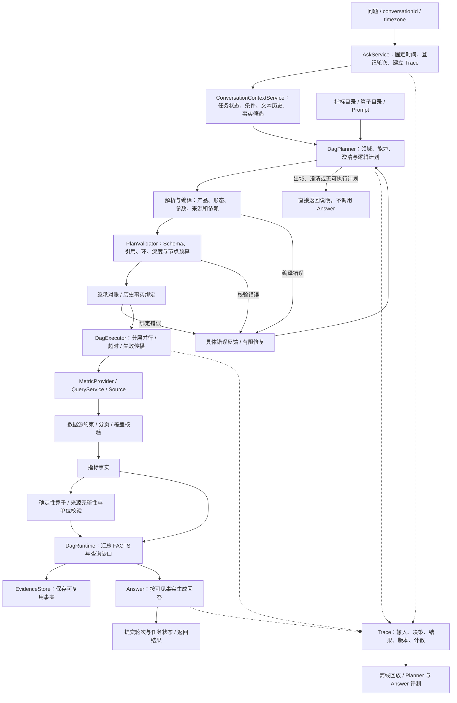

# Harness：核心概念与 CEXPilot 的设计实现

本文面向维护 CEXPilot 的开发者，先建立 harness 的概念，再沿一次问答解释系统如何组织模型输入、限制能力、执行计划、处理失败和验证结果。

实现说明以 **2026-10-15 当前工作树**为准，包含尚未提交的 MCP、Trace 和文件评测实现；不代表线上部署与本地完全一致。本文没有新增线上实验，所有示例都是协议或故障场景说明，不是本次采集的行情结果。

**CEXPilot 的 harness 分布在请求编排、能力目录、计划编译、执行器、事实存储、回答约束和评测中。围栏是其中一部分；有些围栏由代码强制执行，有些依赖模型遵守提示词，还有一些只记录异常供事后分析。**

| 阅读目标 | 对应章节 |
| --- | --- |
| 快速理解 harness 及其与 MCP、Agent 的关系 | §1 |
| 看懂当前系统如何运行 | §2～§3 |
| 找到能力边界、时间、计算和多轮约束 | §4～§5 |
| 理解失败路径、修复预算及软硬门的取舍 | §6 |
| 确认规则是否生效、定位问题 | §7 |
| 扩展系统、理解历史变更和当前缺口 | §8 |

## 1. Harness 解决什么问题

### 1.1 从三种错误理解它

考虑下面三个问题：

1. 用户问“最近 10 期已结算费率的均值”，模型取到样本后自行算错。
2. 用户问“过去一周费率均值”，模型准确算出了最近 10 期均值，但没有满足一周口径。
3. 用户明确问现货，模型生成了合法的永续计划，工具也成功返回了永续价格。

第一种需要确定性计算；第二种需要能力边界与需求一致性检查；第三种需要保留用户要求，并检查最终计划是否仍在回答原问题。仅让工具返回合法 JSON，无法覆盖这些问题。

本文采用以下工作定义：

> Harness 是围绕模型建立的运行与反馈机制，负责提供任务上下文、描述可用能力、解释和执行模型输出、验证结果，并决定继续、修复、澄清或结束。

这个词的使用范围会随讨论对象变化。Anthropic 在长任务实践中讨论环境初始化、进度留存与跨会话接续；OpenAI 的工程实践还包括让仓库知识、架构约束和反馈对 Agent 可见、可执行。本文借用这些思路解释领域问答系统，下面的章节划分是本项目的分析方式，并非某个标准规定的固定模块。[Anthropic 长任务实践](https://www.anthropic.com/engineering/effective-harnesses-for-long-running-agents)、[OpenAI 工程实践](https://openai.com/index/harness-engineering/)

### 1.2 与相邻概念的关系

| 概念 | 关注的问题 | CEXPilot 中的对应 |
| --- | --- | --- |
| 模型 | 如何理解语言、选择动作和组织表达 | Planner 与 Answer 使用的 LLM |
| Prompt | 本次调用向模型说明什么 | 能力目录、规划协议、时间和上下文、回答规则 |
| Agent | 如何结合模型、状态和工具完成任务 | 自然语言问答的完整系统 |
| Workflow / DAG | 哪些步骤依赖哪些步骤、如何调度 | 编译后的物理计划、拓扑分层执行 |
| MCP | 如何发现、调用和交换工具结果 | 资金费率单页取数的可选跨进程通道 |
| Guardrail / 围栏 | 哪些行为需要限制或检查 | 产品限制、引用校验、不完整数据禁算等 |
| Harness | 上述能力如何被组织成可运行、可反馈的系统 | 从 AskService 到评测的外围机制 |

MCP 能把取数能力暴露给另一个进程消费，但不会自动保证“最近 N 期等于一周”。本项目也没有让模型直接连接 MCP Server：Planner 生成领域 JSON，Java 决定如何执行，资金费率 Source 才选择 local 或 MCP 通道。详见 [MCP 接入](MCP接入.md)。

### 1.3 两个范围：在线运行与工程反馈

在线范围是每次请求实际经过的机制：上下文、规划、校验、执行、事实与回答。工程反馈范围还包括 Trace 回放、评测、单测和文档维护，它们帮助发现问题、调整在线机制。

不能因为评测脚本能识别错误，就声称线上每次回答会被拦住；也不能因为 Prompt 有一条规则，就声称代码已验证其语义。后文用“硬拦截、提示词约束、软门、仅观测”明确区分。

## 2. 当前系统的整体架构



图展示职责关系，不表示所有节点都会执行。纯常量计算可以没有取数节点；历史事实绑定可以跳过 Provider；多个独立分支可以部分成功。数据源约束和覆盖核验也依查询形态而异，当前费率 `recent_n` 检查期数，不运行区间覆盖核验。

### 2.1 模型负责语义，程序负责可执行契约

模型选择指标、对象、时间表达、计算方式和澄清问题。程序检查已注册能力、解析时间、展开交易所、推导依赖、校验引用、执行取数与计算。

当前 Planner 输出 `metrics + calculations`，不输出物理 `nodes / tool / args / depends_on`。API 请求中的 LLM `tools` 参数也未用于这两阶段调用；这是模型生成 JSON 计划、宿主解释执行的实现。模型仍然可能理解错语义，编译通过只能证明满足已实现的契约。

### 2.2 配置就是运行边界的一部分

当前默认配置见 [application.yml](../src/main/resources/application.yml)：

| 配置 | 默认值 | 实际含义 |
| --- | --- | --- |
| `dag.max-nodes` | 8 | 按交易所展开后的取数节点与计算节点总预算，还受 `llm.max-tool-calls` 限制 |
| `dag.max-depth` | 3 | 计划依赖深度上限 |
| `dag.planner-max-retries` | 2 | 首次调用之外，最多两次规划修复 |
| `dag.node-timeout-ms` | 30000 | 执行器回收节点 Future 时等待的超时参数 |
| `dag.executor-threads` | 4 | 执行线程池规模 |
| `dag.planner-response-format` | 空 | 默认不向模型服务请求 JSON Mode 或严格 JSON Schema |

严格 Schema 是可选配置，不应写成默认已启用。即使模型服务强制输出 Schema，业务编译校验仍然必要。节点等待超时也不等于整个请求的总耗时预算，更不保证已经发往上游的 HTTP 请求被撤销。

## 3. 跟踪一次“最近 10 期费率的均值”

问题：**“币安 BTC-USDT 永续最近 10 期已结算资金费率的等权平均是多少？”**

### 3.1 请求固定运行上下文

[AskService](../src/main/java/com/cexpilot/api/AskService.java) 在请求开始时固定 `requestTime`，解析请求时区，登记会话轮次，随后构造 Planner 输入和 Trace。未提供时区时按产品时间配置补齐；不会把服务器运行地点或模型训练知识当作用户时区。

同会话执行权由租约控制，旧执行者提交时还要通过 fencing token 校验。它保护并发状态更新，与业务上的“现货不支持”围栏是不同用途的机制。

### 3.2 目录把能力告诉 Planner

[cex-perpetual.yml](../src/main/resources/metrics/cex-perpetual.yml) 中的相关定义为：

```yaml
funding.rate_settled:
  # 此处省略 description；原文还说明已结算状态、费率方向和未接入能力。
  unit: ratio
  bindings:
    recent_n: {provider: funding, selector: RATE, count: {min: 1, max: 100}}
```

Planner 实际 Prompt 由目录和模板渲染，包含指标说明、形态约束、算子输入契约、节点预算和多轮上下文。目录中的 `description` 同时承担业务口径说明，不能只当展示文案。

能力目录也是执行许可的一部分：例如 Ethereum 的 `get_transaction` Tool 虽然仍在仓库并启用注册，但当前指标 Planner 的工具许可来自目录中的算子集合，不会因此自动开放链上分析。

### 3.3 模型只生成领域计划

下面是符合当前协议的一种首轮输出；省略了可选的任务与审计字段：

```json
{
  "in_domain": true,
  "plan": {
    "metrics": [
      {
        "id": "m1",
        "metric": "funding.rate_settled",
        "exchanges": ["binance"],
        "instrument": {
          "market_type": "perpetual",
          "base": "BTC",
          "quote": "USDT"
        },
        "query_shape": "recent_n",
        "count": 10
      }
    ],
    "calculations": [
      {
        "id": "c1",
        "operator": "avg",
        "input": {
          "kind": "field",
          "collection": "{{m1.binance.samples}}",
          "field": "value"
        }
      }
    ]
  },
  "reply": null
}
```

这里没有 `time`，因为 `recent_n` 不接受时间窗口。`samples` 是对象数组，不能填进只接收标量列表的 `values`。

### 3.4 编译器把计划变成可执行图

[MetricPlanCompiler](../src/main/java/com/cexpilot/metric/MetricPlanCompiler.java) 解析计划，经 [MetricQueryResolver](../src/main/java/com/cexpilot/metric/MetricQueryResolver.java) 检查产品、形态、交易所和 count，补齐允许的默认值，生成类型化 `CountQuery`。

本例单个指标组展开成内部取数节点 `metric_0`，逻辑引用被改写为 `{{metric_0.data.samples}}`，计算节点的依赖由引用自动推导。内部 ID 是实现细节，业务评测不应要求模型输出某个固定 ID。

[PlanValidator](../src/main/java/com/cexpilot/dag/PlanValidator.java) 继续核对工具许可、输入契约、引用路径和依赖图。字段在输出契约中合法，不意味着运行时一定存在：覆盖不足或取数失败仍可能导致字段缺失，需要执行期处理。

### 3.5 取数结果先带上可核验的含义

执行链为：

```text
DagExecutor
  → FundingMetricProvider
  → FundingQueryService.queryRecent
  → FundingRateSource（local 或 MCP）
  → 单页请求、分页、去重与样本选择
  → FundingRecentResult
  → MetricResultJson
```

一次指标取数可以对应多次上游 HTTP 请求，并不等于一次工具或 MCP 调用。当前 Provider 只接受 `CountQuery`，结果包含 `requested_count / actual_count / sample_complete`。

`sample_complete=true` 表示取齐了 10 期，不表示覆盖一周；缺少可核实周期也不妨碍报告费率，但不能据此做单期年化。费率支付方向与可用周期由代码输出，避免 Answer 自行推算。

### 3.6 算子检查源数据后计算

[DagExecutor](../src/main/java/com/cexpilot/dag/DagExecutor.java) 在执行 `avg` 前先检查依赖成功、来源完整性与单位，再解析引用并校验真实参数。[AvgTool](../src/main/java/com/cexpilot/calculation/AvgTool.java) 使用 `BigDecimal`，在 `DECIMAL128` 精度下做除法，产出十进制字符串 `value`、参与元素数 `count` 和 `method`。

这是确定性计算，但不能称为所有均值都有无限精度：不能有限表示的除法仍按精度设置舍入。即使算术正确，样本选择错误也会得到错误的业务结论。

### 3.7 Answer 接收事实与缺口

[DagRuntime](../src/main/java/com/cexpilot/dag/DagRuntime.java) 将指标节点、计算节点及失败信息组装为 `FACTS`；将 Planner 对未支持部分的说明放入 `QUERY_STATUS`。事实会尝试在 Answer 前落库，保存失败只记录日志，不阻断本轮回答，但后续可复用性会受影响。

Answer 读取算子产出的均值，说明样本范围与等权口径。它不应再次计算均值，也不能把该结果说成“一周均值”。这一回答行为目前由 [agent_system.txt](../src/main/resources/prompts/agent_system.txt) 约束，并由离线评测检查；在线路径没有逐条断言验真后再放行的步骤。

## 4. 能力边界：围栏放在哪里

### 4.1 区分四种约束强度

| 类型 | 含义 | 例子 |
| --- | --- | --- |
| 硬拦截 | 代码发现违反条件就不执行对应计划或节点 | `spot` 产品、未知指标、环、缺失引用、不完整数据参与计算 |
| 提示词约束 | 要求模型正确判断与表达，代码不能完全证明 | 不把一周换成期数、不改写用户市场要求、回答不补算 |
| 软门 | 先给反馈，满足流程条件后可带审计记录放行 | 继承变化漏报：首次修复，后续可 shadow 放行 |
| 仅观测 | 记录问题但不改变本次执行 | 历史数字字面量匹配提示、离线评测失败 |

同一业务规则可以跨多层实现。“有围栏”必须继续追问：检查谁的输入、何时检查、失败怎么处理、是否真的阻断。

### 4.2 现货：产品校验存在，需求偷换仍有缺口

Planner 模板要求明确的现货或其他市场诉求说明不支持，不改写为永续。`MetricQueryResolver.validateInstrument` 只允许 USDT 报价、USDT 结算永续，生成的计划若仍带 `spot`，编译阶段就失败。

但是，**用户说现货、模型却填了 perpetual 时，产品校验看到的是一个合法永续计划**。当前没有一个独立、完整的原始需求到计划语义对账器，可以保证识别所有这种偷换。`explicit_conditions` 会检查依据片段来自当前问题，但不会完整证明片段语义等于模型填入的值。

现有 [DagPlannerTest](../src/test/java/com/cexpilot/dag/DagPlannerTest.java) 包含 `unsupportedMetricsMarketsShapesAndUnknownFieldsFailBeforeExecution`，验证非法计划被拦截；它不能替代“真实模型面对现货问题是否正确拒答”的行为评测。

旧的 [MarketScopePolicy](../src/main/java/com/cexpilot/market/policy/MarketScopePolicy.java) 文件仍在，当前 `src/main/java` 中没有业务调用点。不能因为类名像围栏，就把它算作主链路生效的检查。

### 4.3 时间窗口：支持与否按指标形态判断

成交 K 线已有区间统计和序列能力；当前盘口只有快照；已结算资金费率只接入最近 N 期。不能用一个“支持历史”的全局布尔值表达这些差异。

对于“过去一周费率均值”，模型应返回 `plan=null` 并说明系统未接入费率时间窗口。若它坚持生成 `funding.rate_settled/time_series`，目录绑定检查会硬拦截；若它悄悄改成合法 `recent_n/count=10`，代码未必能知道原要求被替换，仍需语义评测发现。

**目录防止调用不存在的能力；原需求一致性决定合法能力是否用在了正确任务上。**

### 4.4 算子：既检查形式，也保留来源

当前支持九个算子：`avg / sum / min / max / compare / difference / ratio / relative_change / annualize`。相关约束分三段：

1. 规划期：已注册算子、输入字段、引用路径、标量与集合形态匹配。
2. 执行前：`CalculationTool.validateSource` 拒绝明确不完整或带 `statistics_omitted` 的来源；`MetricCalculationContext` 检查可识别的单位。
3. 执行时：严格数值类型、正数分母或基准、有限范围等算子自身校验。

年化另有强约束：当前行情引用只允许区间 `price.change_pct`，或 `count=1` 的单期已结算费率；周期须引用同源 `observation_seconds / period_seconds`，不接受猜测的 8 小时或跨来源周期。

单位检查不是完整的业务可比性证明：相同单位可能属于不同指标、窗口和产品语义。计算方向与任务意图也不能只靠数据类型推出。详细契约见 [聚合指标](聚合指标.md)。

### 4.5 任务是否能完成，与取数是否成功分别判断

当前提示词区分三类请求：

- 单一核心结果无法产出：不安排无意义取数，返回能力缺口。
- 多个独立问题部分可答：执行支持部分，在 `reply` 说明其余缺口，交给 Answer 结合事实表达。
- 缺少必要条件或指代有歧义：进入澄清，不靠示例币种或第一组候选补齐。

例如“当前未结算费率和最近 10 期已结算费率”可以只查询后一项；“算过去一周费率均值”不能擅自改成“列最近 10 期”。这些主要是 Planner 的语义决策规则，不是编译器对所有用户文本做出的证明。

## 5. 时间、事实与多轮上下文

### 5.1 固定时间基准，保留不同范围

模型输出四类 TimeSpec：自然周期、滚动窗口、相对日期时段、明确日期范围。`TimeSpecParser` 检查结构，`TimeRangeResolver` 按固定请求时刻和时区消解为半开区间。

同一次请求内各节点共用“现在”；历史任务回访还要结合所选任务状态，保留原查询的历史语义。不能每次重新解释历史中的“昨天”。

数据返回时区分：

| 字段 | 说明 |
| --- | --- |
| `requested_range` | 用户请求经时间解析得到的范围 |
| `effective_range` | 为采样网格对齐后的范围，发生变化时输出 |
| `actual_range` | 实际参与标量统计的数据范围，适用于相应统计结果 |
| `coverage` | 完整性、实际覆盖截止点、缺失及未完结状态等 |

这些字段依结果形态出现，不是所有结果都有同一套字段。快照主要带 `as_of`，最近 N 期带样本数量和时间。Answer 必须按实际存在的事实解释范围，不能把网格外扩或已收盘截止点隐去。详见 [时间窗口](时间窗口.md)。

### 5.2 查前能力检查与查后覆盖检查

[SeriesQueryPolicy](../src/main/java/com/cexpilot/market/series/SeriesQueryPolicy.java) 在查询前检查粒度、保留期、网格对齐后的数据点预算。[SeriesCoverageValidator](../src/main/java/com/cexpilot/market/series/SeriesCoverageValidator.java) 在查询后按时间位置核对缺失、错位、重复和未收盘数据，不只比较行数。

Provider 对覆盖不足的区间统计可输出 `statistics_omitted`，不提供统计 `value`；时间序列仍可能返回部分样本与覆盖状态。计算层会拒绝明确标成不完整的来源，回答层则只能披露现有结果与缺口。

这解释了为什么 `ok=true` 不等于“用户需求已满足”：它可能只是查询流程正常结束，并发现没有完整统计可用。

### 5.3 文本历史、查询要求和事实分开

[ConversationContextService](../src/main/java/com/cexpilot/conversation/ConversationContextService.java) 组织当前任务、结构化条件、有限文本历史、历史任务索引和可引用事实。当前文本历史最多取 5 轮、历史回答每条最多 500 字，事实候选上限 10 条；这不是无限记忆，也不是全局严格 token 预算。

条件来源还区分用户本轮明确要求、继承、默认和模型填写。`ConditionProvenanceResolver` 校验 `explicit_conditions` 的依据片段逐字出现在本轮问题中，并在部分可选条件上修正继承与默认关系。例如，上次程序自动选了 5m，不意味着用户永久要求 5m。

这些结构让模型更容易选对上下文，但仍需要模型正确选择 NEW / CONTINUE / RESUME 及目标历史状态。程序能检查引用存在，不能完整证明指代理解正确。

### 5.4 历史事实绑定保护“刚才那个值”

“刚才的均值再求最小值”需要先明确究竟指原样本还是派生均值；“刚才那 10 期的最小值”则应绑定原样本，而非重新取最新 10 期。

`pinned_result + evidence_ref` 通过候选别名引用历史事实，`EvidenceBinder` 再检查会话归属、有效期、Schema 版本、指标、交易所、形态、单位、品种和相关参数是否匹配。绑定后执行器复用原 payload，不调用 Provider。

`EvidenceStore` 当前保留事实 24 小时，单条 payload 上限 256 KiB；超限事实保留审计信息，但不作为可复用候选。派生结果会保存来源，却不能绑定成原始取数或样本集。存储读取的会话范围校验也不等于本文已经审计了整套用户认证授权机制。

原快照不可恢复时，允许一次绑定修复，再失败转澄清；修复不能改用 latest 或删掉必要历史输入冒充完成。复用结果会标记 `reused / source_turn_id / fetched_at` 等信息，由 Answer 说明其历史时间。详见 [上下文管理](上下文管理.md)。

## 6. 错误反馈、修复和失败收口

### 6.1 给模型可操作的错误

`DagPlanner` 会把上一轮输出和错误明细追加到 messages，要求重新输出完整 JSON。例如“count 必须在 1～100”“recent_n 不接受 time”“values 不能引用整个 samples 数组”，比“计划不合法”更有利于定位修复。

首次规划使用 normal 客户端；修复轮使用 flagship 客户端；Answer 使用 normal 客户端。模型由配置指定，角色不同不保证实际配置的是不同模型。[LlmClientConfig](../src/main/java/com/cexpilot/config/LlmClientConfig.java)

修复是针对解析或校验失败，不是完整的业务自动纠错：合法但误解用户意图的计划可能没有触发修复。传输层失败也不等于有了一个可修的计划，Planner 调用异常会记录后抛出，不沿用普通计划修复循环。

### 6.2 不同失败的终止方式

| 情况 | 当前处理 |
| --- | --- |
| 出域 | 直接返回范围说明，不执行 DAG、不调用 Answer |
| 需要澄清 | 返回澄清文本，轮次进入相应状态，不执行查询 |
| 模型主动给出合法 `plan=null + reply` | 接受缺口说明，不为“必须有计划”反复修复 |
| 解析、编译或计划校验失败 | 带错误有限修复；耗尽后固定失败话术，不调用 Answer |
| 历史事实绑定失败 | 最多一次绑定修复，仍失败或必要历史输入被降级时转澄清 |
| 工具或指标节点失败 | 记录失败，依赖它的节点跳过；独立分支继续 |
| 上游执行成功但不完整 | 计算来源校验可拦截下游计算，事实保留缺口供回答说明 |
| Answer 调用失败 | 请求失败；此前已成功保存的事实仍可用于后续接续 |

节点失败后汇总的事实仍可能发给 Answer。因此“无有效计划不调用 Answer”不能扩大成“所有工具都失败就一定不调用 Answer”。

### 6.3 两处有意保留的软约束

继承对账发现模型没有申报真实条件变化时，首次要求修复；修复后仍漏报，可放行已经通过其他检查的计划，记录 `INHERIT_SHADOW`。这里降低了审计元数据问题对可用性的影响，也意味着不能说条件变化都被硬拒绝。

比较方向不再由程序按新旧数据硬判。用户可能问“旧价减现价”，也可能问“现价比旧价涨多少”，左右槽位取决于本轮语义。当前依靠 Prompt 和来源表达，历史字面量匹配仅记 `LITERAL_MATCH_NOTICE`，不阻断。

### 6.4 资源预算与会话状态保护

执行器限制图规模、并发和等待；时间序列还限制数据点预算。会话租约与 fencing token 保护任务状态提交，避免旧请求覆盖新状态；`try/finally` 收尾释放占用。

这些保护有明确范围：Future 取消不保证远程请求停止；没有独立的端到端 token/费用硬上限；事实保存采取尽力而为；在线结果状态也没有独立核验每个用户目标完成度的语义验收器。Trace 的 SUCCESS 不能直接读成“所有事实正确、全部需求已满足”。

## 7. 如何确认 harness 真正生效

### 7.1 先看实际输入和执行，再看最终措辞

对一条 trace，建议依次核对：

1. `CONTEXT_RESOLVED`：任务、活动条件、候选事实是否符合本轮背景。
2. `LLM_CALL / dag_planner`：实际 messages 是否含本次目录和规则，首次及修复输出是什么。
3. `PLAN`、`PLANNER_ATTEMPT`、`PLAN_COMPILED`：哪项校验失败、修了几次、最终编译出了什么；`PLAN_COMPILED` 在历史绑定完成前就可能写入，是否最终获准执行还要看后续决策。
4. `FOLLOWUP_PLAN`、`EVIDENCE_REUSE_DECISION`、`FACT_REUSED`：条件与历史绑定是否正确。
5. `METRIC_RESULT`、`TOOL_CALL` 等执行事件：参数、覆盖状态、计算方向和失败传播。
6. `LLM_CALL / answer`：Answer 真正看到了哪些 FACTS 和缺口，是否添加了无来源结论。
7. `CONTEXT_COMMITTED`：最终状态、保存事实与任务更新情况。

事件随实际路径出现，不应要求拒答 trace 也有取数和 Answer 事件。全量 prompt 与响应优先看 `/api/trace_detail/{traceId}`；批量列表的内联事件不含完整输入输出。具体接口见 [Trace 搭建](trace搭建.md)。

Prompt 指纹帮助判断模板、目录和算子配置是否改变；`build_commit` 标记构建代码版本，但不能完整代表运行配置和未提交内容。模型、参数、输入、事实一起保留，才更接近可分析的实验现场；实时外部数据和模型服务仍可能无法严格重放。

### 7.2 约束清单：实现位置、失败行为与验证边界

| 约束目的 | 实现位置 | 失败行为 / 强度 | 验证入口 |
| --- | --- | --- | --- |
| 不执行未支持产品 | `MetricQueryResolver.validateInstrument` | 编译失败，硬拦截计划中的非法产品 | `DagPlannerTest` 的产品非法用例 |
| 不编造指标或形态 | `MetricCatalog`、`MetricQueryResolver` | 目录查找或绑定失败，硬拦截 | `MetricCatalogTest`、`Stage4RecentAccessTest` |
| 不把一周换成期数 | Planner/Answer Prompt、指标说明 | 提示词约束；合法 recent_n 替代未必被代码发现 | Planner/Answer 语义评测 |
| 不执行非法引用与有环计划 | `MetricPlanCompiler`、`PlanValidator` | 修复，耗尽后不执行 | `PlanValidatorTest`、`OutputReferenceTest` |
| 不把集合当标量参数 | `MetricPlanCompiler`、算子契约 | 规划期或执行期拒绝 | `MetricPlanCompilerRegressionTest`、`CalculationDagTest` |
| 不对明确不完整数据补算 | `CalculationTool.validateSource` | 计算节点失败 | `CalculationDagTest`、`CalculationToolTest` |
| 年化使用合法同源周期 | `MetricCalculationContext` | 计算前拒绝 | `Stage4RecentAccessTest`、`AnnualizeToolTest` |
| 旧事实不跨会话、跨口径绑定 | `EvidenceStore`、`EvidenceBinder` | 绑定修复或澄清 | `EvidenceStoreTest`、`ExecutionBindingsTest` |
| 历史输入不能修成最新输入 | `PinnedRequirements`、`DagPlanner` | 转澄清，硬约束已捕获的历史需求 | `DagPlannerTest`、`TaskPipelineTest` |
| 变化漏报能够发现 | `InheritanceValidator`、`DagPlanner` | 首次修复，后续可 shadow | `InheritanceValidatorTest`、`DagPlannerTest` |
| Answer 不自行补算或编事实 | `agent_system.txt` | 提示词约束，在线不逐条验真 | `answer_eval.py`、固定证据用例 |
| 数字有来源 | `GroundingChecker` | 服务端 eval 中判分，不拦截在线返回 | `GroundingCheckerTest`、`EvalService` |

测试文件存在表示有对应验证入口，不表示本次执行过，更不表示真实模型和所有问法已被覆盖。

### 7.3 三层评测分别回答什么

Java 单测验证时间、契约、计算和控制流，优先用假数据源隔离网络。Planner 文件评测检查用户意图是否变成正确计划，首次和最后一次输出分开判。Answer 文件评测基于实际可见 FACTS 检查重要断言；固定证据模式隔离 Planner 和交易所，单独观察回答行为。

当前服务端 `GroundingChecker` 是宽松的数字出处启发式，允许一定舍入和比例表示，并有小整数等豁免。它不能证明对象、单位、时间、方向或因果关系正确，也未接入在线 Answer 放行路径。文件 Answer 评测进一步检查语义，但仍属于评测，不是在线验真器。详见 [评测体系设计](评测体系设计.md)。

所有测试层都不自动证明交易所数据是真值；数据源端点语义需要独立核验。LLM 裁判还要区分错误、无法确认和评测故障，不能把异常计成通过。

### 7.4 针对问题选择验证方式

| 要验证的改动 | 合适的入口 | 不能替代的部分 |
| --- | --- | --- |
| 产品或计划契约 | 构造合法/非法计划，跑直接相关 Java 单测 | 真实模型是否正确理解“现货” |
| Planner 提示词 | 固定标注、比较首次/最终计划和修复次数 | 上游数据真值 |
| Answer 回答边界 | 固定 FACTS，验证缺计算、缺样本、历史值等场景 | 完整取数链路 |
| 数据源语义 | 假分页测试与明确授权的端点探针 | 最终语言表达 |
| 端到端任务 | 明确授权的回归，逐条核对失败和转绿 | 所有长尾问法 |

代码改动时先 `mvn test-compile`，再按改动类选择直接相关测试；例如计划契约可选 `DagPlannerTest,PlanValidatorTest,MetricPlanCompilerRegressionTest`。本文为文档整理，没有运行这些命令。按仓库约定，网络评测和回归只在用户明确要求执行时运行；跑前备份旧产物，结束后逐条比较，转绿案例要复核数值与口径。

## 8. 演进、扩展与当前缺口

### 8.1 旧围栏为何删除

| 提交 | 可核对的变化 | 设计含义 |
| --- | --- | --- |
| `2df00ea` | 增加“时间能力闸门”，自然周期、历史区间、跨期等整体限制 | 能力尚不完整时先限制发布范围 |
| `9438bf2` | 删除整体时间闸门，转工具参数与查询能力检查，仍限制跨期比较 | 数据查询能力逐步开放 |
| `5100fbf` | 移除 `requires_period_comparison` 字段，要求检查最终结果能否产出 | 问题类别不足以表达组合能力 |
| `653f8b0` | 接入九个计算算子及规划规则 | 有可执行计算后开放对应结果 |
| `485370e` 及后续 | 转向指标目录、逻辑计划与程序编译 | 领域意图与具体执行接口分离 |

可以用 `git show <提交> -- src/main/resources/prompts/dag_planner.txt` 查看原始差异。旧整体禁令被移除，不表示现货、费率时间窗口或任意表达式已经开放；判断当前能力要回到当前目录、Resolver 和 Prompt。

继承软门和比较方向规则也说明，围栏会因误伤成本调整。保留规则应看它保护的不变量、仍存在的错误和维护代价，不能只看某段提示词是否历史上解决过问题。

### 8.2 新增能力时按整条链路修改

以“费率时间窗口查询”为例，不能只删掉 Prompt 中的拒答：

1. 确定指标、单位、时间边界、结算状态和统计含义。
2. 验证底层 Source、分页与结算周期变化，定义完整性判定。
3. 实现或接通类型化 Query 与 Provider，定义结果和输出引用契约。
4. 在目录注册对应 binding，使 Planner 能看到能力；同步清理已过时的缺口说明和示例。
5. 定义聚合、年化等组合是否允许，补齐同源周期与不完整数据处理。
6. 补单测和 Planner/Answer 标注，覆盖支持、拒答、部分可答和数据缺失。
7. 明确执行指令后再做线上验收，对旧拒答和新成功路径逐条复核。

新增算子也要贯通实现、YAML、目录、输入 Schema、引用输出契约、单位来源传播、回答说明和验证。不要只往 Prompt 追加一个算子名字。

### 8.3 下一步建议，尚未实现

| 优先项 | 要补的保障 | 设计注意 |
| --- | --- | --- |
| 原需求与最终计划一致性 | 现货不被改成永续；时间窗口不被改成期数 | 保留可追踪的需求依据，不能把同一个模型的第二次自报当独立证明；语义不确定时澄清 |
| 结果到任务目标的对账 | 明确哪些目标已完成、缺失或失败 | 支持部分可答，不能一失败就丢弃所有独立结果 |
| Answer 输出检查 | 关键数字、对象、单位、时间和比较方向有来源 | 仅数字匹配不够；流式回答需考虑检查前输出与延迟，不能承诺事后可撤回 |
| 全请求资源预算 | token、费用、墙钟时间等统一上限 | 与节点超时、修复预算分开设计 |
| 约束效果统计 | 拦截率、修复成功率、过度拒答、shadow 比例 | 按固定样本与版本对照，不能靠总体 PASS 数推断改进 |

Prompt 已要求将事实、历史文本和查询状态当作数据，不执行其中指令，但本文没有据此宣称形成完整的注入防御或安全沙箱。当前主业务是只读行情，未来若接入下单等写动作，权限、确认、幂等和补偿还需单独设计。

### 8.4 推荐源码阅读顺序

| 顺序 | 文件 | 阅读时的问题 |
| --- | --- | --- |
| 1 | [dag_planner.txt](../src/main/resources/prompts/dag_planner.txt)、[cex-perpetual.yml](../src/main/resources/metrics/cex-perpetual.yml) | 模型看到什么能力，支持与拒答如何判断？ |
| 2 | [DagPlanner](../src/main/java/com/cexpilot/dag/DagPlanner.java) | 如何校验、修复、澄清和选择任务？ |
| 3 | [MetricPlanCompiler](../src/main/java/com/cexpilot/metric/MetricPlanCompiler.java)、[PlanValidator](../src/main/java/com/cexpilot/dag/PlanValidator.java) | 逻辑计划怎样成为有界可执行图？ |
| 4 | [DagExecutor](../src/main/java/com/cexpilot/dag/DagExecutor.java)、[CalculationTool](../src/main/java/com/cexpilot/calculation/CalculationTool.java) | 谁真正调用工具，如何处理失败、完整性和超时？ |
| 5 | [FundingMetricProvider](../src/main/java/com/cexpilot/metric/FundingMetricProvider.java)、[MetricResultJson](../src/main/java/com/cexpilot/metric/MetricResultJson.java) | 数值如何带上身份、时间和质量信息？ |
| 6 | [ConversationContextService](../src/main/java/com/cexpilot/conversation/ConversationContextService.java)、[EvidenceBinder](../src/main/java/com/cexpilot/dag/EvidenceBinder.java) | 如何解释追问、绑定原事实和防止历史降级？ |
| 7 | [DagRuntime](../src/main/java/com/cexpilot/dag/DagRuntime.java)、[agent_system.txt](../src/main/resources/prompts/agent_system.txt) | Answer 真正拿到什么，哪些约束仍是软的？ |
| 8 | [AskService](../src/main/java/com/cexpilot/api/AskService.java)、[评测体系设计](评测体系设计.md) | 请求怎样收尾，如何从失败回到可验证的改进？ |

读完后应能不依赖类名，讲清四件事：一次问答怎样执行；哪些错误能被程序证明并阻断；哪些语义仍依赖模型；新增能力如何同步更新契约、上下文和验证。
