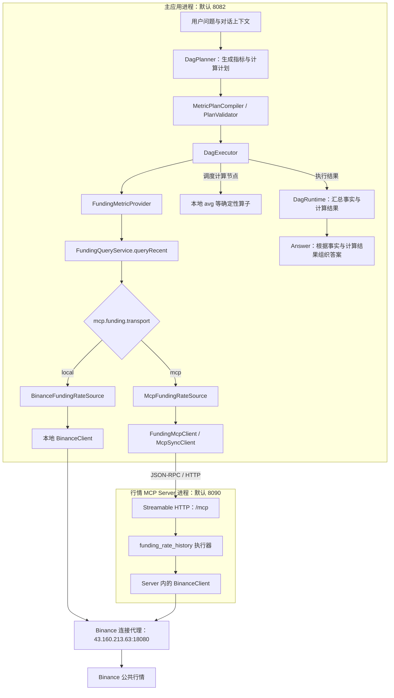
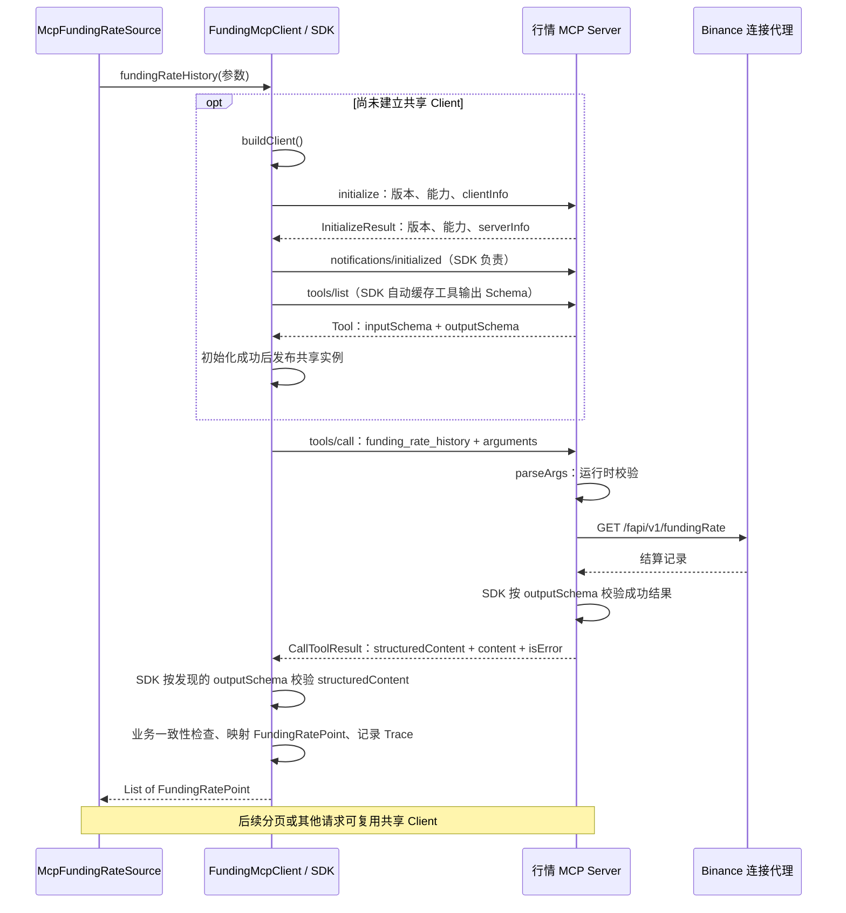

# 行情 MCP 接入：调用链、协议与生命周期

本文面向维护 CEXPilot 的开发者，也用于从一次具体接入中理解 MCP。说明以当前工作树为准：Java 17、Spring Boot 3.3.5、MCP Java SDK 0.18.4；传输采用 Streamable HTTP，服务端目前只提供币安永续已结算资金费率历史工具。

**本次接入的核心：把已有的资金费率单页取数能力，通过标准 MCP 协议交给另一个进程调用。规划、时间消解、分页组织和确定性计算仍由主应用负责。**

阅读时先抓住以下四条线：

| 重点 | 必须能回答的问题 | 对应章节 |
| --- | --- | --- |
| 业务调用链 | 用户一句话如何经过计划、取数和计算，最后得到答案？ | §2～§3 |
| 协议交互 | initialize、tools/list、tools/call 各解决什么问题？ | §4～§5 |
| 生命周期与失败 | 谁创建、发布、复用和关闭 Client？握手失败怎么办？ | §7 |
| 观测与验证 | 远程取数如何进入 Trace？如何确认协议和业务都正确？ | §8～§10 |

**握手失败后的资源释放是重点。** 它属于“有状态客户端的生命周期管理”，能体现是否处理了成功调用之外的故障路径。讲解时应先说明角色和正常链路，再展开资源归属、失败清理与共享实例的并发使用；MCP 的全部内容不能缩成一个关闭连接的问题。

## 1. MCP 在这里解决什么问题

### 1.1 Host、Client、Server 对应到本项目

| 角色 | 当前实现 | 职责 |
| --- | --- | --- |
| Host | CEXPilot 主应用 | 接收请求，维护对话，调用模型，编译与执行计划，组织答案 |
| MCP Client | 主应用内的 FundingMcpClient，内部持有 SDK 的 McpSyncClient | 连接指定 Server，完成协议初始化、远程工具调用和响应解析 |
| MCP Server | 独立启动的 FundingMcpServerApplication | 注册工具描述与执行器，通过 /mcp 接收消息，调用币安客户端 |
| 上游数据源 | 交易所代理后的 Binance 公共行情接口 | 提供资金费率结算记录 |

Client 是 Host 内的一部分，不需要单独启动第三个进程。本项目有两个业务进程：主应用与行情 MCP Server。模型本身也不是连接 MCP Server 的网络客户端。角色定义参考固定版本的 [MCP 架构说明](https://modelcontextprotocol.io/specification/2025-03-26/architecture)。

### 1.2 与 Java 调用、HTTP API、Function Calling 的关系

| 方式 | 提供了什么 | 在本项目中的含义 |
| --- | --- | --- |
| Java 进程内调用 | 方法、类型、对象和异常 | local 模式下直接调用本地 BinanceClient |
| 普通 HTTP API | 跨进程访问，接口结构由双方约定 | 能实现同样的业务，但消费者需理解自定义接口 |
| MCP | 工具发现、描述、调用和结果交换的协议约定 | 兼容的客户端可以识别并调用 funding_rate_history |
| 模型 API 的 Function Calling | 向模型声明工具，取得模型提出的调用请求 | 属于模型与宿主的交互，可由宿主再转成 MCP 调用 |

**这版没有把 MCP 工具动态注入模型。** 当前 Planner 根据指标目录生成 JSON 逻辑计划，Java 编译后执行；执行到资金费率指标时，Source 适配器决定使用本地还是 MCP 通道。两阶段 LLM 请求仍不传 API `tools` 参数。

当前路线是：

```text
模型生成领域计划 → Java 确定调用目标 → MCP Client 执行远程调用
```

另一种常见路线是“发现 MCP 工具 → 转换成模型工具声明 → 模型提出调用 → 宿主执行”。本项目尚未实现这条动态接入路线，不能把它写成已有能力。

### 1.3 收益与代价

当行情能力需要被不同应用消费时，标准工具协议有复用价值；独立进程也可以单独部署和排查。代价是增加协议适配、序列化、通信、会话管理和运维工作。

**当前只有 CEXPilot 一个主要消费者时，进程内调用仍然更简单。** 本次实现验证标准能力暴露与消费的完整链路，不代表 MCP 能提高行情准确性、替代业务语义校验或自动改进 Planner。是否迁移更多指标，应由消费者和部署需求决定。

## 2. 一张图看清进程、调用层级和切换点



图中省略响应回传箭头，重点展示请求方向和职责边界。计算节点依赖资金费率指标成功产出的样本；实际顺序由 DAG 依赖决定。DagExecutor 收集本层结果后再调度后续层，不会让均值计算在操作数尚未取得时执行。执行结束后，由 DagRuntime 汇总事实并调用 Answer。

### 2.1 切换点在 FundingRateSource

```text
local：FundingQueryService → BinanceFundingRateSource → BinanceClient → 代理

mcp： FundingQueryService → McpFundingRateSource
                         → FundingMcpClient → MCP Server → BinanceClient → 代理
```

没有把整个 Provider、Planner 或问答 API 搬到服务端。这里只替换**币安资金费率**通道；OKX 资金费率和其他行情指标继续使用各自原有实现。

BinanceFundingRateSource 在 `transport=local` 或配置缺失时装配；McpFundingRateSource 和 FundingMcpClient 在 `transport=mcp` 时装配。McpConfig 当前使用字符串配置，拼写错误不会自动回退为 local，需按支持值填写。

### 2.2 进程隔离与依赖隔离

两个入口属于同一个 Maven 模块，共享编译产物和 classpath。Server 通过较小的组件扫描范围、funding-mcp profile 和显式导入，只装配服务端与交易所客户端相关 Bean；其业务执行路径不引用 MCP Client。

这是**运行时装配隔离**，不是独立模块、独立依赖或编译期禁止引用。`@Profile` 不会把类从 classpath 中移除。若未来要让错误引用直接编译失败，可以再拆模块；当前没有做这一步。

## 3. 跟踪一次“最近 10 期费率的均值”

以“币安 BTC 最近 10 期已结算资金费率的均值是多少？”为例，下面描述代码应执行的路径；它不是本次新跑出的真实行情结果。

### 3.1 从问题到指标与计算

1. 主应用固定本轮请求时间，建立对话和 Trace 上下文。
2. Planner 选择 `funding.rate_settled / recent_n / count=10`，并选择 avg 计算。
3. 编译器绑定资金费率 Provider，建立计算节点对指标节点的依赖。
4. 校验器检查计划、引用和预算，通过后交给 DAG 执行。
5. FundingMetricProvider 收到 CountQuery，调用 FundingQueryService.queryRecent()。

当前指标目录支持最近 N 期样本，N 为 1～100。虽然底层服务存在时间区间查询方法，资金费率 Provider **只接受 CountQuery**。暴露历史端点，不等于问答入口新增了“指定时间窗口资金费率统计”能力。

相关业务边界见 [Plan 与指标元数据](Plan与指标元数据.md)、[聚合指标](聚合指标.md) 和[指标目录](../src/main/resources/metrics/cex-perpetual.yml)。

### 3.2 为什么一个指标节点会调用多次 MCP

queryRecent() 的输入是“最近 N 期”，Server 工具的输入却是“指定起止时间的一页数据”。转换仍在主应用：

```text
queryRecent(exchange=BINANCE, base=BTC, count=10, requestTime)
  → fundingIntervalMs(BTC)
      → BTC 转成 BTCUSDT
      → MCP 调用：查询最近约 8 天历史，limit=1000
      → 从最近两次结算的间隔推导当前周期，归一到整小时
  → 按 N 和周期估算回溯窗口
  → fetch(BTC, intervalMs, start, end)
      → MCP 调用：拉取一页
      → 必要时继续翻页
      → 样本仍不足时，queryRecent 扩大窗口重查
  → 截取最近 N 期，返回实际样本数及元数据
```

一次需要新取数的成功查询通常至少包含“周期探测”和“样本拉取”两次工具调用，还可能扩窗、分页。会话已建立时复用同一个 Client，不需要每一页都重新握手。

周期探测目前读取 System.currentTimeMillis()，估计的是**当前**结算周期；最近 N 期样本窗口使用主应用固定的 requestTime。当前周期只是回溯提示，不能直接当作全部历史结算的实际周期或年化依据。

### 3.3 复用分页逻辑，而不是复制一套

McpFundingRateSource 组合了一个 BinanceFundingRateSource，向其注入两个函数：

- PageFetcher：使用 FundingMcpClient.fundingRateHistory() 获取一页。
- IntervalProvider：经 MCP 查询历史后，复用 inferIntervalMs() 推导周期。

交易对映射、分页推进、时间网格吸附和去重逻辑仍共用原实现。这里的 `new BinanceFundingRateSource(...)` 使用适配构造器注入函数，不会再偷偷创建一个走本地 HTTP 的数据源。

分页时有三个值得记住的数：每页最多 1000 条、最多 10 页、下一页起点为上一页最大原始 fundingTime + 1ms。满页才考虑继续拉；游标不推进或预算用尽会返回中止原因，上层不能把中止结果当成完整样本。

### 3.4 结果如何回到均值与答案

Server 返回单页 FundingRatePoint 数据，Client 解析后交回 Source。Service 完成样本选择，Provider 再产出标准指标事实及元数据：请求数量、实际数量、是否取得足量样本，以及可用时的单期周期。

recent_n 是样本语义，不执行时间窗口的覆盖网格核对。样本不足时由元数据表达，后续计算仍要遵循现有完整性规则。

avg 节点在主应用本地对标准样本做确定性计算，Answer 使用已有事实和计算结果组织回答。**MCP Server 没有调用 LLM，也没有计算最终均值。**

## 4. 协议链路：握手、发现、调用

本节按 SDK 0.18.4 所用的初始化式协议说明。手工示例使用支持结构化工具输出的 2025-06-18；本地协议测试实际协商为 2025-11-25。真实连接以协商日志为准，不应把示例版本视为唯一支持版本。

### 4.1 首次调用与后续调用



初始化用于协商版本、交换能力和身份信息；notifications/initialized 表示客户端进入正常操作阶段。Java 代码调用 initialize()，SDK 负责其内部协议消息，不需要业务代码再补发通知。协议流程见 [2025-03-26 生命周期](https://modelcontextprotocol.io/specification/2025-03-26/basic/lifecycle)。

### 4.2 三个方法不能混为一谈

| 方法 | 回答的问题 | 返回内容 |
| --- | --- | --- |
| initialize | 双方能按什么协议和能力通信？ | 版本、能力、实现名称等 |
| tools/list | 这个服务有哪些工具，输入输出是什么结构？ | 工具名称、描述、inputSchema、可选 outputSchema 等 |
| tools/call | 用这些参数执行某个工具，结果是什么？ | CallToolResult |

**当前主应用是固定工具适配，SDK 会发现输出契约，但不会动态扩展 Planner。** FundingMcpClient 已知工具名 funding_rate_history，通过 enableCallToolSchemaCaching(true) 开启 SDK 的 Schema 缓存与响应校验；initialize() 内部读取 tools/list，缓存远端声明的 outputSchema，callTool() 返回前据此校验 structuredContent。

SDK 0.18.4 自动初始化钩子读取首页，当前 Server 只有一个工具，全部包含在这一页。它不等于任意 Server 的全量工具检索平台；若将来工具列表分页，需要再处理全页发现与缓存。SDK 的 listTools() 无参方法支持遍历所有页；也不能把 SDK 获取列表理解成“把所有工具放进 LLM 上下文”。实现见 [McpAsyncClient](https://github.com/modelcontextprotocol/java-sdk/blob/v0.18.4/mcp-core/src/main/java/io/modelcontextprotocol/client/McpAsyncClient.java)。

### 4.3 Streamable HTTP 与不同的“流”

这版服务在 /mcp 挂载 WebMVC 函数式路由：POST 传递协议消息，GET 可承载服务端 SSE 消息，DELETE 用于会话结束。响应可能是普通 JSON 或 SSE，手工客户端应接受两种内容类型；SDK 负责具体解析和会话头处理。[对应版本传输规范](https://modelcontextprotocol.io/specification/2025-06-18/basic/transports)

| 对象 | 本项目中的用途 | 需要区分的边界 |
| --- | --- | --- |
| /api/ask/stream | 向前端流式传送问答进度与答案 | CEXPilot 自己的业务 SSE 协议 |
| /mcp 的 SSE | 承载 MCP 协议消息 | 使用 SSE 不等于采用旧式 HTTP+SSE MCP 传输 |
| MCP 会话 | 管理 Client 与 Server 的协议交互 | 不保存用户的多轮问答历史 |

conversationId 属于主应用对话系统，不等于 Mcp-Session-Id。同一个共享 Client 可以服务不同对话；当前 Server 收到的是工具参数，不会收到完整对话、Planner prompt 或整个 DAG。

## 5. 工具契约：哪些语义必须由开发者保证

### 5.1 输入与实际校验

当前只注册 funding_rate_history，下面的参数都必填，额外字段会被拒绝。

| 参数 | 当前接受值 | 业务语义 |
| --- | --- | --- |
| symbol | 非空字符串，如 BTCUSDT | 使用交易所交易对；工具内不做 BTC → BTCUSDT 映射 |
| startTimeMs | 可表示为 Java long 的 JSON 整数 | 包含起点的毫秒时间戳 |
| endTimeMs | 可表示为 Java long 的 JSON 整数 | 包含终点的毫秒时间戳，当前要求严格大于起点 |
| limit | 1～1000 的 JSON 整数 | 单页条数上限，截断保留最早的 N 条 |

当前实现拒绝解析为 Double 的数，包括 1.9；这是 parseArgs() 的具体接受策略。symbol 只检查非空，是否为有效合约仍由上游判断，当前没有额外的合约目录校验。

inputSchema 声明了对象结构、字段类型、必填项和 additionalProperties=false。limit 同时声明 minimum=1、maximum=1000；两个时间参数声明 long 的 minimum/maximum；symbol 声明 minLength=1 和至少包含一个非空白字符的 pattern。startTimeMs < endTimeMs 属于跨字段约束，仍由 Java 校验落实。描述、Schema 和执行器是不同层次，不能认为写了一段说明就已完成运行时检查。

在这版 SDK 装配下，执行器自己落实校验：先拒绝未知字段，再检查类型、整数范围和区间关系。对 BigInteger 使用 longValueExact()：

```text
错误：18446744073709551617.longValue() → 1 → limit 范围校验通过
正确：longValueExact() 抛异常 → isError=true → 不调用交易所
```

### 5.2 两层时间边界：闭区间与半开区间

MCP 工具对应底层端点，使用闭区间 [startTimeMs, endTimeMs]。Source 的分页接口使用半开区间 [startMs, endMs)，因此每页传给工具的终点是 endMs - 1：

```text
Source.fetch(base, intervalMs, startMs, endMs)
    → PageFetcher.page(symbol, cursor, endMs - 1, 1000)
    → tools/call(arguments.endTimeMs = endMs - 1)
```

**区间转换已经在 Source 做了一次，Server 不应再减 1。** 重复转换或漏掉转换会导致边界结算点漏取或重复。工具虽为闭区间，当前仍拒绝 startTimeMs == endTimeMs，不能用它查询单一毫秒。

### 5.3 输出契约：outputSchema 描述，structuredContent 承载

Server 为 funding_rate_history 声明 JSON Schema 2020-12 格式的 outputSchema，可通过 tools/list 发现：

| 字段 | Schema 约束 | 业务语义 |
| --- | --- | --- |
| exchange | string，const=binance | 来源交易所 |
| symbol | 非空 string | 请求使用的交易所交易对 |
| count | integer，0～1000 | 实际返回条数 |
| points | array，最多 1000 条 | 已结算资金费率记录 |
| points[].rate | string，十进制格式 pattern | 比率，0.0001 = 0.01%，避免 double 中转 |
| points[].fundingTime | integer，long 范围 | Unix 毫秒时间戳 |

根对象和每个样本的字段都列入 required，并使用 additionalProperties=false。type、array、items、required 等遵守 JSON Schema；points、rate、fundingTime 是项目业务字段，不是 MCP 预设字段。Schema 的实际定义见 FundingMcpServerConfig.fundingRateHistoryOutputSchema()。

以下是说明结构的示意值，不是真实行情记录：

```json
{
  "jsonrpc": "2.0",
  "id": 3,
  "result": {
    "content": [
      {
        "type": "text",
        "text": "{\"exchange\":\"binance\",\"symbol\":\"BTCUSDT\",\"count\":1,\"points\":[{\"rate\":\"0.0001\",\"fundingTime\":1700006400000}]}"
      }
    ],
    "isError": false,
    "structuredContent": {
      "exchange": "binance",
      "symbol": "BTCUSDT",
      "count": 1,
      "points": [{"rate": "0.0001", "fundingTime": 1700006400000}]
    }
  }
}
```

Server 显式设置 structuredContent(body)，同时将同一份 body 序列化为 TextContent，兼容只支持文本结果的消费者；两份内容应等价。当前主应用以 structuredContent 为成功数据来源，不再从第一条文本猜测 JSON，也不静默回退到旧的纯文本成功响应。

SDK 对声明了 outputSchema 的服务端成功结果进行校验；Client 开启 Schema 缓存后，也在 callTool() 返回前按远端声明校验。缺失 structuredContent、字段类型不符或违反 Schema，不能当成有效样本继续计算。isError=true 的错误结果不要求符合成功输出 Schema，仍可使用文本说明原因。规范见 [结构化结果与输出 Schema](https://modelcontextprotocol.io/specification/2025-06-18/server/tools#output-schema)。

客户端执行次序为：

```text
SDK：发现并缓存远端 outputSchema
  → callTool() 收到结果；成功时按该 Schema 校验 structuredContent
  → FundingMcpClient：先处理 isError=true 的业务错误
  → structuredBody()：读取标准结构化结果，要求 JSON 对象
  → parsePoints()：核对 exchange、请求 symbol、count=points.size、条数不超过请求 limit
  → 将 rate 字符串映射为 BigDecimal、fundingTime 映射为 long
  → 构造 List<FundingRatePoint>，完整业务 JSON 进入 Trace
```

**Schema 描述与校验不等于自动理解业务。** 远端声明能告诉客户端 points 是数组，但不能决定它在 CEXPilot 中应该映射成什么领域类型；count 与数组长度、symbol 与本次请求等跨字段、跨请求约束也仍需业务代码检查。parsePoints() 因此保留为资金费率适配器，不作为所有 MCP 工具的通用解析器。

本次 Client 与 Server 的输出契约一起更新，部署时也应同时更新两侧。文本兼容块帮助旧消费者读取新 Server 的结果，不代表新 Client 支持缺少 structuredContent 的旧 Server。

## 6. Server 装配与 SDK 的分工

入口为 [FundingMcpServerApplication](../src/main/java/com/cexpilot/mcp/server/FundingMcpServerApplication.java) 和 [FundingMcpServerConfig](../src/main/java/com/cexpilot/mcp/server/FundingMcpServerConfig.java)。

```text
FundingMcpServerApplication.main()
  → 自动附加 funding-mcp profile
  → 扫描 com.cexpilot.mcp.server
  → 导入 ExchangeConfig
  → 排除 DataSource / SQL 初始化自动配置
  → 装配 BinanceClient
  → 装配 WebMvcStreamableServerTransportProvider
  → 注册 provider.getRouterFunction() 到 WebMVC
  → 构造 McpSyncServer，注册工具描述及 callHandler
```

这里直接使用 MCP Java SDK 与 mcp-spring-webmvc 传输适配，没有引入 Spring AI 自动配置 starter。JSON 映射使用 JacksonMcpJsonMapper 的 Jackson 2 实现，与当前 Boot 依赖栈配合；升级 SDK 前需核对传输和 JSON 依赖。

| 代码 | 含义 |
| --- | --- |
| .serverInfo("cexpilot-funding-mcp", "0.1.0") | 握手时提供实现身份，便于确认连接目标 |
| .capabilities(...tools(false)...) | 声明支持 tools，false 指不提供工具列表变化通知，并非禁用工具 |
| .tools(fundingRateHistorySpec(...)) | 注册工具元数据与执行函数 |
| .callHandler(...) | 收到工具调用后进入业务执行逻辑 |
| .mcpEndpoint("/mcp") | 固定 Server 路径，Client 的 endpoint 须与之匹配 |

SDK 承担 JSON-RPC 编解码、协议交互和传输适配；开发者承担工具语义、参数校验、取数、业务错误映射和资源生命周期。MCP 没有替项目决定交易对规则、结算周期或数据完整性。

## 7. Client 生命周期：最值得展开的工程细节

阅读入口：[FundingMcpClient](../src/main/java/com/cexpilot/mcp/FundingMcpClient.java)。共享字段中的 Client 是“初始化成功、可以复用的实例”；connect() 内的 newClient 是“尚未交付的资源”。

### 7.1 先建立，再发布；首次使用才握手

共享字段为 volatile McpSyncClient client。client() 使用双重检查与 synchronized，首次进入时创建和初始化，成功后才赋给共享字段：

```java
McpSyncClient current = client;
if (current == null) {
    synchronized (this) {
        current = client;
        if (current == null) {
            current = connect(); // 初始化完成后才返回
            client = current;    // 只发布成功实例
        }
    }
}
return current;
```

外层检查让已有实例的调用不必每次获取初始化锁；锁内再次检查防止并发首次请求重复创建；volatile 保证共享引用的可见性。

懒初始化意味着 Server 未启动时主应用仍可启动，第一次实际查询才暴露连接错误。这是把依赖故障推迟到使用点，不代表远端故障被消除，也没有自动回退到本地取数。

### 7.2 重点：握手失败由创建方就地释放

下面摘取核心逻辑，省略成功日志：

```java
McpSyncClient newClient = clientFactory != null
        ? clientFactory.create() : buildClient();
try {
    McpSchema.InitializeResult init = newClient.initialize();
    return newClient; // 外层随后才发布共享字段
} catch (RuntimeException e) {
    closeQuietly(newClient);
    throw e;
}
```

为什么不能只依赖调用方或应用退出时清理？注意 Java 赋值的时机：

```text
调用方：McpSyncClient session = client()
                    └─ connect()
                         ├─ 已创建 newClient
                         └─ initialize() 抛异常

此时：
  调用方的 session 尚未成功赋值
  共享字段 client 尚未赋值，也为 null
  只有 connect() 的局部变量拿得到失败实例
```

如果 connect() 不关闭它，外层错误处理和应用关闭时的 @PreDestroy 都找不到这个实例。远端持续失败时，每次查询又会创建一个新实例；仅仅“请求抛异常”并没有完成资源清理。

**原则：资源在成功移交前，由创建方负责失败清理；移交后，由持有方负责生命周期。** 这是适用于 MCP Client、数据库连接和流式 HTTP 客户端的工程原则，不是要求业务代码必须采用某种 try/catch 写法的 MCP 专属规则。

当前 closeQuietly() 调用 SDK 的 closeGracefully()，关闭异常只写 debug 日志，避免覆盖原始握手错误。准确说法是“失败路径会尝试关闭”，不能宣称任何网络和中断条件下都保证释放成功。

测试 handshakeFailureClosesClientAndNextCallRetries() 注入 ClientFactory，连续触发两次失败，检查创建两次、关闭两次，证明失败实例不缓存且每次都有清理。工厂用于可控测试，生产构造器仍走真实传输。

### 7.3 重点：单次调用失败不能直接关闭共享 Client

共享 Client 会被多个线程复用。一次调用失败时，其他调用可能仍正常等待响应：

```text
A、B 都拿到旧实例 C1
A 超时，B 的调用还在执行
如果 A 立即关闭 C1，B 也可能因此失败
```

当前实现保留共享实例，只记录本次失败并向上抛出：

```java
try {
    McpSyncClient session = client();
    result = session.callTool(new McpSchema.CallToolRequest(
            TOOL_FUNDING_RATE_HISTORY, arguments));
} catch (Exception e) {
    record(inputJson, null, System.currentTimeMillis() - start, e.getMessage());
    throw new ExchangeException(NAME, "调用行情 MCP Server 失败", e);
}
```

**单次请求失败，不等于整个 Client 已不可用。** 后续调用继续取得同一个 Client，不因本次失败重新创建、重新握手。SDK 自身对部分会话失效的恢复行为与应用层生命周期分开看，不能承诺所有故障都会自动恢复。

旧实现使用 compare-and-clear，仅在共享字段仍指向失败实例时移除并关闭。它能避免迟到失败误关新实例，但不能保护仍在使用旧实例的其他请求，因此已移除这条调用失败后的重置路径。

SDK 0.18.4 的 McpClientSession.closeGracefully() 会结束待响应请求，不能把方法名理解为“等待所有业务调用完成”。只有首次握手失败的候选实例，以及应用退出时持有的共享实例，由当前包装器主动关闭。shutdown() 在锁内清空字段、锁外关闭；首次 connect() 及握手失败后的清理仍在初始化锁内。

测试 callFailureRetainsClientAndNextCallSucceeds() 验证失败后复用原实例、保留失败 Trace，并在 shutdown() 时关闭；failedCallDoesNotCloseAnotherInFlightCall() 用两个线程和 CountDownLatch 固定时序，验证一个请求失败不会关闭另一个请求正在使用的实例。

### 7.4 错误分类与生命周期边界

| 情况 | 当前应用层行为 | 会话处理 |
| --- | --- | --- |
| 建连或初始化失败 | connect() 清理候选实例，外层抛 ExchangeException | 不发布失败实例，下次重新创建 |
| SDK 的 callTool() 抛异常 | 记录失败，抛 ExchangeException | 保留共享 Client，不主动关闭或重建 |
| 返回 isError=true | 包装业务错误并抛出 | 保留 Client |
| 返回了预期解析器识别的非法数据 | 记录解析错误并抛出 | 不主动重建 |
| 应用正常关闭 | @PreDestroy shutdown() 清空字段并尝试关闭 | 结束共享 Client 生命周期 |

isError=true 表示工具执行失败，不表示协议连接损坏。上游交易所报错时，Server 仍可能正常通信；重建会话不能修好无效交易对。

当前包装器不根据 callTool() 异常主动替换客户端，也没有完整的故障分类与恢复机制。若未来需要应用层重建，应先区分请求级错误和实例级故障，再处理旧实例的在途请求与释放，不能直接恢复“异常即关闭”的逻辑。

**应用层没有显式重试本次失败调用。** 它把错误交给 DAG，后续调用继续复用 Client。SDK 自身的会话恢复属于 SDK 行为；Server 内 BinanceClient 对部分上游异常最多尝试三次，属于另一层重试，不能混成一次业务重试承诺。

保留单例也不等于内部资源永远不会积累：SDK 0.18.4 的 [sendRequest()](https://github.com/modelcontextprotocol/java-sdk/blob/v0.18.4/mcp-core/src/main/java/io/modelcontextprotocol/spec/McpClientSession.java) 在收到响应或发送失败时移除 pendingResponses 记录，但超时路径未统一移除；响应永久缺失时可能留下记录。本次改动解决应用层误关共享 Client，没有修复依赖内部的超时清理问题。

### 7.5 超时是分层预算，不是统一的 30 秒

| 层级 | 当前实现 | 含义与限制 |
| --- | --- | --- |
| MCP 请求 | request-timeout-ms 默认 30000，传给 .requestTimeout(...) | 控制 SDK 请求等待，不是问答或全部分页的总预算 |
| SDK 初始化 | 未显式设置 .initializationTimeout(...)，0.18.4 默认 20 秒 | 独立的初始化阶段设置，改 requestTimeout 不会同步改它 |
| DAG 节点 | node-timeout-ms 默认 30000 | collect() 对 Future 的回收等待，cancel 不保证底层 I/O 立即终止 |
| 上游 HTTP | BinanceClient 连接 5 秒、读取 20 秒，部分异常可重试 | 一个工具调用内可能包含多次上游尝试 |

SDK 的两个超时字段可在 [0.18.4 SyncSpec 源码](https://github.com/modelcontextprotocol/java-sdk/blob/v0.18.4/mcp-core/src/main/java/io/modelcontextprotocol/client/McpClient.java) 中分别确认。当前配置类注释中的“含握手”不足以表达这些层次，以实际 builder 设置为准。

节点可能包含周期探测、多页取数以及首次握手，不能把它们理解成同一个 30 秒计时器。排查慢请求时，应区分握手、工具、上游和 DAG 回收。

## 8. Trace：跨线程收集、主线程落库

### 8.1 为什么 Client 里不直接写数据库

DAG 同层节点运行在工作线程，主线程负责收集结果和写 Trace。TraceRepository.appendEvent() 通过读取 MAX(seq)+1 分配事件序号；保持同轮执行主线程顺序写入，可以避免新增工作线程同时争抢序号的问题。这不是数据库层面对所有并发写入的全局保证。

```text
DagExecutor 为每个节点创建 NodeTraceCollector.Session
  → 工作线程 bind(session)
  → FundingMcpClient 完成一次调用后 record(Draft)
  → finally clear()，避免线程池复用时串入下一节点
  → 主线程 collect()
  → session.freezeAndSnapshot()
  → 依次落 TOOL_CALL 子事件
  → 再落本节点的 METRIC_RESULT / TOOL_CALL / FACT_REUSED
```

MCP 子事件名称是 mcp.funding_rate_history，输入为工具名和参数。一个指标可能有多条子事件；METRIC_RESULT 才是 Provider 组织后的标准指标事实。

### 8.2 超时后为什么要冻结快照

future.cancel(true) 发出中断请求，不等于工作线程已经结束。如果它继续收集事件，主线程又遍历同一个普通 ArrayList，就可能抛 ConcurrentModificationException，让本该局部失败的节点破坏整次执行。

当前 Session.add() 与 freezeAndSnapshot() 同步访问内部列表：冻结时标记 frozen=true 并返回不可变快照，之后的迟到事件直接丢弃，主线程遍历的集合不再变化。

**这里选择了明确的截止边界：保住已收集事件，丢弃冻结后的迟到事件。** 代价是超时后的远端完成结果不会补回当前 Trace，因此不能把 Trace 中缺少成功子事件理解为“远端一定没执行”。

同层节点按收集顺序落库；每个节点的子事件先于该节点结果，不代表所有并发子调用按真实开始或完成时间全局排序。现有 MCP 子事件也未携带 node_id，多节点同时调用同一工具时需结合参数和邻近指标事件定位。

### 8.3 为什么不能截断 JSON 后存入 output_json

数据库使用 CAST(? AS JSON) 写入。把完整 JSON 截到 2000 字符再加省略号，通常会破坏语法；普通错误文本也不是 JSON 文档。失败会被 DbTraceSink 捕获并写警告，业务继续，但事件丢失。

| 情况 | output_json | error |
| --- | --- | --- |
| 成功 | 完整、已解析的业务 JSON，不截断 | 空 |
| 工具业务错误 | {"isError":true,"message":"..."} | 错误文本摘要 |
| 业务一致性或映射错误 | 已读取的完整结构化业务 JSON；若尚无法读取则包装错误说明 | 解析原因 |
| SDK 输出 Schema 校验失败 | 可为空；SDK 在 callTool() 返回前抛出，包装器未取得结果 | Schema 校验原因 |
| 传输失败 | 可为空，没有正常结果 | 异常原因 |

成功结果保留完整内容，日志和异常消息可做摘要；错误包装中的 message 当前仍会截断。不能将它描述成“所有失败响应都完整保存”。

### 8.4 当前还没有完整的分布式观测

NodeTraceCollector 与 HttpRequestCounter 都依赖主应用线程上的 ThreadLocal，它们不会随 HTTP 请求自动进入 Server 进程。

当前 Server 未接收主应用 traceId，远端日志不能按同一 Trace ID 直接串联。Server 内交易所 HTTP 请求也不会增加主应用的 httpRequestCount；**MCP 模式下该字段不是整条链路真实上游请求总数**，不能直接与 local 模式作等口径对比。

目前能看到主应用记录的 MCP 子调用、节点结果，以及独立 Server 日志。若将来要完整追踪，应显式传播关联信息，并分别定义 MCP 调用数、上游 HTTP 尝试数等指标；不能简单把一次 MCP 调用计成一次交易所请求。

## 9. 开发运行与手工协议观察

### 9.1 启动两个进程

下面是手工命令示例，本次编辑没有执行它们。命令从仓库根目录运行，主应用的数据库与模型变量先按 [README 本地启动](../README.md#本地启动) 配好。

```bash
# 终端 1：独立 MCP Server，不依赖数据库或模型 API Key。
BINANCE_BASE_URL=http://43.160.213.63:18080 \
mvn spring-boot:run \
  -Dspring-boot.run.main-class=com.cexpilot.mcp.server.FundingMcpServerApplication

# 终端 2：主应用沿用 test profile，币安资金费率切到 MCP。
MCP_FUNDING_TRANSPORT=mcp \
MCP_FUNDING_BASE_URL=http://localhost:8090 \
mvn spring-boot:run -Dspring-boot.run.profiles=test
```

主应用默认访问[本地问答页](http://localhost:8082/)；`/mcp` 是协议端点，直接在浏览器打开它不等于完成工具调用。

| 配置 / 环境变量 | 使用方 | 默认值 / 作用 |
| --- | --- | --- |
| mcp.funding.transport / MCP_FUNDING_TRANSPORT | 主应用 | local，改为 mcp 才启用 Client 和适配 Source |
| mcp.funding.base-url / MCP_FUNDING_BASE_URL | 主应用 | http://localhost:8090 |
| mcp.funding.endpoint / MCP_FUNDING_ENDPOINT | 主应用 | /mcp，Server 当前固定此路径 |
| mcp.funding.request-timeout-ms / MCP_FUNDING_REQUEST_TIMEOUT_MS | 主应用 | 30000，准确边界见 §7.5 |
| MCP_SERVER_PORT | Server | 8090 |
| exchange.binance.base-url / BINANCE_BASE_URL | Server profile | 默认仓库约定的 Binance 代理 |

local 和 mcp 是主应用 Source 的取数通道配置，不是 MCP 传输协议选项。local 同样会通过 BinanceClient 请求交易所；mcp 采用 Streamable HTTP，不会因此变成 stdio。

### 9.2 两个 main 类与打包入口

主应用入口是 com.cexpilot.Application，Server 入口是 com.cexpilot.mcp.server.FundingMcpServerApplication。POM 使用 start-class 确定默认入口，并保留 Maven 启动时覆盖主类的能力。

曾将插件级 mainClass 写死为主应用，导致注释里的 Server 命令实际选中主应用。当前已修正。默认打包产物仍以主应用为入口；仅加 --spring.profiles.active=funding-mcp 不等于切换到 Server main，也不应将它当成第二进程的打包启动说明。

### 9.3 用 curl 看一次协议交互

先确认 Server 已启动。以下命令访问本地 MCP Server；有效的 tools/call 会进一步请求交易所代理。

第一步发起初始化，观察响应头和协商结果：

```bash
curl -i -N --max-time 30 http://localhost:8090/mcp \
  -H 'Content-Type: application/json' \
  -H 'Accept: application/json, text/event-stream' \
  --data '{"jsonrpc":"2.0","id":1,"method":"initialize","params":{"protocolVersion":"2025-06-18","capabilities":{},"clientInfo":{"name":"manual-check","version":"1.0.0"}}}'
```

记录返回的 Mcp-Session-Id（若服务端分配）和 result.protocolVersion。后续请求使用此会话；SDK 会代为管理，手工 curl 需要自己携带。id 关联单个请求与响应，不是会话 ID。

```bash
MCP_SESSION_ID='<初始化响应头中的实际值>'
MCP_PROTOCOL_VERSION='<初始化响应 result.protocolVersion 的实际值>'

# 通知没有 JSON-RPC id，不等待同 id 的结果。
curl -i --max-time 30 http://localhost:8090/mcp \
  -H 'Content-Type: application/json' \
  -H 'Accept: application/json, text/event-stream' \
  -H "Mcp-Session-Id: ${MCP_SESSION_ID}" \
  -H "MCP-Protocol-Version: ${MCP_PROTOCOL_VERSION}" \
  --data '{"jsonrpc":"2.0","method":"notifications/initialized"}'

# 查看 Server 实际提供的工具及 Schema。
curl -i -N --max-time 30 http://localhost:8090/mcp \
  -H 'Content-Type: application/json' \
  -H 'Accept: application/json, text/event-stream' \
  -H "Mcp-Session-Id: ${MCP_SESSION_ID}" \
  -H "MCP-Protocol-Version: ${MCP_PROTOCOL_VERSION}" \
  --data '{"jsonrpc":"2.0","id":2,"method":"tools/list","params":{}}'
```

示例以 2025-06-18 发起协商，后续 MCP-Protocol-Version 请求头使用实际协商值。切换其他协议版本时，应同时核对该版本的请求头和生命周期处理。

下面查询固定历史窗口，只用于观察结构和区间含义：

```bash
curl -i -N --max-time 30 http://localhost:8090/mcp \
  -H 'Content-Type: application/json' \
  -H 'Accept: application/json, text/event-stream' \
  -H "Mcp-Session-Id: ${MCP_SESSION_ID}" \
  -H "MCP-Protocol-Version: ${MCP_PROTOCOL_VERSION}" \
  --data '{"jsonrpc":"2.0","id":3,"method":"tools/call","params":{"name":"funding_rate_history","arguments":{"symbol":"BTCUSDT","startTimeMs":1700000000000,"endTimeMs":1700100000000,"limit":100}}}'
```

观察 tools/list 是否包含 outputSchema、工具名是否一致、isError 是否为 false、structuredContent 是否符合声明，以及兼容文本是否为同一份 JSON。实际条数和数值以真实响应为准，不预先声称示例一定有多少条。把 limit 改为 1.9、0 或加入未知字段，应收到 isError=true，且校验失败发生在请求交易所之前。

手工结束会话：

```bash
curl -i -X DELETE --max-time 30 http://localhost:8090/mcp \
  -H "Mcp-Session-Id: ${MCP_SESSION_ID}" \
  -H "MCP-Protocol-Version: ${MCP_PROTOCOL_VERSION}"
```

也可使用兼容该协议版本和 Streamable HTTP 的 MCP Inspector，按连接、列工具、调用工具的顺序观察。不能把“支持 MCP”理解成任何客户端版本和传输组合都必然互通。

### 9.4 环境故障与协议故障分开排查

旧文档记录过某台开发机出现“curl/Python 能访问代理，Java 请求读取超时”的现象。本轮文档核对没有复现该网络实验，因此将其保留为历史线索，不推广为“Java 只能访问 80/443”的普遍限制。

默认仍走仓库约定代理。遇到类似故障，分别检查主应用到 Server、Server 到代理、代理到上游三段连接，以及实际 profile、地址、超时和 Server 日志。curl 成功不能证明 JVM 请求一定成功，交易所链路超时也不能直接归咎于 MCP 握手。

## 10. 验证证据、测试入口与尚未覆盖的范围

### 10.1 当前已验证到哪一层

最近一次结构化输出改动验证为 **2026-10-16**：mvn test-compile 通过，定向运行 FundingMcpClientTest、FundingMcpServerConfigTest、FundingMcpProtocolTest、McpFundingRateSourceTest，共 33 条通过。协议测试使用真实本地 HTTP Client/Server、mock BinanceClient，验证发现输出契约、结构化结果与兼容文本等价、生产 Client 成功解析，以及 Server 实现漂移后 Client 按已发现 Schema 拒绝错误数据。没有请求线上服务或真实交易所。其余测试与临时探针保留 2026-10-15 的历史记录，不能当成本次全部重跑。

| 验证层 | 已有证据 | 不能由此推出什么 |
| --- | --- | --- |
| 编译 | mvn test-compile 通过 | 不证明远端网络和真实行情可用 |
| 定向测试 | 2026-10-16：Client、Server、协议集成、MCP Source 四个测试类共 33 条通过；2026-10-15：历史 7 个测试类共 47 条通过 | 本次未重跑其余 4 类，也不等于完整问答端到端通过 |
| 仓库内协议集成 | FundingMcpProtocolTest：真实本地 HTTP 与 SDK，mock 交易所客户端，正常调用和 Schema 拒绝路径通过 | 不证明真实交易所或主应用完整问答可用 |
| 本地协议集成探针 | 假行情 HTTP 服务 + 真实 SDK Client/Server，验证握手、列工具、正常调用、小数及未知参数拒绝 | 不证明真实交易所响应正确 |
| 本地故障探针 | 复核旧会话迟到失败、长响应 Trace JSON、握手失败关闭次数、整数越界拒绝 | 临时探针未全部作为仓库测试持久化，不能假设 CI 已覆盖 |
| 历史真实行情记录 | 旧文档记载 curl 调用及与代理数据对照 | 本轮未重跑，不能当成当前全链路验收结果 |
| 主应用完整问答 | 仍标记待补 | 尚未证明 local/mcp 答案、元数据和耗时等价 |

### 10.2 测试类与它们保护的契约

| 测试类 | 条数 | 关注点 |
| --- | --- | --- |
| [FundingMcpClientTest](../src/test/java/com/cexpilot/mcp/FundingMcpClientTest.java) | 18 | 结构化结果读取、拒绝文本回退、精度与类型、业务一致性、业务错误、握手清理和共享实例生命周期 |
| [FundingMcpServerConfigTest](../src/test/java/com/cexpilot/mcp/server/FundingMcpServerConfigTest.java) | 10 | 输入校验、机器可读输入输出约束、结构化与文本结果等价、Schema 拒绝畸形数据 |
| [FundingMcpProtocolTest](../src/test/java/com/cexpilot/mcp/FundingMcpProtocolTest.java) | 3 | 真实 HTTP 工具发现、生产 Client 读取 structuredContent、按远端 Schema 拒绝类型错误 |
| [McpFundingRateSourceTest](../src/test/java/com/cexpilot/market/funding/McpFundingRateSourceTest.java) | 2 | Source 委托、交易对映射、结算时间吸附和周期推导 |
| [FundingSourcePaginationTest](../src/test/java/com/cexpilot/market/funding/FundingSourcePaginationTest.java) | 4 | 原有数据源分页契约 |
| [FundingQueryServiceTest](../src/test/java/com/cexpilot/market/funding/FundingQueryServiceTest.java) | 11 | 资金费率查询组织与边界 |
| [FundingMetricProviderTest](../src/test/java/com/cexpilot/metric/FundingMetricProviderTest.java) | 7 | 标准指标结果与业务语义 |
| [DagExecutorTest](../src/test/java/com/cexpilot/dag/DagExecutorTest.java) | 7 | DAG 并发、依赖、失败、超时、事实复用和迟到 Trace 事件 |

需要重跑时使用定向命令，先编译再测试：

```bash
mvn test-compile
mvn test -Dtest=FundingMcpClientTest,FundingMcpServerConfigTest,FundingMcpProtocolTest,McpFundingRateSourceTest
```

### 10.3 一次业务验收应留什么证据

先选择“最近 10 期已结算费率均值”这类确定场景，保留问题、模式、构建版本、traceId、请求时间、样本和计算结果。

| 场景 | 核对点 |
| --- | --- |
| 正常查询 | 指标身份、实际样本数、结算时刻、费率精度、均值来源正确 |
| local 与 mcp 对照 | 使用相同数据窗口或固定上游样本，对比数值、单位、元数据；不同请求时间的实时结果不能直接逐位比较 |
| Server 未启动 | 主应用可启动，使用能力时明确失败，不伪造数据或静默回退 |
| Server 重启 / 调用变慢 | 观察错误归属、SDK 会话恢复、节点预算和 Trace，不假定包装器会重建实例或失败调用会自动成功重试 |
| 上游交易所失败 | 工具返回业务错误，正常协议连接无需因此重建 |
| 非法参数 | 校验失败不访问上游，返回内容和 Trace 都可解释 |

涉及真实问答或交易所请求的操作应遵守仓库执行约束，得到明确执行指令后再运行；不能因文档写了命令就当成已经完成验证。

## 11. 源码阅读顺序与排查入口

| 顺序 | 文件 | 阅读时抓住的问题 |
| --- | --- | --- |
| 1 | [McpConfig](../src/main/java/com/cexpilot/config/McpConfig.java)、[主配置](../src/main/resources/application.yml) | 哪些开关控制 Source 选择？ |
| 2 | [McpFundingRateSource](../src/main/java/com/cexpilot/market/funding/McpFundingRateSource.java) | 如何注入远程函数，复用本地分页？ |
| 3 | [FundingMcpClient](../src/main/java/com/cexpilot/mcp/FundingMcpClient.java) | 实例何时创建、发布、复用、移除、关闭？ |
| 4 | [FundingMcpServerApplication](../src/main/java/com/cexpilot/mcp/server/FundingMcpServerApplication.java)、[Server 配置](../src/main/resources/application-funding-mcp.yml) | 第二进程扫描什么、监听哪里、连接哪个代理？ |
| 5 | [FundingMcpServerConfig](../src/main/java/com/cexpilot/mcp/server/FundingMcpServerConfig.java) | 工具如何声明、校验、执行和映射错误？ |
| 6 | [BinanceFundingRateSource](../src/main/java/com/cexpilot/market/funding/BinanceFundingRateSource.java)、[FundingQueryService](../src/main/java/com/cexpilot/market/funding/FundingQueryService.java) | 一页数据如何变成最近 N 期样本？ |
| 7 | [DagExecutor](../src/main/java/com/cexpilot/dag/DagExecutor.java)、[NodeTraceCollector](../src/main/java/com/cexpilot/runtime/NodeTraceCollector.java) | 子调用事件如何从工作线程回到主线程？ |

| 症状 | 优先查看 |
| --- | --- |
| 启动后没有 /mcp | 实际 main 类、profile、端口、路由装配 |
| 主应用一直走 local | MCP_FUNDING_TRANSPORT 是否进入主应用进程，条件 Bean 是否匹配 |
| 握手失败 | base-url、endpoint、Server 状态、初始化结果、协议兼容性 |
| isError=true | 工具错误文本、Server 参数校验、BinanceClient 日志 |
| 工具正常，最后无均值 | Provider 样本元数据、计算依赖和完整性规则 |
| 业务有结果但 MCP Trace 缺失 | JSON 落库警告、是否已冻结、是否在绑定的节点线程调用 |
| MCP 模式 HTTP 请求数偏少 | §8.4 的进程计数边界，不能据此认为上游请求减少 |

当前代码未实现完整的认证授权、调用方隔离或配额治理。兼容协议与具备对外运营能力是两件事；增加外部消费者时，需另行定义部署和访问边界。

## 12. 掌握程度与面试表达

### 12.1 建议先讲链路，再讲工程细节

1. **动机与范围**：给已有行情能力增加 MCP 接口，验证跨应用消费；目前只迁移币安资金费率，保留 local 模式。
2. **角色与链路**：CEXPilot 是 Host，内部 Client 调独立 Server；Planner 生成领域计划，Java 执行时选择 MCP 通道。
3. **协议交互**：SDK 初始化协商后调用工具；通用客户端可以发现工具，主应用目前使用固定工具适配。
4. **业务边界**：Server 只拉一页；分页、最近 N 期、样本语义和均值计算在主应用。
5. **生命周期细节**：初始化成功才发布，失败由创建方清理；迟到失败按实例身份清理旧会话。
6. **观测细节**：工作线程收集、主线程冻结落库；取消不等于终止，成功响应必须保持合法 JSON。
7. **取舍与证据**：说明通信成本，区分单测、本地协议验证和仍待补的完整问答验收。

### 12.2 可以直接练习的一段表述

> 我在 CEXPilot 中把币安资金费率单页查询封装成独立 MCP Server，并让主应用通过 MCP Client 消费。Server 通过工具定义发布 inputSchema、outputSchema，用 structuredContent 返回结构化结果，同时提供等价文本兼容块。Client 由 SDK 发现并缓存输出 Schema，先做结构校验，再由资金费率适配器检查请求与结果一致性、映射领域对象。Planner 和计算链路继续使用原来的指标计划，切换发生在 FundingRateSource，因此两种模式共用分页和样本处理逻辑。Client 初始化成功后才发布共享实例，初始化失败由创建方清理；单次调用失败保留共享 Client，避免关闭并发在途请求。Trace 通过节点级收集器回到主线程写入，超时后冻结。当前单体规模下本地调用更简单，这次实现验证的是标准契约、协议接入的边界与代价。

这段话应与实际演示证据一起使用。不要补上尚未实现的“动态发现后自动注册 Planner”“所有行情都走 MCP”“完整分布式 Trace”或“已完成真实问答等价验证”。

**能独立画出 §2 的业务图、§4 的协议时序，并解释 §7 的两个失败时序，才算掌握了这次接入最核心的内容。**
