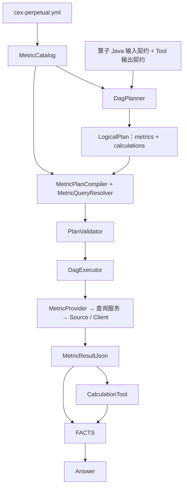

# Plan 与指标元数据

本文描述当前行情问答的规划与执行协议。核心是：**模型选择业务指标、查询形态和计算算子；代码根据元数据绑定执行器，形成可校验、可执行、可回放的计划。** 本文不记录架构演化，也不展开多轮上下文协议。

## 1. 概念与职责

| 概念 | 定义 | 例子 |
| --- | --- | --- |
| Instrument | 被查询的产品，而不只是 API symbol | BTC / USDT 报价 / USDT 结算 / 永续 |
| Metric | 有明确业务含义和单位的指标 | `trade.turnover` 是真实报价币成交额 |
| QueryShape | 同一指标的观测方式 | 当前快照、区间统计、逐点序列等 |
| Binding | 指标在某形态下的执行能力与限制 | TURNOVER → kline，允许 5m / 15m / 1h |
| Provider / Selector | 代码执行入口与类型化指标选择器 | KlineMetricProvider / KlineMetric.TURNOVER |
| LogicalPlan | 模型声明的查询组与计算节点 | 一个查询组分别查询两所成交额，再做变化率 |
| CompiledPlan | 编译产物 | 类型化逻辑计划、原 JSON、物理 DAG、分支映射、有效查询条件 |
| MetricResult | Provider 产出的类型化事实 | Scalar / Series / Point / Omitted |
| Calculation | 对已有事实或显式常量做确定性运算 | relative_change、avg、annualize |

Planner 不需要知道 Binance 的参数名、OKX 的列位置、Provider 名称或物理节点 ID。`tool` 仍是计算执行层的抽象；当前取数走 MetricProvider，不通过旧行情 Tool 包装器。



## 2. 元数据在哪里，哪些会进入 Prompt

当前只加载 [cex-perpetual.yml](../src/main/resources/metrics/cex-perpetual.yml)，不是扫描任意指标 YAML。加载入口是 [MetricCatalog](../src/main/java/com/cexpilot/metric/MetricCatalog.java)。

```yaml
version: cex-perpetual-v1
concepts: |
  # 跨指标共用概念，例如永续、自然日、ratio 与 percent
operators:
  # 算子用途与业务口径
metrics:
  trade.turnover:
    description: 区间真实报价币成交额，由成交 K 线成交额累计
    unit: quote
    bindings:
      range_statistic:
        provider: kline
        selector: TURNOVER
        intervals: [5m, 15m, 1h]
```

| 字段或文件 | 当前用途 |
| --- | --- |
| `concepts` | 共用业务语义，渲染到 Planner |
| 指标 `description` / `unit` | 指标口径、单位，渲染到 Planner；结果身份也保留 description |
| `bindings` 的形态、exchanges、intervals、count、depth | 能力校验，且以紧凑约束形式渲染到 Planner |
| `provider` / `selector` | 服务端执行绑定，不作为模型需要填写的内容 |
| `operators` | 目录允许的算子名与业务说明；注册的 CalculationTool 才能实际执行 |
| `tools/*.yml` | Tool 注册、输入基础契约、输出字段契约；当前算子仍使用这套机制 |
| `CalculationTool.planningInputSchema()` | 每个算子嵌套 input 的规划输入结构 |
| [plan-schema.json](../src/main/resources/metrics/plan-schema.json) | LLM 输出信封和通用计划结构；运行时注入 metric 枚举与算子 anyOf 分支 |
| [dag_planner.txt](../src/main/resources/prompts/dag_planner.txt) | 领域判断、协议、口径约束和规划示例 |

`MetricCatalog.describeMetrics()` 只把业务定义和参数约束投影给模型。相同约束的形态可以合并描述，不同形态的交易所限制不能取并集：例如不能把区间成交额支持 OKX 推导为官方 24h 成交额也支持 OKX。

目录加载会拒绝重复 YAML 键、非法字段和非法边界定义。`MetricProviderRegistry` 启动时校验 Provider 存在、selector 可解析且支持对应形态。`catalog_version` 是声明版本加目录内容指纹；修改内容即改变指纹，不只依赖手工改 version。目录与 Prompt 无热更新。

## 3. 五种查询形态

| query_shape | 参数 | 可计算结果 | 语义 |
| --- | --- | --- | --- |
| `snapshot` | 品种、交易所；仅声明 depth 的指标可带 depth | `value` | 当前点，附数据时间 `as_of` |
| `official_24h` | 品种、交易所 | `value` | 交易所官方滚动统计，附 `as_of`，不是程序自算自然日 |
| `range_statistic` | 必填 time；按 binding 决定是否接受 interval / include_unclosed | 完整覆盖时有 `value`、`observation_seconds` | 一个实际窗口的成品指标 |
| `time_series` | 必填 time；按 binding 指定或省略 interval | `samples[{time,value}]` | 各采样点，不是二维表，没有顶层 value |
| `recent_n` | 必填整数 count | `samples`、单期可核实的 `period_seconds` | 最近 N 期；sample_complete 只说明数量取齐 |

`snapshot / official_24h` 不接受 time、interval、include_unclosed、count。`recent_n` 的规范输出要求完全省略 time。当前 LogicalPlanParser 为兼容模型误写，会剥离 `time:null` 或 `{}`；非空 time 仍报错，不能将这项容错理解为支持时间窗口。启用的计划 JSON Schema 仍要求省略 time。depth 只在目录声明时可用，count 也不能移到其他形态。

当前时间类形态的缺省策略由 Provider 决定：K 线与标记/指数价格自动选择粒度，OI 默认 1h，taker 固定 5m 且目录不开放 interval。具体边界见 [时间窗口](时间窗口.md)。

## 4. 模型输出协议

基础信封为 `in_domain / plan / reply`：

```json
{
  "in_domain": true,
  "plan": {
    "metrics": [
      {
        "id": "m1",
        "metric": "trade.turnover",
        "exchanges": ["binance", "okx"],
        "instrument": {
          "market_type": "perpetual",
          "base": "BTC",
          "quote": "USDT",
          "settle": "USDT"
        },
        "query_shape": "range_statistic",
        "time": {
          "type": "calendar_period",
          "unit": "day",
          "offset": -1,
          "segment": "full",
          "extent": "full_period"
        }
      }
    ],
    "calculations": [
      {
        "id": "c1",
        "operator": "relative_change",
        "input": {
          "current": "{{m1.binance.value}}",
          "baseline": "{{m1.okx.value}}"
        }
      }
    ]
  },
  "reply": null
}
```

这份计划对应“昨天币安 BTC 永续成交额比 OKX 高百分之多少”。`exchanges` 表示分别查询；没有隐含跨所聚合。一个组共享品种、指标、形态、时间、粒度及其他参数；不同窗口、币种或粒度必须另建组。

逻辑计划不输出 `nodes / tool / args / depends_on / type`。id 必须以字母开头，只含字母数字下划线，最长 40 字符，且不能用内部 `metric_` 前缀。指标组与计算节点的 id 全局唯一。settle 可省略，由代码补 USDT；base 必须是大写基础币代码。

`reply` 是简短范围、缺口或澄清说明，不是行情事实；不能放自算数值或引用。出域、无可执行能力、缺必要输入时可返回 `plan=null`。多个独立问题可以查询已支持部分，并用 reply 说明缺口；只有一个核心问题且结果不可产生时，不安排无关取数。

当前信封还有上下文相关字段，本文仅说明首次查询主链；`changes`、`new_frame`、澄清及历史事实引用协议见 [上下文管理](上下文管理.md)。

## 5. 从逻辑计划编译成物理 DAG

实现入口：[LogicalPlanParser](../src/main/java/com/cexpilot/metric/LogicalPlanParser.java)、[MetricPlanCompiler](../src/main/java/com/cexpilot/metric/MetricPlanCompiler.java)、[MetricQueryResolver](../src/main/java/com/cexpilot/metric/MetricQueryResolver.java)。

编译过程按以下顺序执行：

1. 解析 JSON 为 `LogicalPlan / MetricRequest / CalculationRequest`，拒绝未知字段和不匹配的参数形态。
2. 预检逻辑规模、重复 id、算子是否在目录及注册表中，以及每个算子的 input；错误包含 `metrics[i]` 或 `calculations[i]` 路径。
3. 按 metric 与 shape 查 binding；校验品种范围、交易所、粒度、count / depth，并补默认值。
4. 将每个交易所展开为 `ResolvedMetric`，生成 `metric_0`、`metric_1` 等内部 ID，以及 group → exchange → physicalId 映射。
5. 构造类型化 `TimeRangeQuery / SnapshotQuery / CountQuery` 与 `MetricBinding`。后者包含标准品种、实际单位、provider、selector、catalog_version 和 description。
6. 递归改写计算 input 引用，并从引用收集去重后的依赖，构造计算 PlanNode。
7. 形成 CompiledPlan，再交给 PlanValidator 校验物理 DAG。

上面的示例展开如下：

| 逻辑项 | 物理节点 | 执行绑定或输入 |
| --- | --- | --- |
| m1.binance | metric_0 | kline / TURNOVER / Binance / 同一 TimeSpec |
| m1.okx | metric_1 | kline / TURNOVER / OKX / 同一 TimeSpec |
| c1 | c1 | relative_change，current=`{{metric_0.data.value}}`，baseline=`{{metric_1.data.value}}` |

`c1.depends_on=[metric_0,metric_1]` 由编译器生成。第一层并行取两所数据，第二层执行变化率。计算可引用其他计算，无须按列表顺序排列，不能形成环。

有效条件记录在 `CompiledPlan.targets` 中，并标记 EXPLICIT / DEFAULT，例如默认 settle、depth、include_unclosed。编译时还没有真实取数结果；自动粒度和实际范围要到 Provider / QueryService 执行后才能确定。

## 6. 引用契约与校验

| 逻辑引用 | 含义 |
| --- | --- |
| `{{m1.binance.value}}` | 标量指标值 |
| `{{m1.okx.samples}}` | 整个标准样本对象数组 |
| `{{m1.okx.samples.0.value}}` | 单个样本值，数组真实索引仍需执行期检查 |
| `{{m1.binance.observation_seconds}}` | 同一完整区间结果的实际观测时长 |
| `{{c1.value}}` / `{{c1.percent}}` | 已定义的计算输出字段 |

引用必须占据整个字符串，不允许 `{{...}} * 100`、自由表达式或文本插值。指标组引用必须带该组已声明的交易所；不存在的分支会在编译时失败。

`MetricResultJson.outputSchema()` 给出有限的指标引用白名单：序列 time/value、标量 value、区间 observation_seconds、recent_n period_seconds 等。结果中有 unit、coverage、source，不表示这些元数据可以任意引用到算子。计算输出引用按 Tool YAML 的 output_schema 校验。

[PlanValidator](../src/main/java/com/cexpilot/dag/PlanValidator.java) 校验节点、依赖存在性、环、深度、允许算子、参数和输出路径；执行期 [ReferenceResolver](../src/main/java/com/cexpilot/dag/ReferenceResolver.java) 再用真实数据解析，检查字段存在、非 null、数组索引等。**路径契约存在不代表字段每次都有值**，例如不完整区间没有 value，单期费率可能没有 period_seconds。

默认物理节点预算为 `min(dag.max-nodes=8, llm.max-tool-calls=8)`，深度上限 3。双交易所查询组占两个节点；每个计算也占一个节点。节点预算与 Source 的分页 HTTP 预算是两个独立限制。当前没有跨指标请求合并：同窗 OHLC、成交额若作为独立指标组查询，可能重复取同一批 K 线，不能将“一组指标”当作“一次 HTTP”。

## 7. 规划修复与执行失败

`DagPlanner` 默认首次加两次 repair。编译或 DAG 校验失败后，把原输出及错误明细追加到消息，让同一规划模型重新输出完整信封；物理引用错误会尽量翻译回逻辑引用，避免让模型理解内部节点 ID。耗尽后返回固定失败说明，不取数，也不让 Answer 在空事实下作答。调用层异常则走异常收尾，不能假定所有网络失败都会被结构 repair 重试。

`DAG_PLANNER_RESPONSE_FORMAT` 默认为空；选择 json_object 时只约束 JSON 格式，json_schema 时组装结构约束并注入枚举与各算子输入分支。即使启用 schema，编译器和 Validator 仍必须执行：schema 不能证明业务口径、引用存在性、无环、预算或计划是否足以回答用户。

[DagExecutor](../src/main/java/com/cexpilot/dag/DagExecutor.java) 用 Kahn 算法分层，同层提交固定线程池；工作线程读取上一层上下文，编排线程回收结果、写上下文并记录事件，之后再推进下一层。单节点失败只阻断依赖分支；超时取消 Future 并记失败，但底层 HTTP 不保证立刻响应中断。Future 按列表顺序回收，等待预算不等于每个节点从提交时刻起精确截止。

计算前检查上游完整性、已识别单位和限定年化来源；详见 [聚合指标](聚合指标.md)。单位一致只是必要条件，同为 USDT 并不保证窗口、指标或产品可比。

## 8. 标准事实如何进入 Answer

Provider 返回 `MetricResult`，只有 [MetricResultJson](../src/main/java/com/cexpilot/metric/MetricResultJson.java) 将其转换为标准 JSON：

- Scalar：完整区间统计，value、observation_seconds、actual_range。
- Series：samples，加时间覆盖或 recent_n 的数量状态。
- Point：快照或 official_24h，value 和 as_of。
- Omitted：保留身份、元数据、statistics_omitted，没有可用 value。

单位由元数据归一化：base → BTC 等基础币代码；quote → USDT；percent 与 ratio 保持各自口径。`2 percent` 表示 2%，`0.02 ratio` 才表示 2%。

DagRuntime 收集每个节点为 evidence：指标项含 type=metric、identity、ok、data/error；计算项含 type=calculation、operator、input_references、ok、data/error。Answer 接收完整 FACTS、仅说明缺口的 QUERY_STATUS 和固定 TIME_CONTEXT，不按数组长度再次删明细。

Answer 提示词要求只引用已有事实，完整性和数据时间以结果为准；未产出的计算结论不能自行补算。该约束属于模型行为要求，不是输出后数值证明器，因此排查必须同时看取数、计算和最终回答。Trace 观察点为 PLAN、PLAN_COMPILED、METRIC_RESULT、TOOL_CALL、LLM_CALL(answer)。

## 9. 新增能力的落地步骤

1. 先确定指标含义、单位、产品和形态，明确跨所是否同口径。已有成品指标能回答时复用，不能只因 API 有字段就对外宣称能力。
2. 数据能力不足时实现 Client / Source / QueryService，包含解析、分页、预算、保留期和覆盖检查；接口访问遵守仓库代理约定。
3. 增加或扩展 Provider / 类型化 Selector，直接消费服务模型，返回适当 MetricResult。
4. 在 `cex-perpetual.yml` 增加 bindings 与限制。只是新增同类投影且 Provider 已支持时，可能不需改执行器。
5. 结果新增可计算字段时，同步 MetricResultJson 的序列化与引用契约；计算语义变化则同步算子输入、输出及 MetricCalculationContext 来源规则。
6. 更新协议示例和文档；使用假数据验证目录、编译、Provider、引用和不完整分支。更改元数据后构建重启。

相关测试入口：`MetricCatalogTest`、`MetricPlanCompilerRegressionTest`、`PlanValidatorTest`、`DagPlannerTest`、`DagExecutorTest`、`MetricResultJsonTest`，以及各 Provider 的直接测试。按变更选择，先执行 `mvn test-compile`；此文档不要求自动运行线上探针。
