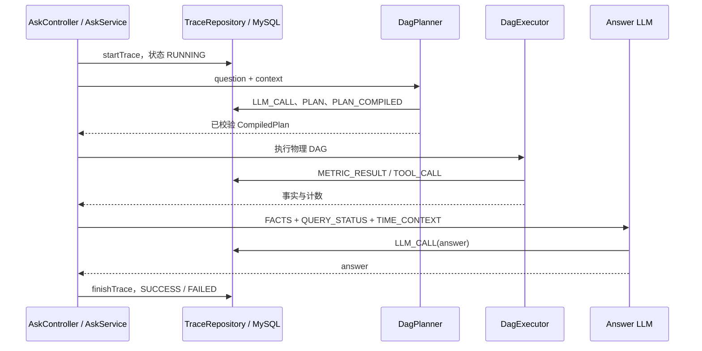

# Trace 搭建与问题回放

Trace 记录一次问答实际发生了什么：发给模型的 Prompt、逻辑计划、物理绑定、指标事实、计算输入输出、最终回答、耗时和错误。它是应用层的可观测记录，当前没有引入 OpenTelemetry，也不是重新执行历史请求的系统。

回放直接读取持久化数据，不重新请求模型或交易所。行情会变化，排查“当时为什么这样答”应使用原始 Trace。

## 1. 数据流与生命周期



图为正常取数路径。无有效计划、出域或需要澄清时，可直接返回说明，不发生指标取数或 Answer 调用。当前还会出现 CONTEXT_RESOLVED、CONTEXT_COMMITTED 等上下文事件，本文不展开其业务协议。

实现分工：

| 组件 | 职责 |
| --- | --- |
| [AskService](../src/main/java/com/cexpilot/api/AskService.java) | 创建 UUID traceId，开启主记录，成功/异常收尾，汇总耗时、Token 与成本 |
| [TraceEvent](../src/main/java/com/cexpilot/runtime/TraceEvent.java) / TraceSink | 事件模型与记录接口 |
| [DbTraceSink](../src/main/java/com/cexpilot/trace/DbTraceSink.java) | 捕获事件写库失败并记日志 |
| [TraceRepository](../src/main/java/com/cexpilot/trace/TraceRepository.java) | 主记录、事件与批量读取的 JDBC 实现 |
| [LlmTraceSerializer](../src/main/java/com/cexpilot/llm/LlmTraceSerializer.java) | 实际 messages 与模型响应的统一序列化 |
| [TraceController](../src/main/java/com/cexpilot/api/TraceController.java) | 单条与时间窗口回放接口 |
| [trace.html](../src/main/resources/static/trace.html) | 可视化展示事件、输入输出与错误 |

`traceId` 是一次问答的关联键；conversationId 标识会话，turnId 标识轮次，visitorId 标识浏览器访客。它们不是同一个概念。SSE 的 meta 在 Trace 开启后发出，客户端可尽早保存 traceId。

## 2. 建库与存量升级

基础建表在 [db/schema.sql](../src/main/resources/db/schema.sql)，通过 `spring.sql.init.mode=always` 启动执行。新库会建立当前完整表结构；存量表由于 CREATE TABLE IF NOT EXISTS 不会自动补列，需要先核对再执行 [db/migrations](../src/main/resources/db/migrations) 中未应用的迁移。

与 Trace 直接相关的迁移包括 visitor_id、build_commit、created_at 索引、ttft_ms / cached_tokens、event_type 加宽及拆分计数。当前 009_turn_counters 为新计数列；应用这份工作树对应版本时必须具备这些列。迁移文件不是可重复执行的全量脚本，也不由 Flyway / Liquibase 自动管理。

历史数据新增计数字段默认 0，含义是“当时未统计”，不能直接证明历史请求没有调用模型或交易所。

### 2.1 ask_trace：一次问答主记录

| 字段 | 当前含义 |
| --- | --- |
| trace_id / conversation_id / visitor_id | 请求、会话与访客关联 |
| question / answer | 原问题与最终完整回答；异常路径 answer 可为空 |
| status | RUNNING、SUCCESS、FAILED |
| model | 普通模型配置名 |
| prompt_version / build_commit | 提示词内容指纹与构建提交标识 |
| llm_steps / tool_calls | 兼容计数，当前分别为 DAG 层数 / 收集到结果的节点数 |
| planner_llm_calls / answer_llm_calls | Planner 实际调用数含 repair；Answer 通常 0 或 1 |
| metric_fetch_count / calculation_count | 非复用指标节点 / 算子节点计数，需结合节点事件确认成功或跳过 |
| http_request_count | Client 发出的交易所 HTTP 请求，分页与重试逐次计数 |
| reused_facts | 成功复用的事实数；复用机制专题暂不展开 |
| prompt_tokens / completion_tokens / cost | 两阶段累计 Token 与按配置单价估算成本 |
| duration_ms / error / created_at / finished_at | 总耗时、异常与数据库时间 |

`SUCCESS` 表示编排返回了答案或说明，不证明全部节点成功、数据完整、用户问题全部回答。能力缺口、规划失败说明或带部分节点失败的回答也可能正常收尾为 SUCCESS。实际执行状态要下钻 PLAN 与节点事件。

`metric_fetch_count / calculation_count` 当前在遍历收集结果时按节点分类递增，失败甚至因上游失败而跳过的算子也可能计入；不能把它们当成成功算子数。tool_calls 也不是交易所 HTTP 次数，llm_steps 名称兼容历史，但现在不是 LLM 调用次数。

### 2.2 trace_event：实际事件

| 字段 | 含义 |
| --- | --- |
| id / trace_id / seq | 行 ID、关联请求、同一 Trace 的记录顺序 |
| event_type / name | 事件类别与规划阶段、指标名或算子名 |
| input_json / output_json | MySQL JSON，保留异构输入输出，允许 SQL NULL |
| duration_ms | 该阶段或节点耗时；无计时的事件可为 NULL |
| prompt_tokens / completion_tokens | LLM usage，其他事件一般为空 |
| ttft_ms / cached_tokens | 客户端报告的首 Token 耗时与缓存 Token，缺失不能当成 0 |
| error | 事件错误；成功事件通常为空 |
| created_at | 数据库写入时间 |

筛选/关联字段放普通列，异构负载放 JSON。当前回放 API 通过 JDBC Map 返回下划线字段；input_json / output_json 可能是 JSON 字符串，回放页会解析，不要假定它们一定已展开成对象。

## 3. 核心事件及负载

| event_type / name | input_json | output_json | 排查重点 |
| --- | --- | --- | --- |
| LLM_CALL / dag_planner | stage、attempt、完整 messages、请求采样参数、response_format 等 | 模型完整 content；usage 存在事件普通列 | 实际 Prompt 与每次 repair 输出 |
| PLAN / dag_planner | 通常为空 | 模型信封，含逻辑 metrics / calculations | error 是否为空，是否选择正确形态与最终算子 |
| PLAN_COMPILED / metric_compiler | catalog_version | 物理 DagPlan，含绑定与改写后的依赖引用 | 逻辑组对应哪个 Provider / Selector / 物理节点 |
| METRIC_RESULT / 指标名 | node_id、args、metric_binding | ToolResult 的 ok、data/error；data 为标准指标 JSON | 单位、品种、窗口、value/samples、coverage |
| TOOL_CALL / 算子名 | node_id、解析后的 args | ToolResult 与算子结果 | 实际操作数、方向、公式、来源与失败原因 |
| LLM_CALL / answer | stage、完整 messages、time_context | 模型完整回答；usage 存在事件普通列 | FACTS 中是否已有最终结论，回答是否正确引用 |

当前取数直接走 Provider，因此不会再出现一条旧行情 TOOL_CALL 作为指标的必要前置。METRIC_RESULT 是节点结果，并非每页 HTTP 的原始响应日志。计算仍记录 TOOL_CALL。

对执行前跳过的节点、解析前异常或超时，事件 args 可能为空或保留未解析引用，不能一律当作实际执行入参。应先读 error 再判断。

物理展开例子见 [Plan与指标元数据](Plan与指标元数据.md)：m1 两所成交额 → metric_0 / metric_1 → c1.relative_change。回放时按 PLAN_COMPILED 的映射核对 METRIC_RESULT，不能凭事件位置猜哪个交易所。

其他上下文及事实事件如 FACT_REUSED 需要按其独立语义解释，不能算作本轮真实行情取数。本文不展开多轮实现。

## 4. 完整 Prompt 与版本定位

新 LLM_CALL 的 `input_json.messages` 是实际发送的消息列表，包括已渲染的指标目录、算子说明、上下文及 repair 消息；output_json.content 是完整模型文本。answer 输入还包含实际 FACTS、QUERY_STATUS 和 TIME_CONTEXT。要判断某条围栏是否进入模型，应读实际 messages，不仅看当前模板文件。

[PromptStore](../src/main/java/com/cexpilot/prompt/PromptStore.java) 以 MD5 前 8 位生成内容指纹。DagPlanner 的版本基于不含每轮动态上下文的实际渲染 Planner Prompt 与 catalog.version；DagRuntime 再结合 Answer 模板指纹形成主记录 prompt_version。它用于区分静态配置版本，不是每次请求 messages 的完整哈希，也不是安全校验摘要。

Maven 构建通过 git-commit-id 与 Spring Boot build-info 注入 commit，AskService 从 BuildProperties 读取到 build_commit。脱离 Git 或缺构建信息时可能为空；dirty 工作树的改动不由提交号单独表达。因此完整调用负载是还原实际 Prompt 的更直接依据。

历史 Trace 可能只有 stage / attempt / message_count 元数据，没有完整 messages。此时可按记录的提交查看当时资源：

```bash
git show <build_commit>:src/main/resources/prompts/dag_planner.txt
git show <build_commit>:src/main/resources/prompts/agent_system.txt
git show <build_commit>:src/main/resources/metrics/cex-perpetual.yml
```

这些只能在对应文件存在且提交可解析时还原静态内容，不能自动恢复当时动态上下文。Planner reply 与模板中的固定示例逐字相同可以佐证模板生效，但不能替代完整 messages，也不能证明整个计划正确。

## 5. 回放接口

以下 GET 请求只读取已有 Trace，不产生新问答。

```bash
curl -sS 'https://cex.hrscrm.net/api/trace/<traceId>'
curl -sS 'https://cex.hrscrm.net/api/trace_detail/<traceId>'
curl -sS 'https://cex.hrscrm.net/api/traces?beginHour=4&endHour=0'
curl -sS 'https://cex.hrscrm.net/api/traces?beginHour=12&endHour=8'
```

单条接口返回 `{trace,events}`，按 seq 排序；不存在返回 404。当前 trace 与 trace_detail 都调用同一 findEvents，没有 2000 字符截断。历史说明里二者的差别不能沿用为当前契约。

批量接口返回 `{begin,end,count,traces}`，每条内联 events 与 feedback，但剔除事件 input_json / output_json 以控制体积。需要 Prompt 或数值时再读单条详情；批量元数据没有输出内容不能解释为数据库没记录。

参数要求：beginHour > endHour ≥ 0，差值不超过 24 小时；支持有限小数，转换为分钟并四舍五入，beginHour 最大为 24×366。窗口按照 **数据库 NOW()** 计算，因为 created_at 也是 DB 写入，避免应用服务器时区与 DB 不同导致查询空窗。返回 begin/end 为 DB 时间展示，不能拿它替代行情 RequestContext。

页面地址：`https://cex.hrscrm.net/trace.html?id=<traceId>`。本地将域名替换为 localhost:8082。

## 6. 写入顺序、耗时和容错的实际边界

### 6.1 seq 是记录顺序，不是节点开始顺序

TraceRepository 用 `MAX(seq)+1` 分配序号，不是独立的并发序号服务。当前 DagExecutor 在同层工作线程全部提交后，由编排线程按节点列表顺序回收并落事件，避免该路径的层内并发写；同层较晚完成的节点可能先被记录。

将来若让工作线程直接写同一 Trace，需要重新处理序号竞争。created_at 与 seq 不能推导严格的并行起止时序。

### 6.2 总耗时不能简单相加

同层节点并行，节点 duration_ms 求和可能高于实际层耗时。当前主记录 duration_ms 从调用 DagRuntime 前计时，到运行时返回或抛异常时结束，包含规划、取数、计算、回答及其间事件/事实落库；不含前置上下文准备、startTrace 和 finishTrace 本身，不能视为完整 HTTP 端到端耗时。节点超时事件使用配置等待预算作为耗时，不能当作底层 HTTP 实际终止时刻。

LLM 首 Token 耗时 ttft_ms 与总 duration_ms 是不同指标；非流式或上游未报告时可能为空。cost 由普通模型的输入/输出每千 Token 配置估算，不包含交易所网络、数据库或实际账单折扣，默认单价 0 不能表示免费。

### 6.3 哪些失败不会阻断，哪些可能阻断

DbTraceSink.record 捕获 **事件 appendEvent** 失败，只记 warning，主流程继续。因此有答案也可能缺事件，应检查应用日志中的“trace 事件落库失败”和迁移状态。

startTrace / finishTrace 是 AskService 直接调用 Repository，并没有同样的 best-effort 包装；数据库失败可能影响请求，不能把“Trace 写入都不影响主流程”当成当前保证。主记录与事件也不是一个覆盖整个请求的数据库事务，异常退出可留下 RUNNING 或部分事件。LLM 异常事件会记录 error，但失败收尾的主记录 Token / 阶段计数可能为空或默认 0，应读已存在的事件复核。

Trace 是问题定位证据，不是完整交易所原始报文归档或事件全量送达保证。完整 Prompt 和 FACTS 也会增加 JSON 体积，需按实际写库状况判断是否完整存储。

## 7. 推荐排查顺序

1. **主记录**：问题原文、model、prompt_version、build_commit、status、总耗时和 error，先确认版本与请求。
2. **Planner LLM_CALL 与 PLAN**：time / shape / metric 是否匹配问题，是否 plan=null，是否安排最终算子；发生修复时读全部 attempt。
3. **PLAN_COMPILED**：校验是否通过、交易所展开、Provider、Selector、单位、依赖与物理节点预算。
4. **METRIC_RESULT**：先看 ok / error，再看 requested/effective/actual、coverage、sample_complete、value/samples，避免只看数字。
5. **TOOL_CALL**：核对 current/baseline 或 left/right、实际集合、结果精度、公式与 metric_sources；失败后是否被正确传播。
6. **Answer LLM_CALL**：确认 FACTS 确实含用户要求的最终结果；若计算成功但答错方向，是回答问题；若没计算却写出结果，是自行补算。

| 现象 | 常见定位点 |
| --- | --- |
| “不支持”与实际能力不符 | Planner 输入目录、对应 metric/shape binding、版本 |
| 空数组且 HTTP 正常 | Source 游标方向、历史/近期段与保留期，不能仅看模型答案 |
| 结果比预期小或大 100 倍 | ratio/percent 单位、Answer 是否重复乘 100、原始 Client 字段口径 |
| 均值与请求期数不符 | requested_count / actual_count / sample_complete 与 avg.count |
| 两边原始数值都有但无比较结果 | PLAN 是否漏算子，TOOL_CALL 是否失败 |
| Trace SUCCESS 但任务未完成 | 独立节点缺口、statistics_omitted、依赖跳过与 Answer |
| 回放缺事件或长期 RUNNING | 进程退出、事件落库 warning、schema 迁移与主记录收尾失败 |

反馈 POST `/api/feedback` 按 traceId 关联 rating、category、comment；它不是重跑入口。相关测试：`TraceControllerTest`、`AskServiceTest`、`DagPlannerTest`、`DagExecutorTest`、`DagRuntimeTest`、`LlmRequestParametersTest`、`HttpRequestCounterTest`。修改对应链路时先 `mvn test-compile`，选择直接相关测试；批量线上探针需要明确执行指令。
