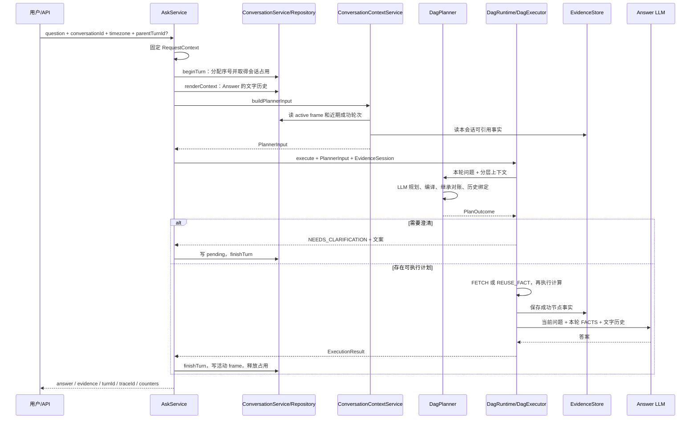

# 上下文管理

本文描述当前多轮问答的上下文管理实现，核对基线为 **1e71a7a，2026-10-13**，并同步当前工作树的 last_query_no 调整。当前主要场景是多轮追问；后续上下文选择、压缩、任务回访和历史结果引用，也归入这个主题。

**每轮自然语言问题都调用 Planner。上下文管理负责给 Planner 提供可继承的任务条件和可引用的历史事实，执行层负责校验、取数与计算。** 正确理解追问是首要目标，没有基于规则绕过 Planner 的执行分支。

本文以现有代码为准。[多轮追问的落地文档](/Users/wangzhangtao/code/CEXPilot/importants/多轮追问的落地文档.md) 是设计背景，其中完整数据集保存、跨指标投影、近期 frame 索引等不能当作已实现能力。阶段四通用数据集复用暂不实施，长期 memory 也不在当前范围内。

阅读顺序：先看第 1～3 节建立概念和调用链，再看第 4～8 节理解状态、规划及事实绑定，最后用第 9 节的具体例子串起来。基础计划协议见 [Plan 与指标元数据](/Users/wangzhangtao/code/CEXPilot/docs/Plan与指标元数据.md)，时间与计算细节分别见 [时间窗口](/Users/wangzhangtao/code/CEXPilot/docs/时间窗口.md)、[聚合指标](/Users/wangzhangtao/code/CEXPilot/docs/聚合指标.md)。

与落地文档前三阶段的对应关系：

| 阶段 | 当前代码主线 | 本文位置 |
| --- | --- | --- |
| 一：结构化上下文与每轮规划 | 轮次生命周期、QueryFrame、上下文组装、继承对账、澄清 | 第 3～7、10 节 |
| 二：语义上必要的历史结果引用 | FACT 持久化、候选索引、pinned_result、绑定到本轮 DAG | 第 8～9 节 |
| 三：观测与上线验证 | 上下文事件、复用决策、独立计数、追问探针 | 第 11、13 节 |

这些是已落地的实现主线，不表示所有边界场景已通过验收；现有缺口集中列在第 12 节。

## 1. 先分清：任务条件、历史数据、临时上下文

用户先问“昨天币安 BTC 最高价”，再问“最低价呢”，系统需要继承币种、交易所和时间条件，但不能拿最高价数字计算最低价。

用户先问“现在价格”，再问“比刚才涨了多少”，则既要继承查询条件，也必须拿到刚才那个实际价格，作为比较基线。

这两件事由不同对象负责：

| 概念 | 解决的问题 | 当前实现 |
| --- | --- | --- |
| Conversation，会话 | 这些轮次属于哪段对话 | conversationId，conversation 表 |
| Turn，轮次 | 哪一次用户输入、执行和回答 | turnId、queryNo，conversation_query 表 |
| QueryFrame，查询任务状态 | 当前正在讨论什么对象、指标和条件 | conversation_state.active_frame_json |
| Clarification，澄清 | 系统还缺什么信息，需要用户补什么 | needs_clarification / clarify、pendingClarification |
| EvidenceFact，持久化事实 | 之前真正查到了什么数据，来自哪一轮 | conversation_artifact，当前 kind=FACT |
| PlannerInput，规划输入 | 本轮模型可见的上下文，以及服务端对应的结构化对象 | contextText、activeFrame、evidence 候选 |
| ExecutionBindings，执行绑定 | 本轮哪个指标节点使用哪个历史事实 | physicalNodeId → ReuseFact；未绑定节点正常取数 |
| DagContext，执行上下文 | 当前 DAG 的中间结果在哪里 | 每次 execute 新建，按本轮节点 ID 存 ToolResult |

**QueryFrame 不等于聊天摘要，也不等于行情数据。** 它描述任务。EvidenceFact 描述实际产出；DagContext 只存在于一次执行中，不承担跨轮存储。

“追问”和“澄清”也不同：

- 追问：用户主动延续或修改问题，例如“那 OKX 呢？”。
- 澄清：系统无法可靠执行，问“你指哪一家交易所？”，等待用户回复。
- 用户回答澄清问题后，也是新的一轮，仍由 Planner 解析并生成完整计划。

## 2. ID、版本和引用分别管什么

| 名称 | 生命周期与作用 | 不能混用的地方 |
| --- | --- | --- |
| conversationId | 多轮共用；查状态与事实时的会话范围 | 与访客标识 visitorId 不同 |
| queryNo | 会话内递增编号，接受请求时分配 | 不是按完成时间排序 |
| turnId | 标识一轮；失败或澄清也有轮次 | 不等于 traceId |
| traceId | 标识该轮的执行回放 | 忙碌请求不创建 trace |
| frameId | QueryFrame 的身份 | 当前每次正常生成 frame 都新建，尚非稳定任务 ID |
| conversation_state.version | 释放本轮占用时递增的数据库状态版本 | 不等于 frame.version |
| QueryFrame.version | JSON 内的版本字段 | 当前工厂方法固定写 1，未实现逐次递增 |
| fencingToken | 每次取得执行占用时递增；提交时防止旧执行者覆盖新状态 | 是执行权校验，不是业务条件版本 |
| m1、m2 | Planner 逻辑指标组 ID | 每轮可以重复，不能跨轮定位事实 |
| metric_0、metric_1 | 编译后当前 DAG 的物理节点 ID | 每轮重新分配 |
| factId / artifact_id | 一条持久化事实的 UUID | 跨轮引用的实际身份 |
| fact_1、fact_2 | 本轮 Planner 候选列表中的短别名 | 每轮按候选顺序重新分配，不是永久 ID |

例如同一个事实，本轮叫 fact_1，下轮有新事实加入后可能叫 fact_3。**模型只能选择本轮提供的短别名，服务端负责解析到真正的 factId。**

## 3. 一次请求如何贯穿这些对象

代码入口：[AskService](/Users/wangzhangtao/code/CEXPilot/src/main/java/com/cexpilot/api/AskService.java)、[DagRuntime](/Users/wangzhangtao/code/CEXPilot/src/main/java/com/cexpilot/dag/DagRuntime.java)。



图中省略了出域、规划失败、忙碌和异常分支，详见第 10 节。

具体调用顺序：

1. AskService 固定 requestTime 和用户时区，整个请求共用时间基准。
2. getOrCreateConversation 确定会话。未传 conversationId 时，当前约定复用该 visitor 最近活跃的会话；没有才创建。
3. beginTurn 在短事务内取得占用，建立 RUNNING 轮次。有有效占用时返回 busy，不调用 Planner。
4. 分别组装 Planner 与 Answer 上下文，然后启动 trace、发送 SSE meta、记录 CONTEXT_RESOLVED。
5. DagRuntime 调用 Planner。合法计划返回 CompiledPlan 和可选 ExecutionBindings；执行前通过回调把 CompiledPlan 交给 AskService，供成功或失败收尾使用。
6. DagExecutor 执行本轮 DAG。整个 DAG 返回后，Runtime 逐节点保存成功事实，**保存发生在 Answer 之前**。
7. 调用 Answer；成功后根据编译计划和 evidence 创建 QueryFrame，结束 trace 和 turn。
8. 异常走失败收尾。当前实现对早期异常、失败状态继承存在边界，不能只凭这条成功链判断全部场景已覆盖。

注意：“每轮都调用 Planner”表示始终经过规划阶段，不保证只调用一次模型。编译错误、继承对账或绑定修复可能增加调用次数。

## 4. QueryFrame：怎样保存可继承的任务条件

实现：[QueryFrame](/Users/wangzhangtao/code/CEXPilot/src/main/java/com/cexpilot/conversation/QueryFrame.java)、[EffectiveTarget](/Users/wangzhangtao/code/CEXPilot/src/main/java/com/cexpilot/metric/EffectiveTarget.java)、[CompiledPlan](/Users/wangzhangtao/code/CEXPilot/src/main/java/com/cexpilot/metric/CompiledPlan.java)。

### 4.1 frame 从哪里来

Planner JSON 先被解析为 LogicalPlan，再由 MetricPlanCompiler.compileFull 编译：

```text
CompiledPlan
  logicalPlan      类型化逻辑计划
  logicalPlanJson  plan 部分的原 JSON
  dagPlan          可执行物理节点
  branches         逻辑组 → 交易所 → 物理节点
  targets          每个物理指标节点的有效条件
```

QueryFrame.fromCompiledPlan 使用 targets 和本轮 evidence 创建 frame。程序不解析 Answer 的自然语言来反推状态，因此答案漏说一个条件，不会直接导致该条件从编译期 targets 消失。

但当前只存一个活动 frame。每次有编译计划并正常完成时，生成新 frame 覆盖旧 frame；**尚未实现近期 frame 列表和回访检索。**

### 4.2 实际字段

| QueryFrame 字段 | 当前写入内容 |
| --- | --- |
| frameId / conversationId / sourceTurnId | 新 UUID、所属会话、本轮 ID |
| version | 当前固定 1 |
| originalQuestion | 本轮 question，不一定是整个任务最初的问题 |
| requestTime / timezone | AskService 收到的请求基准；用户未传 timezone 时这里可为 null |
| targets | 编译后的单指标有效条件，按交易所展开 |
| focus | evidence_nodes：node_id、type、ok、identity/operator、fact_id、reused |
| pendingClarification | 新成功 frame 为 null；澄清轮次可更新已有 frame |
| lastAttempt | 当前工厂方法只写本轮 turnId + SUCCEEDED |

一个 EffectiveTarget 包含：groupId、physicalId、exchange、metric、queryShape、instrument、timeExpression、interval、includeUnclosed、count、depth、unit、provider、catalogVersion，以及部分条件来源。

**多对象按节点保存很重要。** “币安 BTC + OKX ETH”不能压成 exchange=[binance,okx]、base=[BTC,ETH] 后丢掉两者配对关系。当前存储保留了配对，但继承对账尚未完整保留这种关联，见第 12 节。

### 4.3 编译期条件与执行期条件要区分

当前 targets 主要是编译期条件：

- timeExpression 是 TimeSpec JSON，例如 calendar_period / offset=-1，不是已消解的绝对窗口。
- interval 未指定时可能仍为 null，表示交给查询服务选择。
- settle 等默认值由编译绑定补齐。
- 实际 requested_range、effective_range、candle_interval 和 coverage 在 Provider 返回的 MetricResultJson 中。

因此，不能认为“frame 有 targets”就已经保存了所有执行期 meta。当前自动选择出的 5m 没有回填到 targets，绝对区间也主要保留在事实 payload 中。

ConditionOrigin 枚举有 EXPLICIT / INHERITED / DEFAULT，但当前编译器依据“计划是否填写字段”标 EXPLICIT 或 DEFAULT，INHERITED 尚未实际参与构造。它目前不能完整区分“用户要求 5m”和“模型从上轮复制了 5m”。

### 4.4 focus 与 lastAttempt 的现状

focus 已保存事实引用，但当前 Planner 的上下文渲染没有输出 focus。因此，“存下了焦点”与“模型能用到焦点”仍是两回事。

lastAttempt 目前也没有在异常时更新。失败轮次的计划可以存在 conversation_query.logical_plan_json，但下一轮加载器没有把它作为最近失败任务提取出来。这些字段名表达了设计方向，不代表关联逻辑已经全部完成。

## 5. Planner 和 Answer 各自收到什么上下文

实现：[ConversationContextService](/Users/wangzhangtao/code/CEXPilot/src/main/java/com/cexpilot/conversation/ConversationContextService.java)、[ConversationService](/Users/wangzhangtao/code/CEXPilot/src/main/java/com/cexpilot/conversation/ConversationService.java)、[PlannerInput](/Users/wangzhangtao/code/CEXPilot/src/main/java/com/cexpilot/conversation/PlannerInput.java)。

### 5.1 PlannerInput 的四个成员

```java
record PlannerInput(
    String contextText,
    QueryFrame activeFrame,
    List<EvidenceAssembler.Entry> evidence,
    int textHistoryCount
) {}
```

这不是给模型的四段 JSON：

- contextText 注入 dag_planner.txt 的 conversation_context。
- activeFrame 供 InheritanceValidator 在程序里对账。
- evidence 保存“短别名 → EvidenceFact”的同一份映射，供 EvidenceBinder 校验。
- textHistoryCount 用于观测。

**模型看到的别名与服务端用于绑定的候选必须来自同一个 PlannerInput，不能渲染后再独立加载一份列表重新编号。**

### 5.2 contextText 的实际顺序

```text
【活动查询状态】
frame 请求时间、时区
- 每个 target 的交易所、指标、instrument、时间表达、粒度、count/depth 等
【待补条件】              仅已有 frame 内存在 pending 时输出

【可引用历史事实】
- ref=fact_1 ... 身份、区间或 count、observed_at、fetched_at、quality
- ref=fact_2 ...

【近期问答】
用户（时间）：...
助手：...
```

近期文字历史最多 5 条，每条答案截到 500 字符。查询只选 turn_status=SUCCEEDED 或旧数据 NULL，RUNNING、FAILED、NEEDS_CLARIFICATION 都被排除。

活动 frame JSON 解析失败时降级到文字历史；历史事实加载失败时降级为空候选并记日志。并不是所有数据库异常都会被吞掉，例如 findActiveFrameJson 的数据库读取异常不在其 JSON 解析 catch 内。

当前没有统一 token 预算管理：文字答案有硬截断，frame 和事实索引没有按相关性检索、摘要或总预算压缩。

### 5.3 Answer 的上下文不同

Answer 仍用 ConversationService.renderContext：最近 5 条成功问答，每条答案最多 300 字符，不带 Planner 侧的结构化 frame 和候选段。

Answer 的 user message 包括：

```text
本轮原始问题
<FACTS>
  当前 DAG 产出的指标与计算结果，可能包含已验证的历史复用事实
</FACTS>
<QUERY_STATUS>
  Planner 的查询缺口说明
</QUERY_STATUS>
```

复用事实会附 reused、source_turn_id、observed_at（有则附）、fetched_at。Answer 应根据 FACTS 表达历史时间，不能把“本轮可用事实”理解成“本轮新抓取行情”。

完整事实进入 Answer；候选事实只是给 Planner 选择的索引，两者不是同一份内容。当前尚未单独提取 AnswerService，回答调用和 evidence 组装仍在 DagRuntime。

## 6. Planner：完整计划、追问声明与修复

实现：[DagPlanner](/Users/wangzhangtao/code/CEXPilot/src/main/java/com/cexpilot/dag/DagPlanner.java)、[InheritanceValidator](/Users/wangzhangtao/code/CEXPilot/src/main/java/com/cexpilot/dag/InheritanceValidator.java)、[提示词](/Users/wangzhangtao/code/CEXPilot/src/main/resources/prompts/dag_planner.txt)。

### 6.1 输出协议

普通查询仍然返回完整的 metrics / calculations。多轮增加以下信封字段：

```json
{
  "in_domain": true,
  "plan": {
    "metrics": [],
    "calculations": []
  },
  "reply": null,
  "changes": [],
  "new_frame": false,
  "needs_clarification": false,
  "clarify": null
}
```

这是字段布局示例，空计划不代表一个可执行行情查询。

| 字段 | 语义 | 当前程序用途 |
| --- | --- | --- |
| changes | 模型声明本轮改变的条件键 | 与活动 targets 的 diff 对账 |
| new_frame | 模型判断是否为新任务 | true 时不做继承对账；没有独立的旧 frame 管理行为 |
| needs_clarification | 缺条件或指代不明，需要提问 | 返回澄清分支，不执行 DAG、不开 Answer |
| clarify | 给用户的澄清问题 | 优先使用，缺失时尝试 reply，再走修复/兜底 |
| reply | 范围、缺口、拒答或简短说明 | 与行情 FACTS 分开处理 |

当前 changes 键包括 exchange、base、metric、shape、time、interval、count、depth、include_unclosed。它是模型的意图声明，不是服务端可直接执行的 JSON patch。完整计划仍是执行依据。

### 6.2 从模型响应到 PlanOutcome

```text
LLM 响应
  → 解析 JSON、检查 in_domain
  → 出域：返回边界说明
  → needs_clarification：返回澄清或修复文案
  → plan 缺失但有合法 reply：返回能力/范围说明
  → compileFull + PlanValidator
  → 继承对账
  → EvidenceBinder：引用协议、实体绑定、比较输入检查
  → FOLLOWUP_PLAN
  → PlanOutcome
```

PlanOutcome 持有 Optional<CompiledPlan>、needsClarification、reply、lastError、bindings、token 汇总和 llmCalls。Runtime 依据这些字段决定执行、澄清还是直接结束。

### 6.3 INHERIT_SHADOW 到底是什么

当 activeFrame 存在且 new_frame=false：

1. 比较新旧 targets，计算实际变化键。
2. 检查实际变化是否全部包含在 changes 中；多声明目前不拦截。
3. 首次响应漏报变化，向模型发送修复提示。
4. 后续响应仍漏报，记录 INHERIT_SHADOW 并继续绑定和执行。

默认 planner-max-retries=2，含首次最多 3 次调用。这里的“shadow”是**把继承声明不一致软放行并记审计**，不是另跑一份查询比较结果，也不证明计划语义正确。

当前 diff 对各字段取集合比较；时间另用 TimeRangeResolver 等判断。两个交易所与币种交换配对可能仍得到相同集合，因此这套检查不能作为完整的语义正确性证明。

### 6.4 两种额外修复

- 澄清标志为 true 但没有文案：首次要求修复；之后仍缺文案，用固定澄清话术并记录 CLARIFY_FALLBACK。
- 历史绑定失败：允许一次绑定修复，再次失败返回历史不可恢复的澄清。它与其他错误共用规划循环预算，并非额外独立的无限重试。

当前绑定失败提示仍允许模型改成 latest；这样可能绕过原历史引用要求。应按第 12 节的限制理解，不能据“有绑定修复”推断已经保证不可恢复时必定澄清。

## 7. Clarification：澄清状态如何进出

### 7.1 从 Planner 到数据库

例如当前 frame 有币安与 OKX 两组费率，用户说“它的均值呢”，Planner 可返回：

```json
{
  "in_domain": true,
  "plan": null,
  "reply": null,
  "needs_clarification": true,
  "clarify": "您想对币安还是 OKX 那组资金费率求均值？"
}
```

Runtime 返回 ExecutionResult(turnStatus=NEEDS_CLARIFICATION, clarify=文案)。AskService 先调用 recordPendingClarification，再调用 finishTurn。

当前写入已有 frame 的 pending 内容：

```json
{
  "clarify": "您想对币安还是 OKX 那组资金费率求均值？",
  "turnId": "本轮真实 turnId"
}
```

没有保存独立的 missingFields 列表、候选任务快照或待完成的部分 LogicalPlan。已知条件来自原活动 frame。

下一轮用户说“币安”，ContextService 渲染待补问题及活动 targets，Planner 再返回一份完整计划。正常完成后新建的 frame.pendingClarification 为 null，完成这次澄清接续。

### 7.2 必须知道的现有边界

SQL 只在 active_frame_json 非空时 JSON_SET；新会话没有 frame 时，pending 更新无效。同时澄清轮次不进入 recentQueries，所以**首轮就需要澄清的任务目前可能在下一轮失去上下文**。

澄清新任务时，也可能把待补问题挂到旧成功 frame 上。任务原问题、已确定条件、缺失条件需要在后续迭代中成为独立的 pending task；当前代码尚未完成这部分。

不要把 NEEDS_CLARIFICATION 当作异常失败。它是正常的对话决策，但也不代表完成了用户要求的取数任务。

## 8. EvidenceFact：历史结果怎样变成本轮可计算输入

实现：[EvidenceStore](/Users/wangzhangtao/code/CEXPilot/src/main/java/com/cexpilot/evidence/EvidenceStore.java)、[EvidenceAssembler](/Users/wangzhangtao/code/CEXPilot/src/main/java/com/cexpilot/evidence/EvidenceAssembler.java)、[EvidenceBinder](/Users/wangzhangtao/code/CEXPilot/src/main/java/com/cexpilot/dag/EvidenceBinder.java)、[ExecutionBindings](/Users/wangzhangtao/code/CEXPilot/src/main/java/com/cexpilot/metric/ExecutionBindings.java)。

### 8.1 保存的不是完整接口响应

Runtime 在 DAG 执行结束后、Answer 之前保存成功节点：

| 节点 | 保存内容 |
| --- | --- |
| 普通 metric 节点 | MetricResultJson 输出，含指标身份、value 或 samples、范围及质量信息 |
| REUSE_FACT 节点 | 沿用原 factId，不重复插入 |
| 计算节点 | derived=true，保存计算结果与已知上游 sourceFactIds |
| ToolResult 失败或无 data | 不保存事实 |
| payload 超过 256KB | 保存审计行，payload_json=NULL，metadata 记录 cache_skip_reason；不进候选 |

当前只实现 kind=FACT，没有保存 SourceDataset、完整 Candle 列表，也没有 PROJECT_DATASET。

因此 price.high 的事实只含最高价等标准字段；虽然 Provider 曾拿到完整 K 线，最低价字段并未作为数据集保存。追问最低价需要重新查询。

### 8.2 EvidenceFact 的身份与时间

| 字段组 | 内容 |
| --- | --- |
| 身份 | factId、conversationId、sourceTurnId、sourceTraceId |
| identity | metric、exchange、shape、instrument、unit、provider、catalogVersion、适用的参数与 requested_range |
| observedAt | 快照 payload.as_of；序列目前可为 null |
| quality | sample_complete、range_complete、contains_unclosed 等摘要 |
| payload | 完整标准指标结果或计算结果 |
| derived / sourceFactIds | 是否为派生结果及其依赖 |
| lookupKey | 会话及身份 JSON 的 SHA-256；当前不是自动缓存查询入口 |
| fetchedAt / retainedUntil | 获取时间字段、候选保留截止 |
| schemaVersion | 当前为字符串 "1" |

当前 Runtime 传给 saveFacts 的时间是 requestTime，所以 fetchedAt 实际记录请求开始时刻，还不是精确的接口完成时刻。保留截止按该时间加 24 小时计算。

24 小时是**历史引用的保留策略**，不是“行情 24 小时内都新鲜”。latest 节点始终正常取数，不因存在同身份 FACT 就自动命中。

### 8.3 Planner 如何引用历史

指标组新增两个字段：

```json
{
  "id": "m1",
  "metric": "funding.rate_settled",
  "exchanges": ["binance"],
  "instrument": {
    "market_type": "perpetual",
    "base": "BTC",
    "quote": "USDT"
  },
  "query_shape": "recent_n",
  "count": 10,
  "reference_mode": "pinned_result",
  "evidence_ref": "fact_1"
}
```

- reference_mode 缺省或 latest：本轮取数。
- pinned_result：绑定指定历史事实，保留其原样本和时间。
- evidence_ref 只能选择本轮候选短别名，不允许直接给数据库 ID。
- 一个 FACT 对应一个交易所，pinned 指标组只能含对应的一个 exchange。
- derived=true 当前全部拒绝绑定，不只是禁止把派生标量当成样本集。

设计文档中的 FIXED_RANGE 是时间适用性概念；当前模型协议没有第三个 reference_mode=fixed_range。固定历史区间正常用 TimeSpec 表达，是否 pinned 另行决定。

### 8.4 EvidenceBinder 做哪些检查

```text
evidence_ref 是否属于本轮候选
  → 按 conversationId + factId 重新加载
  → 非派生、schemaVersion 一致、仍在保留期
  → metric / exchange / shape / instrument / unit / provider 一致
  → catalogVersion 一致
  → count / depth / interval / includeUnclosed 一致
  → 时间类请求消解后的 requested_range 一致
  → 为物理节点建立 ReuseFact
```

这套校验证明身份一致，不证明 Planner 对用户指代的选择正确。选中了错误但同身份的历史价格，仍可能通过身份校验，所以焦点和来源轮次的上下文也很重要。

Binder 没有通用数据集的匹配、切片或重采样。质量 metadata 随 payload 保留，后续计算仍通过 validateSource 检查不完整来源，不能因为绑定成功就认为所有计算都可做。

### 8.5 旧事实为何不直接用旧节点 ID

```text
本轮逻辑引用：
  {{m1.binance.samples}}

编译结果：
  m1 / binance → metric_0

服务端绑定：
  metric_0 → ReuseFact(factId, sourceTurnId, observedAt, fetchedAt, payload)

执行：
  把 payload.deepCopy() 作为本轮 metric_0 的 ToolResult
  写入本轮 DagContext
  avg 继续通过当前节点引用读取 samples
```

这样 ReferenceResolver 和计算算子仍只处理当前 DAG。跨轮问题由“加载历史事实并绑定到本轮节点”解决，不把旧 DagContext 复活。

实际 ExecutionBindings 只存 reusedByNode；**没有绑定的节点隐式 FETCH**，不是每个节点都显式存一个 FETCH 对象。REUSE_FACT 由服务端生成，模型不负责决定数据库读取方式。

执行器对复用节点记录 FACT_REUSED，普通指标记录 METRIC_RESULT，计算继续记录 TOOL_CALL。

## 9. 三个例子，把输入、存储和执行串起来

下面的 UUID、短名和示意值用于说明结构，不表示本次重新请求了线上服务。

### 9.1 最高价 → 最低价：继承条件，重新取数

沿用设计文档中的历史问题：“昨天币安 BTC 永续的最高价？”。原 trace 的最高价为 83955 USDT，程序自动选择 5m、完整覆盖 288 根。

下面用这条问题和历史数值说明**按当前代码执行时**的存储结构，不表示旧 trace 当时已写入这些新表。追问假设发生在同一自然日，暂不展开跨午夜的时间继承。

首次 Planner 选择：

```json
{
  "in_domain": true,
  "plan": {
    "metrics": [
      {
        "id": "m1",
        "metric": "price.high",
        "exchanges": ["binance"],
        "instrument": {"market_type": "perpetual", "base": "BTC", "quote": "USDT"},
        "query_shape": "range_statistic",
        "time": {"type": "calendar_period", "unit": "day", "offset": -1, "segment": "full", "extent": "full_period"}
      }
    ],
    "calculations": []
  },
  "reply": null
}
```

执行完成后保存：

```text
conversation_query:
  turn-1，question，SUCCEEDED，logical_plan_json，answer，traceId

conversation_state.active_frame_json:
  targets[0].metric = price.high
  targets[0].exchange = binance
  targets[0].instrument = BTC / USDT / USDT / perpetual
  targets[0].timeExpression = calendar_period / day / -1
  targets[0].interval = null
  targets[0].intervalOrigin = DEFAULT
  focus.evidence_nodes[0].fact_id = 最高价事实的 UUID

conversation_artifact:
  kind = FACT，metric = price.high
  payload.value = 83955
  payload.candle_interval = 5m
  payload.requested_range = 实际历史自然日
  payload.coverage.range_complete = true
```

**当前 frame 里自动粒度仍为 null，5m 在 FACT payload 中。** 这与设计文档里的“执行 meta 已全部写入 frame”示例有区别。

追问“那最低价呢？”：Planner 获得活动条件，返回完整的 price.low 计划，通常声明 changes=["metric"]，其余查询条件保持同一含义。程序编译、校验后正常访问 K 线 Provider，生成新的最低价 FACT，再调用 Answer。

调用情况：规划阶段至少 1 次 LLM，可能有修复；最低价节点真实取数；Answer 1 次。**当前不存在拿最高价 FACT 投影最低价的路径。**

### 9.2 最近 10 期 → 均值：引用同一批样本

首问“币安 BTC 最近 10 期已结算资金费率”，Provider 返回升序 samples，程序保存原始 FACT。下一轮候选段为它分配 fact_1。

追问“刚才这 10 期的平均值呢”，Planner 期望返回：

```json
{
  "in_domain": true,
  "plan": {
    "metrics": [
      {
        "id": "m1",
        "metric": "funding.rate_settled",
        "exchanges": ["binance"],
        "instrument": {"market_type": "perpetual", "base": "BTC", "quote": "USDT"},
        "query_shape": "recent_n",
        "count": 10,
        "reference_mode": "pinned_result",
        "evidence_ref": "fact_1"
      }
    ],
    "calculations": [
      {
        "id": "c1",
        "operator": "avg",
        "input": {"kind": "field", "collection": "{{m1.binance.samples}}", "field": "value"}
      }
    ]
  },
  "reply": null
}
```

执行过程：

1. 编译 m1/binance → metric_0，c1 依赖 metric_0。
2. Binder 校验 fact_1 所指原始 FACT，建立 metric_0 的 REUSE_FACT。
3. Executor 载入原 samples，不调用 Funding Provider。
4. avg 按当前来源与单位规则执行，生成计算结果。
5. 原始 FACT 沿用 ID；均值保存为新的 derived FACT，sourceFactIds 指向原样本。
6. Answer 看到本轮均值及其原样本来源。
7. 新 frame.focus 同时包含样本节点和计算节点引用。

这一轮仍调用 Planner 和 Answer。复用是为了保证“这 10 期”不变，不只是节省一次接口请求。

用户若改问“现在最新 10 期的均值”，则应使用 latest/缺省模式，重新取当前集合。同一 count=10 不代表同一批样本。

### 9.3 当前价 → 比刚才涨多少：同指标、两个版本

Planner 需要两个逻辑组：

```text
m_old：price.last / binance / BTC / snapshot
       reference_mode=pinned_result，evidence_ref=fact_1

m_now：price.last / binance / BTC / snapshot
       reference_mode=latest

c1：relative_change
    current  = {{m_now.binance.value}}
    baseline = {{m_old.binance.value}}
```

虽然 metric、交易所和币种完全相同，仍必须编译成两个物理节点：一个载入旧 FACT，一个重新获取当前价。不能按 metric 名去重成一个节点。

本轮新增当前价 FACT 和变化率 derived FACT，旧价格不覆盖。Answer 应区分两个观测时刻。

当前比较输入校验针对这一方向做了限制，但对“旧价减新价”等反向请求过于严格，见第 12 节。不能把这个例子理解成所有比较都必须新值在左。

## 10. 表结构、事务与轮次状态

权威定义见 [schema.sql](/Users/wangzhangtao/code/CEXPilot/src/main/resources/db/schema.sql)；已有库迁移见 [007](/Users/wangzhangtao/code/CEXPilot/src/main/resources/db/migrations/007_conversation_turn_lifecycle.sql)、[008](/Users/wangzhangtao/code/CEXPilot/src/main/resources/db/migrations/008_conversation_artifact.sql)、[009](/Users/wangzhangtao/code/CEXPilot/src/main/resources/db/migrations/009_turn_counters.sql)。这里解释字段职责，不再复制一套可能漂移的建表 SQL。

### 10.1 四张业务表怎样分工

| 表 | 核心字段 | 读写位置 |
| --- | --- | --- |
| conversation | conversation_id、visitor_id、title、last_active_at | 会话选择与历史入口 |
| conversation_query | query_no、turn_id、parent_turn_id、turn_status、question、answer、trace_id、logical_plan_json、started_at/finished_at | beginTurn 插入，finishTurn 补终态；recentQueries 读成功历史 |
| conversation_state | version、last_query_no、running_turn_id、lease_until、fencing_token、active_frame_json | 执行占用与唯一活动任务状态 |
| conversation_artifact | artifact_id、kind、source_turn_id/trace_id、metadata_json、payload_json、derived、lookup_key、fetched_at、retained_until | 保存标准事实，列出候选和按会话加载 |

当前 conversation_query **没有**设计稿中的 effective_request_json、route、artifact_refs_json；查询条件主要在 active frame，来源引用在 FACT 和 focus 中。

metadata_json 保存 identity、observed_at、quality、source_fact_ids、cache_skip_reason；payload_json 是完整结果。lookup_key 不是唯一键，同身份的两个快照可以同时保存。

Trace 的 ask_trace / trace_event 是执行回放，不作为运行时历史事实仓库。Answer 失败后，已写 FACT 仍可能存在，即使该轮没有成功活动 frame。

### 10.2 beginTurn 与 finishTurn

last_query_no 表示会话最后已分配的轮次序号，未分配时为 0。每次成功取得占用后加 1，新值直接作为本轮 queryNo；忙碌请求不推进计数。首次创建状态行并取得占用时直接写 1。

已有 next_query_no 列的数据库需执行 [010_last_query_no.sql](/Users/wangzhangtao/code/CEXPilot/src/main/resources/db/migrations/010_last_query_no.sql)，按 last_query_no = next_query_no - 1 转换；历史 conversation_query.query_no 不变。旧版 007 迁移保留历史定义，新建库以当前 schema.sql 为准。迁移需停止旧应用、等待在途请求结束，完成后再启动新版。

beginTurn 是短事务：

```text
acquireTurn：
  无占用或租约过期 → running_turn_id = 本轮，last_query_no + 1，fencing_token + 1
  未过期占用       → 不取得执行权，返回 busy

取得占用：
  queryNo = 返回的 last_query_no
  insertRunningTurn(..., RUNNING)
```

finishTurn 也是短事务：

```text
更新轮次 answer / trace / logical_plan / status / finished_at
如有新 frame：按 conversation + running_turn_id + fencing_token 写入
按同一占用条件释放 running_turn_id，version + 1
更新会话活跃时间
```

事务不跨 LLM 或行情请求持有数据库锁。ConversationConfig.turnLease 默认 10 分钟，目前不续租。fencing token 只保护状态写入，不会主动取消已经在运行的旧请求。

parentTurnId 当前只落库，不校验它是否与当前活动轮次一致。对旧会话 last_query_no 初始化、租约 SQL 顺序和早期异常释放的已知问题，见第 12 节。

### 10.3 三种“成功”不能混为一谈

| 情况 | 当前轮次处理 | frame / Answer |
| --- | --- | --- |
| 正常执行并回答 | 通常 SUCCEEDED | 用 CompiledPlan + evidence 新建 frame |
| 澄清 | NEEDS_CLARIFICATION；trace 仍可为 SUCCESS | 不调用 Answer；尝试更新 pending |
| 出域或无计划但有说明 | Runtime 正常返回，turnStatus 缺省转 SUCCEEDED | 没有新编译计划则不建 frame |
| 规划修复耗尽并返回固定失败话术 | 仍可能作为正常返回转 SUCCEEDED | 不执行 DAG、不调用 Answer |
| 取数节点失败但 Runtime 最终正常回答 | 没有完整 PARTIAL 状态归并，仍可能 SUCCEEDED | frame.focus 可以包含 ok=false |
| Runtime / Answer 抛异常 | FAILED | 不覆盖活动 frame，已有 FACT 不回滚 |

因此 HTTP/SSE 正常返回、trace.status=SUCCESS、用户要求完成，是三个不同判断。查看状态时还要看有无有效计划、节点结果及答案缺口。

## 11. Trace、计数和定位方法

完整 Trace 机制见 [Trace 搭建](/Users/wangzhangtao/code/CEXPilot/docs/trace搭建.md)。

| 事件 | 何时记录 | 重点字段 |
| --- | --- | --- |
| CONTEXT_RESOLVED | Planner 输入组装后 | query_no、活动 targets 摘要、pending 标志、候选数、历史条数 |
| LLM_CALL / dag_planner | 每次规划或修复 | 完整 messages、模型输出、耗时及 token |
| INHERIT_SHADOW | 修复后仍漏报 changes | 声明、差异说明、被放行的计划 |
| CLARIFY_FALLBACK | 澄清标志存在但修复后仍缺文案 | 原始 Planner 输出 |
| PLAN / PLAN_COMPILED | 计划及编译阶段 | 逻辑 JSON、物理节点、metric binding |
| EVIDENCE_REUSE_DECISION | 历史实体绑定检查 | ref、factId、REUSE/REJECT、原因、源时间 |
| FOLLOWUP_PLAN | 校验和绑定通过后 | metric 分支、FETCH/REUSE_FACT、changes、new_frame |
| FACT_REUSED | Executor 产出历史事实节点 | 当前 node、原 factId/turn、原时间 |
| CONTEXT_COMMITTED | 收尾后 | turn 状态、新事实 ID 列表、frame_updated |

Planner 的完整输入以 LLM_CALL 为准。CONTEXT_RESOLVED 只是摘要，不包含所有字段；协议别名不合法时还可能在实体绑定事件之前失败。

计数来源：

- plannerLlmCalls：Planner 循环实际调用次数，包括修复。
- answerLlmCalls：正常返回路径为 0 或 1。
- metricFetchCount：Runtime 中未绑定历史事实的 metric 结果节点数。
- calculationCount：Runtime 收集到的计算节点数，包含可能被 skipped 的节点。
- httpRequestCount：Executor 共享 AtomicInteger，通过 HttpRequestCounter 在线程中绑定；交易所 Client 每次真实请求递增，分页和重试分别计数。
- reusedFactCount：绑定并成功产出的历史事实节点数。
- toolCalls：兼容旧字段，混合节点计数，不等于 HTTP 次数。

“Planner 解析错了”按以下顺序查：

1. LLM_CALL 中是否有正确 active frame、pending 和候选？
2. Planner 完整计划的对象、形态、时间和计算方向是否正确？
3. 是否经过修复？INHERIT_SHADOW 放行了什么变化？
4. FOLLOWUP_PLAN 的数据来源是否符合“刚才”或“最新”？
5. FACT_REUSED / METRIC_RESULT 是否提供了正确事实？
6. Answer 是否正确表达了已经正确的事实？

失败路径当前未完整回填独立计数，frame_updated 也未严格代表数据库实际影响行数。因此不能仅凭汇总列断言没有发生调用或状态确实提交。

排查存储可使用只读查询：

```sql
SELECT query_no, turn_id, parent_turn_id, turn_status,
       question, logical_plan_json, trace_id
FROM conversation_query
WHERE conversation_id = :conversation_id
ORDER BY query_no;

SELECT version, last_query_no, running_turn_id, lease_until,
       fencing_token, active_frame_json
FROM conversation_state
WHERE conversation_id = :conversation_id;

SELECT artifact_id, source_turn_id, derived, metadata_json,
       fetched_at, retained_until, payload_json IS NOT NULL AS has_payload
FROM conversation_artifact
WHERE conversation_id = :conversation_id
ORDER BY fetched_at DESC, artifact_id DESC;
```

冒号参数由客户端绑定。需要查看明细时再取指定 artifact 的 payload，避免一次输出全部大 JSON。

## 12. 当前边界：阅读代码时不要误认为已经具备

以下是当前实现状态，不是这篇文档要新增的功能。详细证据和复现见 [前三阶段实现审查](/Users/wangzhangtao/code/CEXPilot/importants/多轮追问前三阶段实现审查-2026-10-12.md)。

| 方向 | 当前边界 | 影响 |
| --- | --- | --- |
| 澄清接续 | 无活动 frame 时 pending 写不进去；澄清轮次不进历史 | 首轮澄清可能丢任务 |
| 失败接续 | FAILED 不进历史，lastAttempt 未更新 | “重试”可能接到旧成功任务 |
| 任务回访 | 只有一个活动 frame，frameId 每次新建 | 回到最初任务不能可靠定位 |
| 条件来源 | INHERITED 未真正构造，执行后的自动值未回填 | 难以区分用户约束与系统默认 |
| 节点对账 | 按字段集合比较 | 多对象配对互换可能漏检 |
| 历史焦点 | focus 保存但未渲染 | 多个同身份样本时指代仍依赖文字 |
| 历史不可恢复 | 修复提示允许改 latest | 原快照要求可能被弱化 |
| 比较方向 | 统一要求旧值在右/基准侧 | 反向比较可能被错误修复 |
| 轮次初始化 | 新状态未按旧 query_no 初始化 | 存量会话升级可能撞唯一键 |
| 执行占用 | 租约赋值顺序、try 前异常、无续租等 | 异常恢复与占用释放仍需完善 |
| 多标签页 | parentTurnId 只记录 | 串行请求也可能接错其他页的新任务 |
| FACT 容量 | 只有单条 256KB，候选查询无总量上限 | 会话数据和 Planner 输入可能增长 |
| 清理 | 有 deleteExpired 方法，无应用调度调用 | 24h 过期只是候选过滤，不等于删库 |
| 观测 | 失败计数、跳过节点统计和提交结果有缺口 | 不能只看汇总数字判断真实行为 |

明确未实现：

- 通用 SourceDataset / 完整 Candle 缓存与跨指标投影。
- Planner 免调用分支。
- 长期 memory、向量召回、跨会话偏好。
- 模型摘要驱动的上下文压缩、统一 token 预算。
- 多分支会话及可靠的旧 frame 回访。

未来迭代先更新本篇对应章节的“实际数据流与契约”，再更新边界；不要把计划中的类型直接加入现有结构图。

## 13. 配置、测试与扩展入口

### 13.1 当前配置和硬编码值

| 项目 | 当前值 / 位置 |
| --- | --- |
| 同会话执行租约 | ConversationConfig.turnLease，默认 10 分钟；配置前缀 conversation |
| Planner 修复次数 | dag.planner-max-retries，环境变量 DAG_PLANNER_MAX_RETRIES，默认 2 |
| Planner 文字历史 | 5 条，答案最多 500 字符，ConversationContextService |
| Answer 文字历史 | 5 条，答案最多 300 字符，ConversationService |
| FACT 单条 payload | 256 × 1024 字节，EvidenceStore.MAX_PAYLOAD_BYTES |
| FACT 保留期 | 24 小时，EvidenceStore.RETENTION |
| FACT schemaVersion | "1"，EvidenceStore.SCHEMA_VERSION |

这些大多不是动态开关。Prompt 和目录变更仍遵循项目的加载与部署方式，不因上下文模块引入热更新。

### 13.2 改哪个行为，先看哪里

| 目标 | 核心入口 | 直接测试 |
| --- | --- | --- |
| 改 prompt 的上下文内容、优先级或裁剪 | ConversationContextService、EvidenceAssembler | ConversationContextServiceTest |
| 改查询状态字段与来源 | QueryFrame、EffectiveTarget、MetricPlanCompiler | MetricPlanCompilerRegressionTest、ConversationContextServiceTest |
| 改追问协议、澄清与修复 | dag_planner.txt、DagPlanner、InheritanceValidator | DagPlannerTest、InheritanceValidatorTest |
| 改历史引用的可用性 | LogicalPlanParser、EvidenceBinder、EvidenceStore | DagPlannerTest、EvidenceStoreTest |
| 改历史结果如何进入计算 | ExecutionBindings、DagExecutor、MetricCalculationContext | DagExecutorTest、DagRuntimeTest |
| 改轮次、事务和并发 | AskService、ConversationService、ConversationRepository | AskServiceTest、ConversationServiceTest、ConversationTurnConcurrencyTest |
| 改计数或 trace | DagRuntime、DagExecutor、TraceRepository、HttpRequestCounter | AskServiceTest、DagRuntimeTest、HttpRequestCounterTest |

内存并发测试模拟状态机，不执行实际 MySQL upsert。涉及 SQL 赋值、存量迁移和事务行为时，应补实际数据库集成验证，不能只依赖该内存测试。

验证代码时先 test-compile，再选择直接相关测试；不默认全量执行。示例：

```bash
mvn test-compile
mvn test -Dtest=ConversationContextServiceTest,DagPlannerTest,InheritanceValidatorTest
```

真实模型意图理解仍需案例评测。mock LLM 可以验证状态和执行机制，不能证明模型能正确继承、理解否定条件或选择历史样本。

[scripts/probe_followup.py](/Users/wangzhangtao/code/CEXPilot/scripts/probe_followup.py) 保留 P 系复现探针和 F 系验收链，支持 phase/baseline 等选项。它会请求线上服务，只在用户明确要求执行时运行，跑前备份产物。未触发澄清、失败、过期等前提的用例不能当作对应分支已验证，判据现状见审查报告。

### 13.3 推荐的源码阅读顺序

1. [AskService](/Users/wangzhangtao/code/CEXPilot/src/main/java/com/cexpilot/api/AskService.java)：先找到请求、轮次和 trace 的外层边界。
2. [QueryFrame](/Users/wangzhangtao/code/CEXPilot/src/main/java/com/cexpilot/conversation/QueryFrame.java) 与 [ConversationContextService](/Users/wangzhangtao/code/CEXPilot/src/main/java/com/cexpilot/conversation/ConversationContextService.java)：弄清存了什么、模型实际看到了什么。
3. [DagPlanner](/Users/wangzhangtao/code/CEXPilot/src/main/java/com/cexpilot/dag/DagPlanner.java)：看完整计划、澄清和修复如何返回。
4. [InheritanceValidator](/Users/wangzhangtao/code/CEXPilot/src/main/java/com/cexpilot/dag/InheritanceValidator.java) 与 [EvidenceBinder](/Users/wangzhangtao/code/CEXPilot/src/main/java/com/cexpilot/dag/EvidenceBinder.java)：区分条件对账与数据身份校验。
5. [DagRuntime](/Users/wangzhangtao/code/CEXPilot/src/main/java/com/cexpilot/dag/DagRuntime.java) 与 [DagExecutor](/Users/wangzhangtao/code/CEXPilot/src/main/java/com/cexpilot/dag/DagExecutor.java)：看旧事实怎样进入本轮 DAG、什么时候保存事实和调用 Answer。
6. [ConversationRepository](/Users/wangzhangtao/code/CEXPilot/src/main/java/com/cexpilot/conversation/ConversationRepository.java) 与 [EvidenceRepository](/Users/wangzhangtao/code/CEXPilot/src/main/java/com/cexpilot/evidence/EvidenceRepository.java)：最后核对持久化条件与生命周期。

