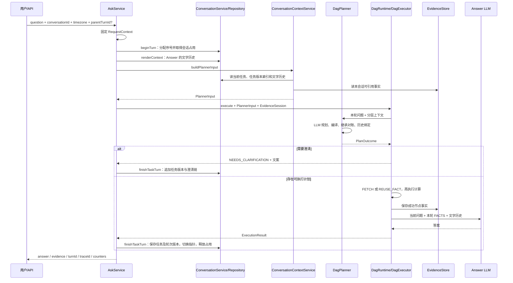

# 上下文管理

本文描述当前多轮问答的上下文管理实现，核对基线为 **1d5382c，2026-10-13**，并同步当前工作树的任务生命周期及局部修复。当前主要场景是多轮追问；后续上下文选择、压缩、任务回访和历史结果引用，也归入这个主题。

**每轮自然语言问题都调用 Planner。上下文管理负责给 Planner 提供可继承的任务条件和可引用的历史事实，执行层负责校验、取数与计算。** 正确理解追问是首要目标，没有基于规则绕过 Planner 的执行分支。

本文以现有代码为准。[多轮追问的落地文档](/Users/wangzhangtao/code/CEXPilot/importants/多轮追问的落地文档.md) 是设计背景，其中完整数据集保存、跨指标投影、近期 frame 索引等不能当作已实现能力。阶段四通用数据集复用暂不实施，长期 memory 也不在当前范围内。

阅读顺序：先看第 1～2 节区分对象，第 4～7 节理解任务状态及动作，再看执行链与历史事实绑定。基础计划协议见 [Plan 与指标元数据](/Users/wangzhangtao/code/CEXPilot/docs/Plan与指标元数据.md)，时间与计算细节分别见 [时间窗口](/Users/wangzhangtao/code/CEXPilot/docs/时间窗口.md)、[聚合指标](/Users/wangzhangtao/code/CEXPilot/docs/聚合指标.md)。

与落地文档前三阶段的对应关系：

| 阶段 | 当前代码主线 | 本文位置 |
| --- | --- | --- |
| 一：结构化上下文与每轮规划 | 轮次生命周期、QueryFrame、上下文组装、继承对账、澄清 | 第 3～7、10 节 |
| 二：语义上必要的历史结果引用 | FACT 持久化、候选索引、pinned_result、绑定到本轮 DAG | 第 8～9 节 |
| 三：观测与上线验证 | 上下文事件、复用决策、独立计数、追问探针 | 第 11、13 节 |

这些是已落地的实现主线，不表示所有边界场景已通过验收；现有缺口集中列在第 12 节。

## 1. 先分清：任务条件、历史数据、临时上下文

用户先问“昨天币安 BTC 最高价”，再问“最低价呢”，系统需要继承币种、交易所和时间条件，但不能拿最高价数字计算最低价。

用户先问“现在价格”，再问“比刚才涨了多少”，则既要继承查询条件，也必须拿到刚才那个实际价格，作为比较基线。

这两件事由不同对象负责：

| 概念 | 解决的问题 | 当前实现 |
| --- | --- | --- |
| Conversation，会话 | 这些轮次属于哪段对话 | conversationId，conversation 表 |
| Turn，轮次 | 哪一次用户输入、执行和回答 | turnId、queryNo，conversation_query 表 |
| TaskState，完整任务版本 | 任务原问题、状态、有效计划、成功状态和未完成链 | conversation_frame.state_json 与轮次 task_state_json |
| QueryFrame，有效查询条件 | 当前任务已确定的对象、指标和条件 | conversation_frame.state_json 中的 frame；active_frame_json 为缓存 |
| Clarification，澄清 | 系统还缺什么信息，需要用户补什么 | needs_clarification / clarify、TaskState.dialogue |
| EvidenceFact，持久化事实 | 之前真正查到了什么数据，来自哪一轮 | conversation_artifact，当前 kind=FACT |
| PlannerInput，规划输入 | 本轮模型可见的上下文，以及服务端对应的结构化对象 | contextText、activeFrame、evidence 候选 |
| ExecutionBindings，执行绑定 | 本轮哪个指标节点使用哪个历史事实 | physicalNodeId → ReuseFact；未绑定节点正常取数 |
| DagContext，执行上下文 | 当前 DAG 的中间结果在哪里 | 每次 execute 新建，按本轮节点 ID 存 ToolResult |

**QueryFrame 不等于聊天摘要，也不等于行情数据。** 它描述任务。EvidenceFact 描述实际产出；DagContext 只存在于一次执行中，不承担跨轮存储。

“追问”和“澄清”也不同：

- 追问：用户主动延续或修改问题，例如“那 OKX 呢？”。
- 澄清：系统无法可靠执行，问“你指哪一家交易所？”，等待用户回复。
- 用户回答澄清问题后，也是新的一轮，仍由 Planner 解析并生成完整计划。

## 2. ID、版本和引用分别管什么

| 名称 | 生命周期与作用 | 不能混用的地方 |
| --- | --- | --- |
| conversationId | 多轮共用；查状态与事实时的会话范围 | 与访客标识 visitorId 不同 |
| queryNo | 会话内递增编号，接受请求时分配 | 不是按完成时间排序 |
| turnId | 标识一轮；失败或澄清也有轮次 | 不等于 traceId；一轮记录任务 ID、版本和来源版本 |
| traceId | 标识该轮的执行回放 | 忙碌请求不创建 trace |
| frameId | 独立任务的稳定身份 | 同任务追问不变；NEW 才分配新 ID |
| conversation_state.version | 释放本轮占用时递增的数据库状态版本 | 不等于 frame.version |
| QueryFrame.version | 该有效计划产生时的任务版本 | 没有新有效计划时可以早于 TaskState.version |
| fencingToken | 每次取得执行占用时递增；提交时防止旧执行者覆盖新状态 | 是执行权校验，不是业务条件版本 |
| m1、m2 | Planner 逻辑指标组 ID | 每轮可以重复，不能跨轮定位事实 |
| metric_0、metric_1 | 编译后当前 DAG 的物理节点 ID | 每轮重新分配 |
| factId / artifact_id | 一条持久化事实的 UUID | 跨轮引用的实际身份 |
| fact_1、fact_2 | 本轮 Planner 候选列表中的短别名 | 每轮按候选顺序重新分配，不是永久 ID |

例如同一个事实，本轮叫 fact_1，下轮有新事实加入后可能叫 fact_3。**模型只能选择本轮提供的短别名，服务端负责解析到真正的 factId。**

## 3. 一次请求如何贯穿这些对象

代码入口：[AskService](/Users/wangzhangtao/code/CEXPilot/src/main/java/com/cexpilot/api/AskService.java)、[DagRuntime](/Users/wangzhangtao/code/CEXPilot/src/main/java/com/cexpilot/dag/DagRuntime.java)。



图中省略了出域、规划失败、忙碌和异常分支，详见第 10 节。

具体调用顺序：

1. AskService 固定 requestTime 和用户时区，整个请求共用时间基准。
2. getOrCreateConversation 确定会话。未传 conversationId 时，当前约定复用该 visitor 最近活跃的会话；没有才创建。
3. beginTurn 在短事务内取得占用，建立 RUNNING 轮次。有有效占用时返回 busy，不调用 Planner。
4. 分别组装 Planner 与 Answer 上下文，然后启动 trace、发送 SSE meta、记录 CONTEXT_RESOLVED。
5. DagRuntime 调用 Planner。合法计划返回 CompiledPlan 和可选 ExecutionBindings；执行前通过回调把 CompiledPlan 交给 AskService，供成功或失败收尾使用。
6. DagExecutor 执行本轮 DAG。整个 DAG 返回后，Runtime 逐节点保存成功事实，**保存发生在 Answer 之前**。
7. 调用 Answer；根据任务选择提交状态和新版本，结束 trace 和 turn。
8. 异常走统一失败收尾，保留任务选择、有效计划和已产出的 evidence；任务失败版本与最近成功版本分别保存。

注意：“每轮都调用 Planner”表示始终经过规划阶段，不保证只调用一次模型。编译错误、继承对账或绑定修复可能增加调用次数。

## 4. QueryFrame：怎样保存可继承的任务条件

实现：[QueryFrame](/Users/wangzhangtao/code/CEXPilot/src/main/java/com/cexpilot/conversation/QueryFrame.java)、[EffectiveTarget](/Users/wangzhangtao/code/CEXPilot/src/main/java/com/cexpilot/metric/EffectiveTarget.java)、[CompiledPlan](/Users/wangzhangtao/code/CEXPilot/src/main/java/com/cexpilot/metric/CompiledPlan.java)。

### 4.1 frame 从哪里来

Planner JSON 先被解析为 LogicalPlan，再由 MetricPlanCompiler.compileFull 编译：

```text
CompiledPlan
  logicalPlan      类型化逻辑计划
  logicalPlanJson  来源对账后实际执行的逻辑 JSON（保留模型原响应在 trace）
  dagPlan          可执行物理节点
  branches         逻辑组 → 交易所 → 物理节点
  targets          每个物理指标节点的有效条件
```

QueryFrame.fromCompiledPlan 使用 targets 和本轮 evidence 创建 frame。程序不解析 Answer 的自然语言来反推状态，因此答案漏说一个条件，不会直接导致该条件从编译期 targets 消失。

当前会话可以保存多个独立任务。生产链路由 TaskState.complete 使用稳定 frameId 和新版本创建有效 QueryFrame；conversation_frame 保存每项任务最新状态，conversation_query 保存每轮完整任务快照。旧的 fromCompiledPlan 简便重载仅用于单轮兼容/测试，不是生产任务 ID 的分配依据。

### 4.2 实际字段

| QueryFrame 字段 | 当前写入内容 |
| --- | --- |
| frameId / conversationId / sourceTurnId | 稳定任务 ID、所属会话、产生此有效计划的轮次 ID |
| version | 有效计划生成时的任务版本 |
| originalQuestion | 本轮 question，不一定是整个任务最初的问题 |
| requestTime / timezone | AskService 收到的请求基准；用户未传 timezone 时这里可为 null |
| targets | 编译后的单指标有效条件，按交易所展开 |
| focus | evidence_nodes：node_id、type、ok、identity/operator、fact_id、reused |
| pendingClarification | 旧字段兼容；新澄清链保存在 TaskState.dialogue |
| lastAttempt | 产生该有效计划的轮次及其状态；完整未完成链以 TaskState 为准 |

一个 EffectiveTarget 包含：groupId、physicalId、exchange、metric、queryShape、instrument、timeExpression、interval、includeUnclosed、count、depth、unit、provider、catalogVersion，以及 conditionSources（字段来源及继承基准）、executionMetadata（本轮真实执行元数据）。

**多对象按节点保存很重要。** “币安 BTC + OKX ETH”不能压成 exchange=[binance,okx]、base=[BTC,ETH] 后丢掉两者配对关系。存储、继承 diff 和来源继承共用目标配对策略：先保留完全未变的目标，再逐对匹配剩余节点。

### 4.3 编译期条件与执行期条件要区分

EffectiveTarget 保存两层信息，不能互相覆盖：

- 查询要求：timeExpression、interval、includeUnclosed、count、depth 和完整 instrument。interval=null 表示自动选择，并不是缺少上次结果。
- 本轮执行结果：executionMetadata 中的 candle_interval、interval_source、requested_range、effective_range、actual_range、coverage、as_of、实际样本数等。没有成功执行的节点不填；Provider 省略与 requested_range 相同的 effective_range 时，提交时补为相同范围。不会保存 samples 等明细，也不会复制上轮执行结果充当本轮结果。

[QueryFrame.fromCompiledPlan](/Users/wangzhangtao/code/CEXPilot/src/main/java/com/cexpilot/conversation/QueryFrame.java) 按 physicalId 与 evidence.node_id 配对，从成功节点的 data 提取白名单元数据。Answer 失败时，已经成功取数的节点仍可保留这部分信息。

#### 条件来源怎样构造

[ConditionSource](/Users/wangzhangtao/code/CEXPilot/src/main/java/com/cexpilot/metric/ConditionSource.java) 按字段记录 origin、requirementOrigin、sourceTurnId、sourceFrameId、sourceVersion 和 userText；requirementTurnId/requirementFrameId/requirementVersion 保留该条件最初有记录的来源，后续继承不覆盖。

| origin | 判断依据 | requirementOrigin |
| --- | --- | --- |
| EXPLICIT | Planner 提供当前用户问题中的原文片段，服务端验证该片段确实存在 | EXPLICIT |
| INHERITED | 与所选任务版本的对应条件相同 | 保留该要求最初的 EXPLICIT / DEFAULT / PLANNED 性质 |
| DEFAULT | 参数省略，由代码补齐或执行时自动选择 | DEFAULT |
| PLANNED | 模型填写了条件，但没有可核对的用户原文依据 | PLANNED |

例如，本轮沿用上次自动粒度，origin=INHERITED、requirementOrigin=DEFAULT；沿用上次用户指定的 1h，则 origin=INHERITED、requirementOrigin=EXPLICIT。sourceTurnId/sourceFrameId/sourceVersion 由程序填为所选有效 frame 的轮次、任务、版本，模型不能自行填写这些标识。首次产生的来源标识在任务提交时填入当前轮次与版本。连续继承时，source* 指向这次直接继承的版本，requirement* 保留最初记录该要求的轮次/版本；旧快照没有这些标识时只能从选中的已知版本开始记录，不能推断更早来源。

Planner 顶层可输出：

```json
{
  "explicit_conditions": {
    "m1": {"interval": "5分钟", "exchange": "币安"}
  }
}
```

仅当当前用户问题确实包含“5分钟”“币安”时，这份声明才通过结构和原文检查；不能引用旧问题或 Answer 的原文来标记本轮 EXPLICIT。是否正确理解该片段所对应的条件，仍由模型解析负责，这个检查不是完整的自然语言语义证明。没有这份声明的旧输出仍兼容，但不能仅因 JSON 出现 interval 就升级为 EXPLICIT。用户本轮提到“固定”“粒度”“保持”等可能要求改粒度的表达时，程序保守保留缺原文依据的模型 interval 为 PLANNED，不仅凭它恰好等于上次自动值就删除参数；这类文字线索不当成 EXPLICIT 的证明。

实现顺序是：MetricPlanCompiler 先标 PLANNED/DEFAULT → [ConditionProvenanceResolver](/Users/wangzhangtao/code/CEXPilot/src/main/java/com/cexpilot/dag/ConditionProvenanceResolver.java) 验证原文、配对所选版本、归一化可选条件 → 必要时重新编译（不调用 LLM）→ 填充 EXPLICIT/INHERITED → 继承 diff、历史事实绑定和执行 → QueryFrame 回填真实元数据。重新编译后的 LogicalPlan 才是保存与执行的依据。

#### 自动与固定粒度的具体区别

```text
首次：查昨天的成交额，未指定粒度
  interval = null
  interval 来源 = DEFAULT
  executionMetadata.candle_interval = 5m

追问：换成最近30天
  Planner 即使抄回 interval=5m，且未给本轮固定粒度原文依据：
  程序识别它是上次自动执行值，移除这个参数
  interval = null，来源 INHERITED / requirementOrigin=DEFAULT
  查询服务重新选粒度，例如 1h；本轮 executionMetadata 写 1h

追问：固定用5分钟粒度
  interval = 5m
  explicit_conditions.m1.interval = "5分钟"
  来源 EXPLICIT，sourceTurnId 为本轮

追问：再换回昨天，模型漏填 interval
  程序沿用所选版本的固定 5m 要求
  来源 INHERITED / requirementOrigin=EXPLICIT

追问：改回自动
  Planner 省略 interval，并以 "自动" 声明本轮明确解除固定粒度
  interval = null，后续继续自动选择
```

同样区分 settle、include_unclosed 和 depth 的代码默认与固定要求。一个指标组展开到多所后继承要求不一致时，要求 Planner 拆组，不取第一条的条件。新任务没有继承基准；历史回访使用选中的版本，而不是当前活动任务的来源。旧快照没有 conditionSources 时，原 DEFAULT 可保留，旧 EXPLICIT 降为未核实的 PLANNED，不追认用户原文；缺失的历史执行元数据不补造。

### 4.4 TaskState：任务版本与有效计划分开

[TaskState](/Users/wangzhangtao/code/CEXPilot/src/main/java/com/cexpilot/conversation/TaskState.java) 保存完整任务版本：

| 字段 | 作用 |
| --- | --- |
| frameId / conversationId / version | 任务身份、会话归属、该任务的递增版本 |
| originQuestion / firstQueryNo | 最初问题与起始轮次，后续短回复不能覆盖 |
| lastQueryNo / turnId / status | 最近一次尝试及结果 |
| requestTime / timezone | 该版本请求时间及有效时区；没有完整 QueryFrame 的澄清任务也会保存 |
| frame | 最近有效计划的查询条件及事实焦点；计划已通过但 Answer 失败时也可更新 |
| successfulFrame | 最近成功状态，失败不会覆盖它 |
| logicalPlan | 已验证的完整计划，包含计算结构，不只存 has_valid_plan |
| dialogue | 尚未完成的澄清/失败问答链，累积原问题的补充条件 |

TaskState.version 每次任务尝试提交后递增。若 Planner 尚未产出新计划，frame 仍可指向上一个有效计划，其版本小于当前任务版本；这两个版本不能混用。

focus 通过本轮 evidence 映射渲染成可输出的 ref，并附 source_turn_id。候选之外的焦点明确标为不可用，派生结果明确标为不可绑定。持久化计划中的旧 evidence_ref 也会按稳定 factId 重映射，不能直接复制上一轮的短别名。

### 4.5 任务如何选择与提交

[TaskScope](/Users/wangzhangtao/code/CEXPilot/src/main/java/com/cexpilot/conversation/TaskScope.java) 是 Planner 选中的动作和来源 TaskState，沿 PlanOutcome → ExecutionResult / ExecutionFailure 传回 AskService。

| 动作 | 选择基准 | 提交动作 |
| --- | --- | --- |
| NEW | 本轮问题，不继承旧任务 | 服务端分配新 frameId，版本 1；旧任务保留 |
| CONTINUE | 当前任务最新版本，包括澄清/失败状态 | 沿用 frameId，追加版本 |
| RESUME | 候选中的历史任务与指定版本 | 沿用所选 frameId，在该任务数据库最新版本号上追加版本；记录旧来源版本 |

例如任务 A 已到 v8，用户回到 A/v1 再改交易所，提交的是 A/v9，conversation_query.base_frame_version=1；不会覆盖 v1，也不会重复生成 v2。

每轮在 finishTaskTurn 短事务中同时保存任务最新状态、轮次版本快照和活动指针，再释放执行占用。成功、澄清、失败共用此入口。JSON 缺省节点在读取时统一为 Java null，避免持久化往返后把未变快照判成时间变化。

## 5. Planner 和 Answer 各自收到什么上下文

实现：[ConversationContextService](/Users/wangzhangtao/code/CEXPilot/src/main/java/com/cexpilot/conversation/ConversationContextService.java)、[ConversationService](/Users/wangzhangtao/code/CEXPilot/src/main/java/com/cexpilot/conversation/ConversationService.java)、[PlannerInput](/Users/wangzhangtao/code/CEXPilot/src/main/java/com/cexpilot/conversation/PlannerInput.java)。

### 5.1 PlannerInput 的六个成员

```java
record PlannerInput(
    String contextText,
    QueryFrame activeFrame,
    List<EvidenceAssembler.Entry> evidence,
    int textHistoryCount,
    List<TaskSnapshot> tasks,
    TaskState currentTask
) {}
```

这些成员同时用于模型上下文与程序校验：

- contextText 注入 dag_planner.txt 的 conversation_context。
- activeFrame 供 InheritanceValidator 在程序里对账。
- evidence 保存“短别名 → EvidenceFact”的同一份映射，供 EvidenceBinder 校验。
- tasks 是本轮可选择的任务/版本索引，与输出的 task_ref/state_ref 一一对应。
- currentTask 包含当前未完成链及有效计划；它决定 CONTINUE 的基准。
- textHistoryCount 用于观测。

**模型看到的别名与服务端用于绑定的候选必须来自同一个 PlannerInput，不能渲染后再独立加载一份列表重新编号。**

### 5.2 contextText 的实际顺序

```text
【活动查询状态】
frame 请求时间、时区
- 每个 target 的交易所、指标、instrument、时间表达、粒度、count/depth 等
【待补条件】              仅已有 frame 内存在 pending 时输出

【可引用历史事实】
- ref=fact_1 ... 身份、区间或 count、observed_at、fetched_at、quality
- ref=fact_2 ...

【近期问答】
用户（时间）：...
助手：...
```

近期文字历史最多 5 条，每条答案截到 500 字符。查询只选 turn_status=SUCCEEDED 或旧数据 NULL，RUNNING、FAILED、NEEDS_CLARIFICATION 都被排除。

活动 frame JSON 解析失败时降级到文字历史；历史事实加载失败时降级为空候选并记日志。并不是所有数据库异常都会被吞掉，例如 findActiveFrameJson 的数据库读取异常不在其 JSON 解析 catch 内。

当前没有统一 token 预算管理：文字答案有硬截断，frame 和事实索引没有按相关性检索、摘要或总预算压缩。

### 5.3 Answer 的上下文不同

Answer 仍用 ConversationService.renderContext：最近 5 条成功问答，每条答案最多 300 字符，不带 Planner 侧的结构化 frame 和候选段。

Answer 的 user message 包括：

```text
本轮原始问题
<FACTS>
  当前 DAG 产出的指标与计算结果，可能包含已验证的历史复用事实
</FACTS>
<QUERY_STATUS>
  Planner 的查询缺口说明
</QUERY_STATUS>
```

复用事实会附 reused、source_turn_id、observed_at（有则附）、fetched_at。Answer 应根据 FACTS 表达历史时间，不能把“本轮可用事实”理解成“本轮新抓取行情”。

完整事实进入 Answer；候选事实只是给 Planner 选择的索引，两者不是同一份内容。当前尚未单独提取 AnswerService，回答调用和 evidence 组装仍在 DagRuntime。

## 6. Planner：完整计划、追问声明与修复

实现：[DagPlanner](/Users/wangzhangtao/code/CEXPilot/src/main/java/com/cexpilot/dag/DagPlanner.java)、[InheritanceValidator](/Users/wangzhangtao/code/CEXPilot/src/main/java/com/cexpilot/dag/InheritanceValidator.java)、[提示词](/Users/wangzhangtao/code/CEXPilot/src/main/resources/prompts/dag_planner.txt)。

### 6.1 输出协议

普通查询仍然返回完整的 metrics / calculations。多轮增加以下信封字段：

```json
{
  "in_domain": true,
  "plan": {
    "metrics": [],
    "calculations": []
  },
  "reply": null,
  "changes": [],
  "task_action": "CONTINUE",
  "task_ref": null,
  "state_ref": null,
  "needs_clarification": false,
  "clarify": null
}
```

这是字段布局示例，空计划不代表一个可执行行情查询。

| 字段 | 语义 | 当前程序用途 |
| --- | --- | --- |
| changes | 模型声明本轮改变的条件键 | 与所选任务版本的 targets 对账 |
| explicit_conditions | 指标组 ID → 条件字段 → 当前用户原文片段 | 验证来源；服务端填充继承轮次和版本，不直接信任模型自报 EXPLICIT |
| task_action | NEW / CONTINUE / RESUME | 选择任务生命周期动作；显式值优先 |
| task_ref / state_ref | 历史任务及版本的本轮别名 | RESUME 定位来源；版本省略时取该任务最新候选 |
| new_frame | 旧协议兼容字段 | 无 task_action 时 true 转 NEW，false 转 CONTINUE |
| needs_clarification | 缺条件或指代不明，需要提问 | 返回澄清分支，不执行 DAG、不开 Answer |
| clarify | 给用户的澄清问题 | 优先使用，缺失时尝试 reply，再走修复/兜底 |
| reply | 范围、缺口、拒答或简短说明 | 与行情 FACTS 分开处理 |

当前 changes 键包括 exchange、base、metric、shape、time、interval、count、depth、include_unclosed。它是模型的意图声明，不是服务端可直接执行的 JSON patch。完整计划仍是执行依据。

### 6.2 从模型响应到 PlanOutcome

```text
LLM 响应
  → 解析 JSON、检查 in_domain
  → 出域：返回边界说明
  → needs_clarification：返回澄清或修复文案
  → plan 缺失但有合法 reply：返回能力/范围说明
  → compileFull + ConditionProvenanceResolver（归一化后必要时重编译）+ PlanValidator
  → 继承对账
  → EvidenceBinder：引用协议、实体绑定、比较输入检查
  → FOLLOWUP_PLAN
  → PlanOutcome
```

PlanOutcome 持有 Optional<CompiledPlan>、needsClarification、reply、lastError、bindings、taskScope、token 汇总和 llmCalls。Runtime 依据这些字段决定执行、澄清还是直接结束。

### 6.3 INHERIT_SHADOW 到底是什么

当所选任务版本存在有效 frame 时（NEW 没有继承基准）：

1. 比较新旧 targets，计算实际变化键。
2. 检查实际变化是否全部包含在 changes 中；多声明目前不拦截。
3. 首次响应漏报变化，向模型发送修复提示。
4. 后续响应仍漏报，记录 INHERIT_SHADOW 并继续绑定和执行。

默认 planner-max-retries=2，含首次最多 3 次调用。这里的“shadow”是**把继承声明不一致软放行并记审计**，不是另跑一份查询比较结果，也不证明计划语义正确。

当前 diff 先建立并认领节点对应关系，再逐对比较全部条件；时间沿用同一配对并通过 TimeRangeResolver 比较。它仍只证明计划变化与声明一致，不独立证明变化来自用户。

### 6.4 两种额外修复

- 澄清标志为 true 但没有文案：首次要求修复；之后仍缺文案，用固定澄清话术并记录 CLARIFY_FALLBACK。
- 历史绑定失败：允许一次绑定修复，再次失败返回历史不可恢复的澄清。它与其他错误共用规划循环预算，并非额外独立的无限重试。

绑定失败后的修复由 PinnedRequirements 逐项保留历史输入的有效条件及最终计算用途；改名或重排不改变身份，但删除、降级某个历史输入、保留无关 pinned 节点不能绕过。原结果不可恢复时澄清。

### 6.5 校验失败后的双模型修复

生产链路的 DagPlanner 同时注入 normalLlmClient 与 flagshipLlmClient。第一次调用 normal；解析、编译、参数/引用校验、继承对账、来源对账或历史绑定错误进入既有修复循环后，后续调用使用 flagship。不会同时发两份规划请求，也不增加调用次数上限。

```text
attempt=1：normal 生成计划
  校验通过 → 执行 DAG → normal 生成 Answer
  校验失败 → 保留 system + 原 question + 历史上下文
             追加失败输出和具体错误
attempt=2：flagship 输出完整修复计划，再走相同校验
attempt=3：仍需修复时继续 flagship（受原重试预算限制）
```

历史绑定仍只修复一次，必要历史输入保护不因换模型而解除；修复耗尽仍按原规则返回失败/澄清。正常澄清、出域或能力说明不是校验失败；HTTP 超时、欠费、鉴权异常沿现有异常路径结束，不在本期加入网络故障模型切换。合法但语义理解错误的计划也不会因为这套机制自动触发模型 2。

使用现有环境变量 `LLM_NORMAL_MODEL`、`LLM_FLAGSHIP_MODEL`。第二套地址/Key 默认继承第一套，可用 `LLM_FLAGSHIP_BASE_URL` / `LLM_FLAGSHIP_API_KEY` 覆盖。未设置第二模型名字时沿用既有默认 qwen-max；`DAG_PLANNER_MAX_RETRIES=2` 表示含首次最多 3 次，设为 0 时不进入模型 2。两套客户端使用本轮同一提示词和 response_format，模型 2 必须支持所配置的输出格式。旧的单客户端构造仅保留显式调用和测试兼容，生产使用带 Qualifier 的双客户端构造。

[LlmUsage](/Users/wangzhangtao/code/CEXPilot/src/main/java/com/cexpilot/llm/LlmUsage.java) 按次保存 modelRole、model、输入/输出 token 与 estimatedCost，沿 PlanOutcome / PlanningFailure → ExecutionResult / TurnCounters → AskService 传递。每次调用按所属模型的 input/output 单价计算后汇总，不能把模型 2 的 token 按 normal 价格计算。Answer 始终按 normal 记账。只有收到完整 usage 才有该次估算费用；任一次缺 usage 时总费用为 null，失败 trace 的 token 只汇总已收到部分。单次 LLM_CALL 保留模型、角色与费用，ask_trace.model 仍表示默认/首次模型，混合调用以单次事件为准。默认单价 0 只是未配置计费；当前估算仍未单独应用缓存 token 的折扣单价。

本期不新增数据库列或迁移。相关离线测试：[PlannerModelFallbackTest](/Users/wangzhangtao/code/CEXPilot/src/test/java/com/cexpilot/dag/PlannerModelFallbackTest.java)、[PlannerModelConfigTest](/Users/wangzhangtao/code/CEXPilot/src/test/java/com/cexpilot/config/PlannerModelConfigTest.java)、[LlmUsageTest](/Users/wangzhangtao/code/CEXPilot/src/test/java/com/cexpilot/llm/LlmUsageTest.java)。

### 6.6 Trace 怎样区分两次模型尝试

每次 Planner 尝试在完成校验、历史绑定与必要历史输入保护后，写一条 `PLANNER_ATTEMPT` 终态事件。不能仅看 `LLM_CALL.error`：模型已返回但 JSON/计划不合法时，调用本身成功，失败发生在校验。也不能仅看 `PLAN_COMPILED`，因为历史绑定仍可能在编译之后失败。

`/api/trace/{traceId}` 与 `/api/trace_detail/{traceId}` 保留完整 events，新增：

- `planner_attempts`：每次 attempt 的 model/model_role、call_status、validation_status、result、call_error/validation_error、retry_reason、耗时、token、estimated_cost，以及 llm_call_seq/result_seq，便于直接做评测。
- `final_plan`：最终获准执行的归一化逻辑计划，而不是模型原响应中的候选。没有可执行计划时为 null。
- `final_compiled_plan`：同一最终计划的实际 DAG。已编译但绑定/历史保护失败的候选不能进入这两个字段。

示例摘要：

```json
{
  "planner_attempts": [
    {"attempt": 1, "model": "model-one", "model_role": "normal", "call_status": "SUCCEEDED", "validation_status": "FAILED", "result": "REPAIR_REQUIRED", "validation_error": "输出 JSON 解析失败"},
    {"attempt": 2, "model": "model-two", "model_role": "flagship", "call_status": "SUCCEEDED", "validation_status": "PASSED", "result": "EXECUTABLE", "retry_reason": "输出 JSON 解析失败"}
  ]
}
```

`validation_status`：PASSED 仅表示产生了通过全部规划检查的可执行计划；FAILED 表示校验/绑定/历史保护失败；NOT_RUN 表示调用失败，没有进入校验；NOT_APPLICABLE 表示正常澄清、出域或无计划说明；UNKNOWN 表示旧记录没有足够明确的终态信息。不代表数据查询或 Answer 一定成功，也不等同于数值真值验收。

`/api/traces` 在去掉 input_json/output_json 前，为每条 trace 附加相同的轻量 planner_attempts；批量摘要不复制完整计划或 prompt。完整原文仍从单条接口的 events 取。旧记录可以利用已记录错误，缺失的模型/终态标识不按新版本配置补造；旧 FOLLOWUP_PLAN 且没有后续失败时可保留历史计划展示，但校验状态仍标 UNKNOWN。

回放页只展示 `final_plan`，并显示对应 attempt 和模型；拓扑使用 `final_compiled_plan`。所有失败输出和完整重试记录继续保留在接口，页面不再逐个展示候选计划。顶部 model 标为“首次模型”，避免把它误当成整次问答唯一模型。

实现：[PlannerTraceView](/Users/wangzhangtao/code/CEXPilot/src/main/java/com/cexpilot/trace/PlannerTraceView.java)。无需数据库迁移。

## 7. Clarification：澄清状态如何进出

### 7.1 首轮和连续澄清

```text
用户：查 BTC 最近几期的资金费率。
系统：哪家交易所？
用户：币安。
系统：最近多少期？
用户：10 期。
```

首次 Planner 选择 NEW，并返回 needs_clarification=true。提交时创建独立任务 A/v1，originQuestion 保留最初问题，dialogue 保存首个问题和澄清；frame 可以为 null，不要求先成功查询。

第二轮选择 CONTINUE，保存 A/v2，追加“币安/最近多少期”，而不是把原问题改成“币安”。用户中途问“为什么要指定期数”等说明时，没有有效查询计划的回答只结束本轮问答，不清空任务补充链。第三轮仍在 A 上，Planner 得到原问题和完整补充链，生成币安 BTC 的最近 10 期计划。执行成功后保存 A/v3，写有效 frame 并清空未完成链；originQuestion 和历史版本仍保留。

### 7.2 失败重试

```text
任务 A：BTC 查询成功。
NEW 任务 B：ETH 昨日收盘价，计划通过，Answer 失败。
CONTINUE B：再试一次，Planner 又失败。
CONTINUE B：那 OKX 呢？
```

B/v1 保存 ETH 有效计划、条件及已有事实焦点；B/v2 追加“再试一次”的失败记录，保留 ETH 原问题、有效计划和条件。最后一轮以 B 为基准切换交易所，成功后写 B/v3。任务 A 仍在独立任务表中，可另行 RESUME。

ExecutionFailure 携带任务选择及已组装 evidence；AskService 即使在 Answer 失败时也能保存事实焦点。未产出新计划的失败则保留所选任务的上一个有效计划，并追加本轮问题。没有任务决策的出域说明不修改已有任务。

### 7.3 新任务、当前任务与历史版本

澄清或失败都会成为当前正在讨论的任务，但不会把另一个任务的成功状态改写。新任务没有有效条件时，Planner 输入不拿旧任务的 frame 当成其有效条件。CONTINUE 保持任务身份；RESUME 必须从本轮候选选择来源，不允许编造 ID。

当前候选按独立任务取最近 5 项，同时保留最初任务；每项提供最新状态、最近两个版本、最初版本及最近成功版本；最初版本尚未完成条件澄清时，另提供首个有效查询版本。全部历史版本仍在数据库中，不因索引截断而删除。其他不在本轮候选中的任务/版本需要澄清；本轮没有加入任意历史全文检索。

## 8. EvidenceFact：历史结果怎样变成本轮可计算输入

实现：[EvidenceStore](/Users/wangzhangtao/code/CEXPilot/src/main/java/com/cexpilot/evidence/EvidenceStore.java)、[EvidenceAssembler](/Users/wangzhangtao/code/CEXPilot/src/main/java/com/cexpilot/evidence/EvidenceAssembler.java)、[EvidenceBinder](/Users/wangzhangtao/code/CEXPilot/src/main/java/com/cexpilot/dag/EvidenceBinder.java)、[ExecutionBindings](/Users/wangzhangtao/code/CEXPilot/src/main/java/com/cexpilot/metric/ExecutionBindings.java)。

### 8.1 保存的不是完整接口响应

Runtime 在 DAG 执行结束后、Answer 之前保存成功节点：

| 节点 | 保存内容 |
| --- | --- |
| 普通 metric 节点 | MetricResultJson 输出，含指标身份、value 或 samples、范围及质量信息 |
| REUSE_FACT 节点 | 沿用原 factId，不重复插入 |
| 计算节点 | derived=true，保存计算结果与已知上游 sourceFactIds |
| ToolResult 失败或无 data | 不保存事实 |
| payload 超过 256KB | 保存审计行，payload_json=NULL，metadata 记录 cache_skip_reason；不进候选 |

当前只实现 kind=FACT，没有保存 SourceDataset、完整 Candle 列表，也没有 PROJECT_DATASET。

因此 price.high 的事实只含最高价等标准字段；虽然 Provider 曾拿到完整 K 线，最低价字段并未作为数据集保存。追问最低价需要重新查询。

### 8.2 EvidenceFact 的身份与时间

| 字段组 | 内容 |
| --- | --- |
| 身份 | factId、conversationId、sourceTurnId、sourceTraceId |
| identity | metric、exchange、shape、instrument、unit、provider、catalogVersion、适用的参数与 requested_range |
| observedAt | 快照 payload.as_of；序列目前可为 null |
| quality | sample_complete、range_complete、contains_unclosed 等摘要 |
| payload | 完整标准指标结果或计算结果 |
| derived / sourceFactIds | 是否为派生结果及其依赖 |
| lookupKey | 会话及身份 JSON 的 SHA-256；当前不是自动缓存查询入口 |
| fetchedAt / retainedUntil | 获取时间字段、候选保留截止 |
| schemaVersion | 当前为字符串 "1" |

当前 Runtime 传给 saveFacts 的时间是 requestTime，所以 fetchedAt 实际记录请求开始时刻，还不是精确的接口完成时刻。保留截止按该时间加 24 小时计算。

24 小时是**历史引用的保留策略**，不是“行情 24 小时内都新鲜”。latest 节点始终正常取数，不因存在同身份 FACT 就自动命中。

### 8.3 Planner 如何引用历史

指标组新增两个字段：

```json
{
  "id": "m1",
  "metric": "funding.rate_settled",
  "exchanges": ["binance"],
  "instrument": {
    "market_type": "perpetual",
    "base": "BTC",
    "quote": "USDT"
  },
  "query_shape": "recent_n",
  "count": 10,
  "reference_mode": "pinned_result",
  "evidence_ref": "fact_1"
}
```

- reference_mode 缺省或 latest：本轮取数。
- pinned_result：绑定指定历史事实，保留其原样本和时间。
- evidence_ref 只能选择本轮候选短别名，不允许直接给数据库 ID。
- 一个 FACT 对应一个交易所，pinned 指标组只能含对应的一个 exchange。
- derived=true 当前全部拒绝绑定，不只是禁止把派生标量当成样本集。

设计文档中的 FIXED_RANGE 是时间适用性概念；当前模型协议没有第三个 reference_mode=fixed_range。固定历史区间正常用 TimeSpec 表达，是否 pinned 另行决定。

### 8.4 EvidenceBinder 做哪些检查

```text
evidence_ref 是否属于本轮候选
  → 按 conversationId + factId 重新加载
  → 非派生、schemaVersion 一致、仍在保留期
  → metric / exchange / shape / instrument / unit / provider 一致
  → catalogVersion 一致
  → count / depth / interval / includeUnclosed 一致
  → 时间类请求消解后的 requested_range 一致
  → 为物理节点建立 ReuseFact
```

这套校验证明身份一致，不证明 Planner 对用户指代的选择正确。选中了错误但同身份的历史价格，仍可能通过身份校验，所以焦点和来源轮次的上下文也很重要。

Binder 没有通用数据集的匹配、切片或重采样。质量 metadata 随 payload 保留，后续计算仍通过 validateSource 检查不完整来源，不能因为绑定成功就认为所有计算都可做。

### 8.5 旧事实为何不直接用旧节点 ID

```text
本轮逻辑引用：
  {{m1.binance.samples}}

编译结果：
  m1 / binance → metric_0

服务端绑定：
  metric_0 → ReuseFact(factId, sourceTurnId, observedAt, fetchedAt, payload)

执行：
  把 payload.deepCopy() 作为本轮 metric_0 的 ToolResult
  写入本轮 DagContext
  avg 继续通过当前节点引用读取 samples
```

这样 ReferenceResolver 和计算算子仍只处理当前 DAG。跨轮问题由“加载历史事实并绑定到本轮节点”解决，不把旧 DagContext 复活。

实际 ExecutionBindings 只存 reusedByNode；**没有绑定的节点隐式 FETCH**，不是每个节点都显式存一个 FETCH 对象。REUSE_FACT 由服务端生成，模型不负责决定数据库读取方式。

执行器对复用节点记录 FACT_REUSED，普通指标记录 METRIC_RESULT，计算继续记录 TOOL_CALL。

## 9. 三个例子，把输入、存储和执行串起来

下面的 UUID、短名和示意值用于说明结构，不表示本次重新请求了线上服务。

### 9.1 最高价 → 最低价：继承条件，重新取数

沿用设计文档中的历史问题：“昨天币安 BTC 永续的最高价？”。原 trace 的最高价为 83955 USDT，程序自动选择 5m、完整覆盖 288 根。

下面用这条问题和历史数值说明**按当前代码执行时**的存储结构，不表示旧 trace 当时已写入这些新表。追问假设发生在同一自然日，暂不展开跨午夜的时间继承。

首次 Planner 选择：

```json
{
  "in_domain": true,
  "plan": {
    "metrics": [
      {
        "id": "m1",
        "metric": "price.high",
        "exchanges": ["binance"],
        "instrument": {"market_type": "perpetual", "base": "BTC", "quote": "USDT"},
        "query_shape": "range_statistic",
        "time": {"type": "calendar_period", "unit": "day", "offset": -1, "segment": "full", "extent": "full_period"}
      }
    ],
    "calculations": []
  },
  "reply": null
}
```

执行完成后保存：

```text
conversation_query:
  turn-1，question，SUCCEEDED，logical_plan_json，answer，traceId

conversation_state.active_frame_json:
  targets[0].metric = price.high
  targets[0].exchange = binance
  targets[0].instrument = BTC / USDT / USDT / perpetual
  targets[0].timeExpression = calendar_period / day / -1
  targets[0].interval = null
  targets[0].intervalOrigin = DEFAULT
  focus.evidence_nodes[0].fact_id = 最高价事实的 UUID

conversation_artifact:
  kind = FACT，metric = price.high
  payload.value = 83955
  payload.candle_interval = 5m
  payload.requested_range = 实际历史自然日
  payload.coverage.range_complete = true
```

**当前 frame 里自动粒度仍为 null，5m 在 FACT payload 中。** 这与设计文档里的“执行 meta 已全部写入 frame”示例有区别。

追问“那最低价呢？”：Planner 获得活动条件，返回完整的 price.low 计划，通常声明 changes=["metric"]，其余查询条件保持同一含义。程序编译、校验后正常访问 K 线 Provider，生成新的最低价 FACT，再调用 Answer。

调用情况：规划阶段至少 1 次 LLM，可能有修复；最低价节点真实取数；Answer 1 次。**当前不存在拿最高价 FACT 投影最低价的路径。**

### 9.2 最近 10 期 → 均值：引用同一批样本

首问“币安 BTC 最近 10 期已结算资金费率”，Provider 返回升序 samples，程序保存原始 FACT。下一轮候选段为它分配 fact_1。

追问“刚才这 10 期的平均值呢”，Planner 期望返回：

```json
{
  "in_domain": true,
  "plan": {
    "metrics": [
      {
        "id": "m1",
        "metric": "funding.rate_settled",
        "exchanges": ["binance"],
        "instrument": {"market_type": "perpetual", "base": "BTC", "quote": "USDT"},
        "query_shape": "recent_n",
        "count": 10,
        "reference_mode": "pinned_result",
        "evidence_ref": "fact_1"
      }
    ],
    "calculations": [
      {
        "id": "c1",
        "operator": "avg",
        "input": {"kind": "field", "collection": "{{m1.binance.samples}}", "field": "value"}
      }
    ]
  },
  "reply": null
}
```

执行过程：

1. 编译 m1/binance → metric_0，c1 依赖 metric_0。
2. Binder 校验 fact_1 所指原始 FACT，建立 metric_0 的 REUSE_FACT。
3. Executor 载入原 samples，不调用 Funding Provider。
4. avg 按当前来源与单位规则执行，生成计算结果。
5. 原始 FACT 沿用 ID；均值保存为新的 derived FACT，sourceFactIds 指向原样本。
6. Answer 看到本轮均值及其原样本来源。
7. 新 frame.focus 同时包含样本节点和计算节点引用。

这一轮仍调用 Planner 和 Answer。复用是为了保证“这 10 期”不变，不只是节省一次接口请求。

用户若改问“现在最新 10 期的均值”，则应使用 latest/缺省模式，重新取当前集合。同一 count=10 不代表同一批样本。

### 9.3 当前价 → 比刚才涨多少：同指标、两个版本

Planner 需要两个逻辑组：

```text
m_old：price.last / binance / BTC / snapshot
       reference_mode=pinned_result，evidence_ref=fact_1

m_now：price.last / binance / BTC / snapshot
       reference_mode=latest

c1：relative_change
    current  = {{m_now.binance.value}}
    baseline = {{m_old.binance.value}}
```

虽然 metric、交易所和币种完全相同，仍必须编译成两个物理节点：一个载入旧 FACT，一个重新获取当前价。不能按 metric 名去重成一个节点。

本轮新增当前价 FACT 和变化率 derived FACT，旧价格不覆盖。Answer 应区分两个观测时刻。

比较方向按用户本轮要求决定；旧价减现价可以使用 left=旧、right=新，不根据取数时间统一交换输入槽位。

## 10. 表结构、事务与轮次状态

权威定义见 [schema.sql](/Users/wangzhangtao/code/CEXPilot/src/main/resources/db/schema.sql)；已有库迁移见 [007](/Users/wangzhangtao/code/CEXPilot/src/main/resources/db/migrations/007_conversation_turn_lifecycle.sql)、[008](/Users/wangzhangtao/code/CEXPilot/src/main/resources/db/migrations/008_conversation_artifact.sql)、[009](/Users/wangzhangtao/code/CEXPilot/src/main/resources/db/migrations/009_turn_counters.sql)。这里解释字段职责，不再复制一套可能漂移的建表 SQL。

### 10.1 五张业务表怎样分工

| 表 | 核心字段 | 读写位置 |
| --- | --- | --- |
| conversation | conversation_id、visitor_id、title、last_active_at | 会话选择与历史入口 |
| conversation_query | query_no、turn_id、frame_id、frame_version、base_frame_version、task_action、task_state_json、logical_plan_json、frame_json、question/answer/status | 每轮登记与完成；保存不可覆盖的任务版本快照 |
| conversation_state | version、last_query_no、running_turn_id、lease_until、fencing_token、active_frame_id、active_frame_json | 执行占用与当前任务指针；JSON 为有效条件缓存 |
| conversation_frame | frame_id、conversation_id、version、first_query_no、last_query_no、status、state_json | 每个独立任务最新状态，包含未完成任务 |
| conversation_artifact | artifact_id、kind、source_turn_id/trace_id、metadata_json、payload_json、derived、lookup_key、fetched_at、retained_until | 保存标准事实，列出候选和按会话加载 |

当前 conversation_query 使用 task_state_json 保存完整任务版本；effective_request_json、route、artifact_refs_json 等设计稿字段未使用。历史 FACT 和任务状态分别保存。

metadata_json 保存 identity、observed_at、quality、source_fact_ids、cache_skip_reason；payload_json 是完整结果。lookup_key 不是唯一键，同身份的两个快照可以同时保存。

Trace 的 ask_trace / trace_event 是执行回放，不作为运行时历史事实仓库。Answer 失败后，已写 FACT 仍可能存在，即使该轮没有成功活动 frame。

### 10.2 beginTurn 与 finishTurn

last_query_no 表示会话最后已分配的轮次序号，未分配时为 0。每次成功取得占用后加 1，新值直接作为本轮 queryNo；忙碌请求不推进计数。首次创建状态行并取得占用时直接写 1。

已有 next_query_no 列的数据库需执行 [010_last_query_no.sql](/Users/wangzhangtao/code/CEXPilot/src/main/resources/db/migrations/010_last_query_no.sql)，按 last_query_no = next_query_no - 1 转换；历史 conversation_query.query_no 不变。旧版 007 迁移保留历史定义，新建库以当前 schema.sql 为准。迁移需停止旧应用、等待在途请求结束，完成后再启动新版。

beginTurn 是短事务：

```text
acquireTurn：
  无占用或租约过期 → running_turn_id = 本轮，last_query_no + 1，fencing_token + 1
  未过期占用       → 不取得执行权，返回 busy

取得占用：
  校验 parentTurnId 与本会话最近完成轮次
    不同 → 抛 CONTEXT_CONFLICT，整个短事务回滚
    相同 / 旧客户端未携带 → 继续
  queryNo = 返回的 last_query_no
  insertRunningTurn(..., RUNNING)
```

生产链路 finishTaskTurn 是短事务：

```text
锁定 conversation_state，校验 running_turn_id + fencing_token
读取目标任务最新版本，分配新的任务版本
保存 conversation_frame 最新 TaskState
更新本轮 answer / trace / plan / frame_id / frame_version / base_frame_version / task_state_json
切换 active_frame_id，同步有效条件缓存及未完成状态缓存
释放执行占用，更新会话活跃时间
```

事务不跨 LLM 或行情请求持有数据库锁。ConversationConfig.turnLease 默认 10 分钟，目前不续租。fencing token 只保护状态写入，不会主动取消已经在运行的旧请求。

parentTurnId 校验的是本会话最近完成的问答轮次，包含 SUCCEEDED、NEEDS_CLARIFICATION、FAILED 和正常说明，不等同于活动 frame.sourceTurnId。校验发生在 acquireTurn 已持有 state 行锁的同一事务中；失败会回滚序号、token 与占用，不建查询行、trace，不调用 LLM。已有未过期执行占用时仍优先返回 busy。null 表示旧客户端没有声明父轮次，继续兼容；空串明确表示页面没有看到历史完成轮次。

标签 A 看着 BTC，标签 B 完成 ETH，A 再问“它现在呢”：A 提交 BTC 的 turnId，与服务端最新 ETH turnId 不符。普通 /api/ask 返回 HTTP 409 + code=CONTEXT_CONFLICT；SSE 已开启连接，使用 error 事件返回相同错误码。服务端返回 currentParentTurnId 仅供诊断，页面不能直接采用它并自动重发原问题。

前端每个标签页独立保存 parentTurnId：/api/conversation/latest 的父轮次从同一次回显历史中取；收到非 busy 的 done 后推进，失败仅在服务端确认失败轮次已提交的 error 中收到 turnId 时推进。meta 只是请求开始，不推进。历史尚未载入时禁止发送；冲突、读取历史失败或未确认结果的断流时，提示刷新历史并确认后重问。不会通过共享 localStorage 把其他标签页的新 token 偷换进旧页面。

存量序号按 MAX(query_no)+1 初始化；释放租约用数据库当前时间。取得占用后上下文读取等操作均在异常收尾边界内。

### 10.3 三种“成功”不能混为一谈

| 情况 | 当前轮次处理 | frame / Answer |
| --- | --- | --- |
| 正常执行并回答 | 通常 SUCCEEDED | 对所选任务追加版本，更新有效及成功 frame |
| 澄清 | NEEDS_CLARIFICATION；trace 仍可为 SUCCESS | 不调用 Answer；保留原任务及补充链 |
| 出域或无计划但有说明 | Runtime 正常返回，turnStatus 缺省转 SUCCEEDED | 出域不改变任务；域内说明可按已选动作保存无有效 frame 的任务状态 |
| 规划修复耗尽并返回固定失败话术 | FAILED | 不执行 DAG、不调用 Answer，保存失败接续状态 |
| 取数节点失败但 Runtime 最终正常回答 | 没有完整 PARTIAL 状态归并，仍可能 SUCCEEDED | frame.focus 可以包含 ok=false |
| Runtime / Answer 抛异常 | FAILED | 保留成功 frame，保存失败有效条件与焦点；已有 FACT 不回滚 |

因此 HTTP/SSE 正常返回、trace.status=SUCCESS、用户要求完成，是三个不同判断。查看状态时还要看有无有效计划、节点结果及答案缺口。

## 11. Trace、计数和定位方法

完整 Trace 机制见 [Trace 搭建](/Users/wangzhangtao/code/CEXPilot/docs/trace搭建.md)。

| 事件 | 何时记录 | 重点字段 |
| --- | --- | --- |
| CONTEXT_RESOLVED | Planner 输入组装后 | query_no、活动 targets 摘要、pending 标志、候选数、历史条数 |
| LLM_CALL / dag_planner | 每次规划或修复 | 完整 messages、模型输出、耗时及 token |
| INHERIT_SHADOW | 修复后仍漏报 changes | 声明、差异说明、被放行的计划 |
| CLARIFY_FALLBACK | 澄清标志存在但修复后仍缺文案 | 原始 Planner 输出 |
| PLAN / PLAN_COMPILED | 计划及编译阶段 | 逻辑 JSON、物理节点、metric binding |
| EVIDENCE_REUSE_DECISION | 历史实体绑定检查 | ref、factId、REUSE/REJECT、原因、源时间 |
| FOLLOWUP_PLAN | 校验和绑定通过后 | metric 分支、FETCH/REUSE_FACT、changes、new_frame |
| FACT_REUSED | Executor 产出历史事实节点 | 当前 node、原 factId/turn、原时间 |
| CONTEXT_COMMITTED | 收尾后 | turn 状态、新事实 ID 列表、frame_updated |

Planner 的完整输入以 LLM_CALL 为准。CONTEXT_RESOLVED 只是摘要，不包含所有字段；协议别名不合法时还可能在实体绑定事件之前失败。

计数来源：

- plannerLlmCalls：Planner 循环实际调用次数，包括修复。
- answerLlmCalls：正常返回路径为 0 或 1。
- metricFetchCount：Runtime 中未绑定历史事实的 metric 结果节点数。
- calculationCount：Runtime 收集到的计算节点数，包含可能被 skipped 的节点。
- httpRequestCount：Executor 共享 AtomicInteger，通过 HttpRequestCounter 在线程中绑定；交易所 Client 每次真实请求递增，分页和重试分别计数。
- reusedFactCount：绑定并成功产出的历史事实节点数。
- toolCalls：兼容旧字段，混合节点计数，不等于 HTTP 次数。

“Planner 解析错了”按以下顺序查：

1. LLM_CALL 中是否有正确 active frame、pending 和候选？
2. Planner 完整计划的对象、形态、时间和计算方向是否正确？
3. 是否经过修复？INHERIT_SHADOW 放行了什么变化？
4. FOLLOWUP_PLAN 的数据来源是否符合“刚才”或“最新”？
5. FACT_REUSED / METRIC_RESULT 是否提供了正确事实？
6. Answer 是否正确表达了已经正确的事实？

失败路径当前未完整回填独立计数，frame_updated 现以提交返回结果为准。因此不能仅凭汇总列断言没有发生调用或状态确实提交。

排查存储可使用只读查询：

```sql
SELECT query_no, turn_id, parent_turn_id, turn_status,
       question, logical_plan_json, trace_id
FROM conversation_query
WHERE conversation_id = :conversation_id
ORDER BY query_no;

SELECT version, last_query_no, running_turn_id, lease_until,
       fencing_token, active_frame_json
FROM conversation_state
WHERE conversation_id = :conversation_id;

SELECT artifact_id, source_turn_id, derived, metadata_json,
       fetched_at, retained_until, payload_json IS NOT NULL AS has_payload
FROM conversation_artifact
WHERE conversation_id = :conversation_id
ORDER BY fetched_at DESC, artifact_id DESC;
```

冒号参数由客户端绑定。需要查看明细时再取指定 artifact 的 payload，避免一次输出全部大 JSON。

## 12. 当前边界与下一批接入

本轮已接入独立任务、版本快照、连续澄清与失败重试，及 R4/R5/R10/R12 的局部修复；R9、R11 已接入前后端父轮次校验、条件来源与真实执行元数据。仍需区分“状态可以恢复”和“模型能否正确理解任务指代”：任务分类错误时，版本快照提供恢复依据，但不自动判断用户真正想回到哪一版。

| 方向 | 当前边界 |
| --- | --- |
| 历史选择 | 索引有限；最初任务及最初版本单独保留，不在候选中的其他版本需澄清 |
| R9 多标签页 | 页面携带父轮次且服务端事务内校验；未携带的旧客户端仍兼容，不能提供同等冲突保护 |
| R11 条件来源 | 原文核对、继承基准和执行元数据已保存；PLANNED 不当用户明确要求，旧元数据缺失不补造，语义解析仍需真实模型验收 |
| FACT 使用 | 原始事实有保留期及候选预算，任务可恢复不代表原行情可恢复或仍新鲜 |
| 存量迁移 | 旧轮次可保留已有快照/有效计划，不能猜测旧任务归属或补出已经丢失的数据 |
| 时间 | 本轮未验收跨午夜相对日期继承，历史区间应参考所选版本时间生成绝对区间 |
| 验证 | 离线状态机和脚本模型测试不能代替真实模型意图评估；MySQL 迁移与事务仍需实际环境验证 |

尚未接入长期 memory、通用 SourceDataset、跨指标数据投影、Planner 免调用分支和任意历史任务全文检索。

部署旧库需先按 [013_task_lifecycle.sql](/Users/wangzhangtao/code/CEXPilot/src/main/resources/db/migrations/013_task_lifecycle.sql) 迁移，再启动新版。新库直接使用 schema.sql。R9、R11 使用已有 JSON 字段与 parent_turn_id，不增加表或迁移。已应用 013 的库直接部署新版，刷新页面加载新的父轮次提交逻辑。

## 13. 配置、测试与扩展入口

### 13.1 当前配置和硬编码值

| 项目 | 当前值 / 位置 |
| --- | --- |
| 陈旧页面冲突 | ConversationService.beginTurn、StaleContextException、AskController、index.html；ContextConflictApiTest、context-parent.test.cjs |
| 同会话执行租约 | ConversationConfig.turnLease，默认 10 分钟；配置前缀 conversation |
| Planner 修复次数 | dag.planner-max-retries，环境变量 DAG_PLANNER_MAX_RETRIES，默认 2；normal 首次，flagship 修复 |
| 修复模型 | llm.flagship.model，环境变量 LLM_FLAGSHIP_MODEL，默认 qwen-max；地址/Key 可继承 normal |
| Planner 文字历史 | 5 条，答案最多 500 字符，ConversationContextService |
| Answer 文字历史 | 5 条，答案最多 300 字符，ConversationService |
| FACT 单条 payload | 256 × 1024 字节，EvidenceStore.MAX_PAYLOAD_BYTES |
| FACT 保留期 | 24 小时，EvidenceStore.RETENTION |
| FACT schemaVersion | "1"，EvidenceStore.SCHEMA_VERSION |

这些大多不是动态开关。Prompt 和目录变更仍遵循项目的加载与部署方式，不因上下文模块引入热更新。

### 13.2 改哪个行为，先看哪里

| 目标 | 核心入口 | 直接测试 |
| --- | --- | --- |
| 改 prompt 的上下文内容、优先级或裁剪 | ConversationContextService、EvidenceAssembler | ConversationContextServiceTest |
| 改查询状态字段与来源 | TaskState、QueryFrame、EffectiveTarget、ConditionSource、MetricPlanCompiler、ConditionProvenanceResolver | TaskLifecycleTest、ConditionProvenanceResolverTest、MetricPlanCompilerRegressionTest、TaskPipelineTest |
| 改追问协议、澄清与修复 | dag_planner.txt、DagPlanner、InheritanceValidator | DagPlannerTest、InheritanceValidatorTest |
| 改历史引用的可用性 | LogicalPlanParser、EvidenceBinder、EvidenceStore | DagPlannerTest、EvidenceStoreTest |
| 改历史结果如何进入计算 | ExecutionBindings、DagExecutor、MetricCalculationContext | DagExecutorTest、DagRuntimeTest |
| 改轮次、事务和并发 | AskService、ConversationService、ConversationRepository | AskServiceTest、TaskLifecycleTest、ConversationServiceTest、ConversationTurnConcurrencyTest |
| 改计数或 trace | DagRuntime、DagExecutor、TraceRepository、HttpRequestCounter | AskServiceTest、DagRuntimeTest、HttpRequestCounterTest |

内存并发测试模拟状态机，不执行实际 MySQL upsert。涉及 SQL 赋值、存量迁移和事务行为时，应补实际数据库集成验证，不能只依赖该内存测试。

验证代码时先 test-compile，再选择直接相关测试；不默认全量执行。示例：

```bash
mvn test-compile
mvn test -Dtest=ConversationContextServiceTest,DagPlannerTest,InheritanceValidatorTest
```

真实模型意图理解仍需案例评测。mock LLM 可以验证状态和执行机制，不能证明模型能正确继承、理解否定条件或选择历史样本。

[scripts/probe_followup.py](/Users/wangzhangtao/code/CEXPilot/scripts/probe_followup.py) 保留 P 系复现探针和 F 系验收链，支持 phase/baseline 等选项。它会请求线上服务，只在用户明确要求执行时运行，跑前备份产物。未触发澄清、失败、过期等前提的用例不能当作对应分支已验证，判据现状见审查报告。

### 13.3 推荐的源码阅读顺序

1. [AskService](/Users/wangzhangtao/code/CEXPilot/src/main/java/com/cexpilot/api/AskService.java)：先找到请求、轮次和 trace 的外层边界。
2. [QueryFrame](/Users/wangzhangtao/code/CEXPilot/src/main/java/com/cexpilot/conversation/QueryFrame.java) 与 [ConversationContextService](/Users/wangzhangtao/code/CEXPilot/src/main/java/com/cexpilot/conversation/ConversationContextService.java)：弄清存了什么、模型实际看到了什么。
3. [DagPlanner](/Users/wangzhangtao/code/CEXPilot/src/main/java/com/cexpilot/dag/DagPlanner.java)：看完整计划、澄清和修复如何返回。
4. [InheritanceValidator](/Users/wangzhangtao/code/CEXPilot/src/main/java/com/cexpilot/dag/InheritanceValidator.java) 与 [EvidenceBinder](/Users/wangzhangtao/code/CEXPilot/src/main/java/com/cexpilot/dag/EvidenceBinder.java)：区分条件对账与数据身份校验。
5. [DagRuntime](/Users/wangzhangtao/code/CEXPilot/src/main/java/com/cexpilot/dag/DagRuntime.java) 与 [DagExecutor](/Users/wangzhangtao/code/CEXPilot/src/main/java/com/cexpilot/dag/DagExecutor.java)：看旧事实怎样进入本轮 DAG、什么时候保存事实和调用 Answer。
6. [ConversationRepository](/Users/wangzhangtao/code/CEXPilot/src/main/java/com/cexpilot/conversation/ConversationRepository.java) 与 [EvidenceRepository](/Users/wangzhangtao/code/CEXPilot/src/main/java/com/cexpilot/evidence/EvidenceRepository.java)：最后核对持久化条件与生命周期。

