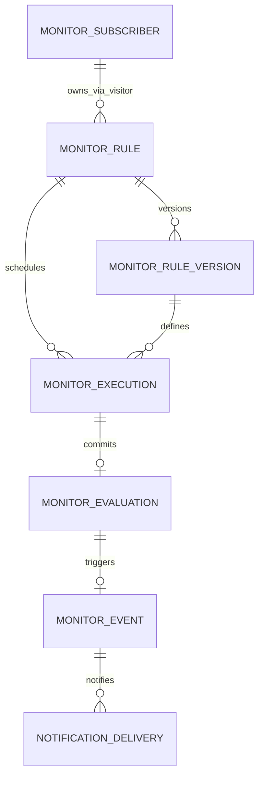
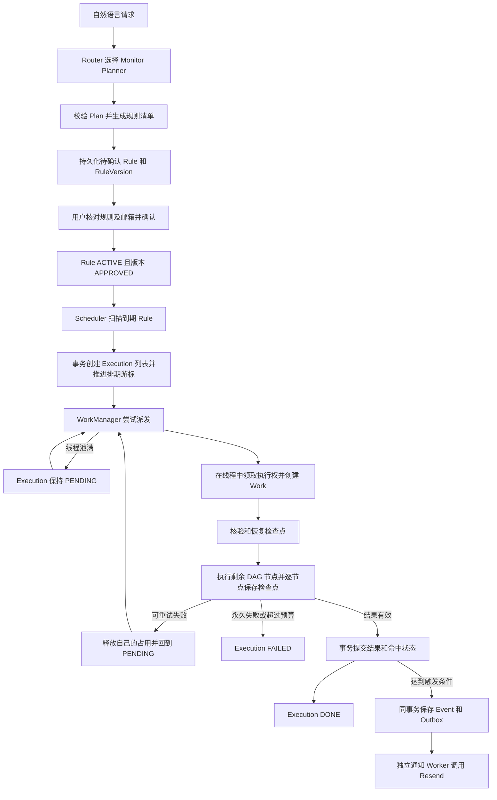
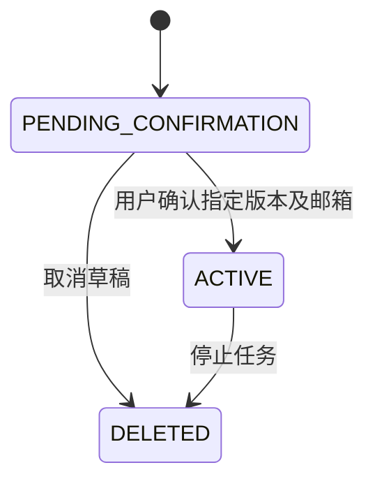
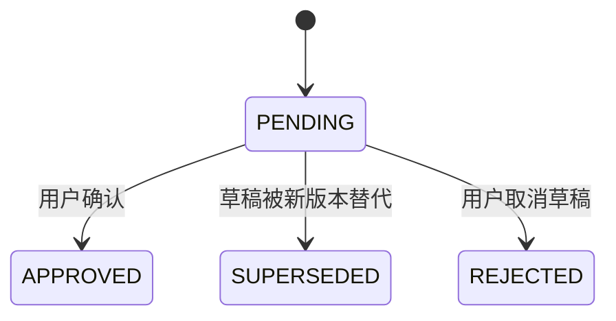
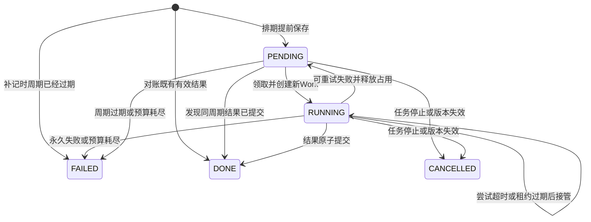
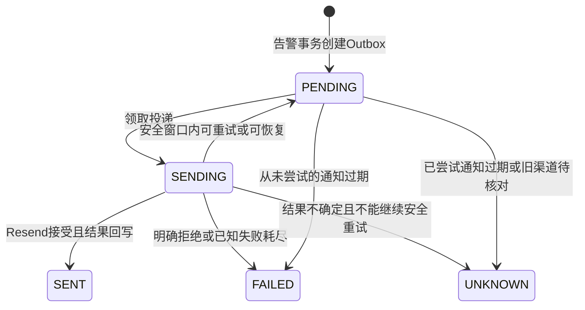

# Monitor Agent：主动监控 V1 实现总结

更新日期：2026-10-27。本文描述当前代码已实现的能力、数据结构和恢复边界；部署仍需完成数据库迁移、配置邮件（真实 Resend 或显式模拟模式）并打开监控总开关。

V1 已形成完整链路：**自然语言规划 → 待确认草稿 → 用户确认 → 提前保存 Execution → Work 执行与节点恢复 → 原子提交结果及告警 → Resend 邮件投递。**

**已实现应用进程崩溃、重启后的有界恢复。** 恢复依据是数据库中的排期游标、Execution、租约、尝试次数和检查点，WorkManager 的内存状态丢失不会丢掉已经提交的执行记录。恢复受本周期期限和尝试次数限制；过期执行会留下失败记录，不会无限补跑历史或补发过期行情告警。相关机制已有本地恢复测试，尚未进行真实进程强杀和线上故障演练。

## 1. 功能范围

### 1.1 用户可用的能力

| 能力 | V1 行为 |
| --- | --- |
| 意图路由 | Plan 前先区分 Query、Monitor 或需要澄清的请求；Query 保持原查询链路 |
| 自然语言创建 | Monitor Planner 生成独立候选，复用指标 LogicalPlan 和已接入的计算算子 |
| 规则组合 | 1～2个条件，固定 AND；同一交易所、同一 USDT 永续品种 |
| 行情范围 | Binance 或 OKX；支持符合监控约束的滚动时间指标和快照指标，包括价格、OI 及合法计算结果 |
| 规则确认 | 编译器生成确定性的规则说明，用户核对规则、版本和邮箱后点击确认；模型文本不能代替确认操作 |
| 邮箱绑定 | 直接填写通知邮箱，无验证码；通过浏览器访客 cookie 隔离任务归属 |
| 草稿修改 | 同一会话修改尚未确认的草稿会新增版本，旧卡片失效 |
| 任务管理 | 卡片支持取消草稿、停止已启用任务、查看执行记录、告警证据和邮件投递状态 |
| 行情执行 | 后台只调用确定性指标和计算能力，不再调用 Router、Planner 或 Answer |
| 执行恢复 | 持久化 Execution，失败有界重试，重启可接管，成功节点可恢复 |
| 通知 | 连续满足后创建告警和邮件 Outbox，通过 Resend 投递 |
| 模拟邮件 | 全局RESEND_DRY_RUN，或命中特定模拟收件地址时，只记录日志并落库为带模拟标记的SENT |
| 运维巡检 | 管理凭证访问/api/monitor-health，按请求执行7项只读检查，返回违规和未完成检查 |

待确认草稿已持久化，但不会产生 Execution、查询行情或发送邮件。填写邮箱、读取历史、在聊天里说“确认”，都不会直接启用任务。聊天确认接口核验 `version + specHash + recipient`，重复确认不会重置调度和命中状态。

尚未接入：OR、不同任务自定义检查频率、运行中规则的自然语言修改与版本切换、暂停恢复、完整用户账户系统、历史告警自然语言追问、Work 心跳、多队列调度和邮件送达 webhook。当前已具备待确认草稿的自然语言修改，以及按钮取消、停止。

### 1.2 时间与数据口径

- 检查间隔固定5分钟，扫描器默认每10秒运行一次，在数据边界后默认等待20秒发布延迟。
- 滚动窗口为5～1440分钟，且为5分钟整数倍；同一 Plan 中所有时间指标的窗口一致。快照指标没有滚动窗口。
- 时间指标未指定采样粒度时，在确认前固定为 `5m` 并保存；当前后台不允许显式非 `5m` 的时间指标启用。
- 观察窗口、采样粒度、检查间隔是三个概念。例如“最近一小时变化”可以每5分钟检查一次。
- 比较符支持 `GT/GTE/LT/LTE`，阈值按被引用结果的单位解释。百分数指标的 `-2` 表示 `-2%`；价格、数量、ratio 等沿对应指标或算子的单位契约解释。
- 价格变化率按完整已收盘成交 K 线的首开至末收计算；OI 变化率要求准确的起止采样端点。缺失、不完整、窗口偏移或过期数据不会触发告警。
- 例如15:05:20派发截止点为15:05的“最近一小时”检查：K线使用 `[14:05,15:05)`，OI变化使用14:05和15:05的准确采样点。重试保持这一截止点。
- 整个 AND 条件连续命中次数为1～12。轮询间隔内短暂发生又消失的条件可能漏掉，不承诺连续时刻监测。

## 2. 对象模型与关联

| 对象 | 持久化 | 职责和身份 |
| --- | --- | --- |
| Rule | 是 | 一个长期监控任务；`rule_id` 标识整个条件组，保存整体状态、当前版本、排期游标和触发状态 |
| RuleVersion | 是 | 某个版本的 Plan、条件清单及策略；身份为 `(rule_id, version)`，定义内容固定，审批状态可变化 |
| Execution | 是 | 一个应执行的检查周期；业务身份为 `(rule_id, rule_version, scheduled_at)`，另有 `execution_id` |
| Work | 否 | 完成 Execution 的一次尝试；每次有新 `workId`，固定版本和截止点，持有本次 token |
| WorkManager | 否 | 管理本进程的派发、并发、完成回调、重试和超时撤销；跨进程执行权由数据库仲裁 |
| Evaluation | 是 | 一次有效提交的检查结果和行情证据；同一周期最多一条 |
| Event / Delivery | 是 | 触发后的独立业务告警和通知投递记录；不依赖 Work 进程存活 |

示例：

```text
Rule：monitor-A
└─ RuleVersion：version=1
   ├─ 共用 Plan：价格指标 + OI指标 + 必要计算
   ├─ condition_1：价格变化率 < -2%
   └─ condition_2：OI变化率 > 3%

Execution：monitor-A / version=1 / 截止15:05
├─ Work A：第1次尝试，保存价格节点，OI失败
└─ Work B：第2次尝试，恢复有效价格节点，继续取OI并提交
```

多个条件保存在同一版本的 `rules` JSON 数组中，没有单独的条件明细表。`condition_1` 等 ID 只在版本内定位条件，不是全局唯一 ID；定位条件需要 `rule_id + version + condition ID`。各条件通过 `valueRef` 引用同一份 Plan 的指标或计算输出。

当前一个 Rule 只启用一个版本。停止 Rule 会使未完成 Execution 取消，并撤销在途 Work 的有效提交权；已完成 Execution 和已提交 Event 不改写，已创建的邮件仍独立处理。

## 3. 表结构

监控相关共7张表。完整 DDL 以 [schema.sql](../src/main/resources/db/schema.sql) 和 [迁移目录](../src/main/resources/db/migrations) 为准。下列为逻辑关联，当前 DDL 未配置外键约束。所有业务 `DATETIME` 按 UTC 写入和读取。



Execution 与 Evaluation 通过 `(rule_id, rule_version, scheduled_at)` 对应，Evaluation 表没有额外的 `execution_id` 列。Subscriber 与聊天 Rule 的关系由服务端使用 `visitor_id` 及 `owner_id='v:'+visitor_id` 建立。

### 3.1 `monitor_rule`：任务、排期和触发状态

| 字段 | 类型 | 含义 |
| --- | --- | --- |
| `rule_id` | VARCHAR(64)，主键 | 整个监控任务及条件组的 ID |
| `owner_id`、`request_id` | VARCHAR(64) | 归属及创建幂等标识；组合唯一 |
| `status` | VARCHAR(32) | PENDING_CONFIRMATION / ACTIVE / DELETED |
| `active_version`、`pending_version` | INT | 当前启用版本和待确认版本 |
| `source_conversation_id` | VARCHAR(64)，可空 | 聊天来源会话；当前所有新任务均关联来源会话 |
| `recipient` | VARCHAR(255)，可空 | 聊天确认时固定的收件人；以后更换绑定邮箱不改写已有任务 |
| `next_check_at` | DATETIME(6)，可空 | 下一次应生成 Execution 的时间，即持久化排期游标 |
| `last_evaluated_slot` | DATETIME(6)，可空 | 最近有效提交的检查截止点 |
| `consecutive_hits`、`trigger_state` | INT / VARCHAR(24) | 整组条件的连续命中计数及 ARMED / WAITING_RESET |
| `hit_evidence_json` | JSON，可空 | 尚未达到触发次数的连续命中证据 |
| `created_at`、`updated_at` | DATETIME(6) | 创建及更新时间 |

关键约束和索引：`UNIQUE(owner_id,request_id)`；到期扫描索引 `(status,next_check_at)`；草稿查询索引 `(owner_id,source_conversation_id,status)`。

### 3.2 `monitor_rule_version`：不可变版本定义

| 字段 | 类型 | 含义 |
| --- | --- | --- |
| `rule_id`、`version` | VARCHAR(64) / INT，联合主键 | 版本身份 |
| `user_query` | TEXT，可空 | 原始需求 |
| `rule_spec_json` | JSON | 完整Plan执行定义，`schemaVersion=2` |
| `spec_hash` | CHAR(64) | 定义摘要，用于确认核验和执行绑定 |
| `status` | VARCHAR(24) | PENDING / APPROVED / SUPERSEDED / REJECTED |
| `source_turn_id` | VARCHAR(64)，可空且唯一 | 聊天同一轮重复保存的幂等标识 |
| `created_at`、`approved_at` | DATETIME(6) | 创建和确认时间 |

聊天定义示意，具体 Plan 和条件字段有所省略：

```json
{
  "schemaVersion": 2,
  "timezone": "Asia/Shanghai",
  "catalogVersion": "目录版本",
  "candidate": {"plan": {}, "monitor": {}},
  "rules": [
    {"id":"condition_1", "valueRef":"{{m1.binance.value}}", "operator":"LT", "threshold":-2, "unit":"percent"},
    {"id":"condition_2", "valueRef":"{{m2.binance.value}}", "operator":"GT", "threshold":3, "unit":"percent"}
  ],
  "relation": "AND",
  "requiredHits": 2,
  "checkIntervalSeconds": 300,
  "rearmPolicy": "AFTER_NO_MATCH"
}
```

### 3.3 `monitor_execution`：持久化执行账本

| 字段 | 类型 | 含义 |
| --- | --- | --- |
| `execution_id` | VARCHAR(64)，主键 | 同一周期各次 Work 共用的执行 ID |
| `rule_id`、`rule_version`、`spec_hash` | VARCHAR(64) / INT / CHAR(64) | 固定任务版本和定义摘要 |
| `scheduled_at` | DATETIME(6) | 本轮行情截止点，不是线程实际开始时间 |
| `deadline_at` | DATETIME(6) | 本轮总期限，当前为截止点后300秒 |
| `status` | VARCHAR(24) | PENDING / RUNNING / DONE / FAILED / CANCELLED |
| `attempt_count` | INT | 已领取尝试次数，重启后不清零 |
| `lease_token`、`lease_until` | BIGINT / DATETIME(6) | Execution独立递增的领取令牌与本次Work期限；lease_until=min(领取时间+work-timeout-seconds,deadline_at) |
| `checkpoint_json` | JSON，可空 | 已保存的完整成功节点、中间数据及校验信息 |
| `result` | VARCHAR(16)，可空 | 有效提交后的检查结果；执行中和失败终止时可以为空 |
| `last_error` | VARCHAR(1000)，可空 | 最近失败或终止原因 |
| `started_at`、`finished_at` | DATETIME(6)，可空 | 首次领取和最终终止时间 |
| `created_at`、`updated_at` | DATETIME(6) | 账本创建和最近更新时间 |

关键唯一键：**`UNIQUE(rule_id,rule_version,scheduled_at)`**。同一周期反复扫描、重试或接管，不会生成多个逻辑 Execution。Work ID 不持久化；每次新尝试生成新 Work ID 和 token。

索引覆盖状态及周期派发、按任务查询和终态记录清理。Execution 没有 `next_retry_at`，V1 的执行重试可以立即进行；邮件队列有独立的退避时间。

### 3.4 `monitor_evaluation`：有效检查结果

| 字段 | 含义 |
| --- | --- |
| `evaluation_id`，主键 | 有效提交的检查结果 ID |
| `rule_id`、`rule_version`、`scheduled_at` | 周期身份，组合唯一 |
| `data_cutoff_at` | 本轮数据截止点 |
| `started_at`、`finished_at` | 产生最终结果的那次 Work 开始和提交时间 |
| `result` | MATCH / NO_MATCH / UNKNOWN；与 Execution 的运行状态分开 |
| `evidence_json`、`error_code` | 最终指标值、各条件判断、行情事实和错误信息 |

该表在最终有效提交时写入。RUNNING、中途失败和待重试不伪装成一条已完成 Evaluation。后台取数失败当前会有界重试，耗尽后 Execution 为 FAILED，不当作 NO_MATCH。

### 3.5 `monitor_event`：业务告警及长期证据

| 字段 | 含义 |
| --- | --- |
| `event_id`，主键 | 告警事件 ID |
| `rule_id`、`rule_version`、`evaluation_id` | 来源任务、版本和触发检查 |
| `event_key`，唯一 | 根据任务、版本和周期生成的事件幂等键 |
| `triggered_at` | 触发时间 |
| `evidence_snapshot` | 规则、hash、全部连续命中证据、指标值和冻结邮件请求 |

Event 保存足够的解释证据。清理 Evaluation 和 Execution 后，历史告警仍能展示，不依赖会话缓存或重新查询历史行情。`evidence_snapshot.resend_request` 冻结发件人、收件人、标题、正文和事件请求头。

邮件中每个实际值按规则id关联其description展示，不向用户显示condition_1等内部标识；缺少历史描述时使用“监控条件”兜底。正文分别说明“连续命中N次即触发”和本次告警已保存的实际连续命中次数，并逐次编号列出命中证据。检查截止时间按冻结定义中的timezone渲染，附带时区偏移与原始UTC时间；缺少或无效时区回退UTC。历史已冻结邮件的正文不会因模板升级而改写，以保持相同Resend幂等键的请求一致，新模板用于之后新生成的告警。

### 3.6 `notification_delivery`：通知 Outbox

| 字段 | 含义 |
| --- | --- |
| `delivery_id`，主键；`event_id` | 投递身份和来源告警 |
| `channel`、`recipient` | EMAIL 和固定收件人；与 event_id 组合唯一 |
| `status`、`attempt_count`、`next_retry_at` | 投递状态、尝试次数和下次可重试时间 |
| `lease_until`、`lease_token` | 独立于行情执行的投递占用和回写保护 |
| `provider_message_id` | Resend 返回的邮件 ID |
| `last_error`、`sent_at`、`created_at`、`updated_at` | 错误、服务商接受发送的时间及审计时间 |

### 3.7 `monitor_subscriber`：灰度邮箱绑定

字段为 `visitor_id`（主键）、`email`、`created_at`、`updated_at`。无验证码或邮箱已验证字段，邮箱不唯一，也不是认领其他浏览器任务的凭证。

浏览器 cookie `cexpilot_uid` 用于任务归属。相同邮箱的其他浏览器不能查看原任务；清除 cookie 或换浏览器，不会按邮箱自动恢复任务。Resend API Key 只从部署环境读取，不写入这些表。

## 4. 执行流程



### 4.1 先排期，后执行

Scheduler 默认每10秒执行一次：先处理本进程超时 Work，再生成到期 Execution，最后派发可执行记录。

每个到期 Rule 在短事务中锁定任务行，读取 `next_check_at` 和当前启用版本，生成应有的周期记录，然后推进游标。每个 Rule 每批最多处理100个周期，扫描每批最多20个到期 Rule。长停机时分批补账；超出期限的周期直接记录 FAILED。

**创建 Execution 与推进游标在同一事务中。** 线程池繁忙、进程在派发前退出，均不会抹去已经提交的 PENDING 记录。执行结束不再推进排期游标，避免旧 Work 将新的排期时间覆盖回去。

### 4.2 领取与 Work 管理

- WorkManager 使用内存索引按 ruleId 去重，检查线程池当前为2线程、无排队容量；邮件池独立为1线程。
- 线程池接纳后才领取数据库执行权，避免任务排队期间消耗租约。
- 领取事务统一按 **Rule → Execution** 加锁，核验任务启用、版本、定义摘要、期限和尝试次数。
- 领取后 Execution 变为 RUNNING、尝试次数加一，本条 Execution 的 token 递增，保存本次 lease_until，创建内存 Work。
- Rule不保存执行租约或token；同一Execution通过行锁、RUNNING状态、租约和token防止重复有效领取。V1各周期的有效窗口不重叠：本轮deadline_at=截止点+300秒，下轮最早在下一截止点+20秒才可领取。
- Rule行锁仍用于与停止、版本修改及命中计数更新串行化。本地WorkManager按ruleId去重；跨进程的执行正确性由Execution执行权及周期期限保证。租约过期后旧线程可能仍在取数，但不能提交过期结果。
- 已存在同周期 Evaluation 时，领取逻辑可以将 Execution 对账为 DONE，不再创建重复 Work。

租约回答“执行权有效到何时”，token 区分“哪次领取的执行权”。提交时同时核验，避免旧 Work 借用新 Work 的租约。

### 4.3 节点中间数据与断点恢复

Worker 只取数、计算并返回结果。检查点保存和最终提交由 WorkManager 调用 ExecutionService 完成，Worker 不直接操作数据库。

检查点格式示意：

```json
{
  "schemaVersion": 1,
  "specHash": "固定版本的摘要",
  "slot": "2026-10-27T07:05:00Z",
  "catalogVersion": "固定的指标目录版本",
  "nodes": {
    "metric_0": {"signature":"节点签名", "data":{}},
    "c1": {"signature":"节点签名", "data":{}}
  }
}
```

- 只保存完成且有效的节点。中间数据持久化粒度是 DAG 节点，不是每个分页请求、每一行样本或任意代码指令。
- 新 Work 校验格式版本、specHash、目录版本、截止点、节点签名和数据新鲜度。检查点身份不匹配时不复用；目录变更导致执行定义本身不可运行时直接终止。
- 时间指标必须完整覆盖同一要求窗口；快照须通过时效校验。失败或部分数据不成为成功检查点。
- 计算节点只有在全部依赖也被有效复用时才复用。过期快照会使依赖它的计算一起失效。
- 有效成功节点直接恢复，缺失、失败或失效的节点重新执行。
- 一个节点取数已完成、检查点尚未提交就崩溃，恢复后会重做该节点；已经提交的有效节点可以复用。

### 4.4 重试、超时与终止

默认最多3次尝试。Execution只保留两个执行控制时间：`deadline_at=scheduled_at+300秒` 固定本周期总期限；`lease_until=min(领取时间+60秒,deadline_at)` 同时表示本次Work期限和占用到期时间。重试增加本条Execution的token并重新计算lease_until，不延长deadline_at；不再维护独立attempt_deadline。

可重试错误或临时数据不可用时，在同一 Execution 下立即创建新 Work，保持版本、截止点和 executionId 不变。释放和重领均核验旧 token；每次重新领取获得新 token。没有执行退避状态或心跳，超时由扫描和完成/检查点回调检查。保存检查点不续租，也不延长本次或整个周期的期限。

永久错误、次数耗尽、总期限到达时，Execution 终止为 FAILED。任务本身仍可保持 ACTIVE，继续后续周期；本轮失败打断连续命中，但不解除已经触发后的 WAITING_RESET。补记更早的过期周期不会清掉较新周期的命中计数。

任务停止、启用版本变化或定义失效时，旧执行被取消或失去提交权。线程取消只是尽力中断，正确性最终由数据库状态和 token 校验保障。

## 5. 状态机

### 5.1 Rule 与 RuleVersion



Rule 失败执行后仍为 ACTIVE；它不会随着每个 Work 在 RUNNING、DONE 之间变化。DELETED 是软删除，V1 不支持再次启动。



RuleVersion 的定义内容固定。停止已启用任务不会将已批准版本改成 REJECTED；运行中版本修改与生效策略留待后续版本实现。

### 5.2 Execution



| 状态 | 含义 | 后续行为 |
| --- | --- | --- |
| PENDING | 已持久化，尚未执行或可立即重试 | 满足条件时创建 Work |
| RUNNING | 被某次尝试领取 | 有效占用期间不重复领取；尝试超时或租约过期后可接管 |
| DONE | 有效检查结果和相应业务状态已提交 | 不再派发 |
| FAILED | 本周期终止 | 不自动重启本周期，后续周期继续按 Rule 排期 |
| CANCELLED | 任务或版本已不允许继续 | 不再派发 |

DONE 表示执行完成，不表示条件命中。MATCH / NO_MATCH / UNKNOWN 是检查结果，与执行状态分开；重试时不把每次失败尝试写成重复 Evaluation。

### 5.3 告警触发状态：保存在 Rule 上

| 当前状态和检查结果 | 变化 |
| --- | --- |
| ARMED + MATCH，未达连续次数 | 计数加一；跨过未执行周期时从新一轮计数开始 |
| ARMED + MATCH，达到连续次数 | 生成一次 Event 和 Outbox，保存连续证据，进入 WAITING_RESET，计数清零 |
| WAITING_RESET + MATCH | 保持等待，不重复告警 |
| 任意状态 + 有效 NO_MATCH | 回到 ARMED，清除连续计数和暂存证据 |
| 任意状态 + UNKNOWN | 清除连续计数，保留触发状态 |
| 本周期 Execution FAILED | 打断连续计数，保留触发状态 |

只有有效 NO_MATCH 才允许触发后的任务重新武装，行情缺失或 Work 失败不会被解释成条件恢复。

### 5.4 邮件投递状态



SENT 表示 Resend API 接受发送并返回邮件 ID，不表示已到达收件箱。UNKNOWN 不自动重发，V1 没有送达/退信 webhook 或人工重发接口。

## 6. Durable：持久化、崩溃恢复与保证边界

### 6.1 当前已经实现的恢复能力

Durable 依赖已提交到数据库的排期、执行和业务记录，而非 WorkManager 的内存 Map。恢复需连接同一套保留数据的数据库、开启监控，并恢复所需配置和外部依赖。

| 崩溃位置 | 数据库中保留什么 | 恢复后的行为 |
| --- | --- | --- |
| 排期事务提交前 | 事务回滚，旧游标仍在 | 下一次扫描重新生成，不会出现只推进游标却没有 Execution |
| Execution 已保存，Work 尚未派发 | PENDING 记录与新游标 | 扫描并重新派发；线程池满也采用这条路径 |
| Work 已领取，尚未保存节点 | RUNNING、次数、期限、租约和 token | 尝试超时或租约到期后，在剩余预算内新建 Work，重做未保存部分 |
| 已保存部分节点 | 已提交的 checkpoint_json | 新 Work 验证后复用有效节点，继续执行其余节点 |
| 结果提交事务中途 | 事务整体回滚，之前的检查点仍在 | 重新领取后恢复计算和提交，不产生半条告警 |
| 结果提交成功、进程未及时返回 | DONE、Evaluation、Rule状态及可能的 Event/Outbox | 不重复执行或重复推进命中；同周期已有 Evaluation 时也可对账为 DONE |
| 告警已提交，邮件尚未发送 | Event 和 PENDING Outbox | 独立投递器继续处理，无需重跑行情 |
| 邮件 API 可能已接受，状态未回写 | SENDING、冻结请求、投递 ID 和次数 | 在安全窗口内使用相同幂等键及载荷恢复；无法确认且不能安全重试时记 UNKNOWN |
| 进程停机跨过多个检查周期 | 旧排期游标及已有账本 | 分批补记缺失周期；过期周期记 FAILED，只执行尚未过期的周期 |

### 6.2 恢复示例

```text
15:05:00  本轮行情截止点
15:05:20  Execution落库，Work A领取
          lease_until=15:06:20（本次尝试期限）
          deadline_at=15:10:00
15:05:35  价格节点检查点已提交
15:05:40  应用进程退出，OI节点未完成
15:06:30  应用恢复扫描，发现尝试期限已到
          Work B接管，executionId、版本、截止点不变，token更新
          复用仍有效的价格数据，继续取OI并提交
```

如果直到15:10:30才恢复，本轮已经超过总期限，标为 FAILED，不补发15:05周期的告警；按排期处理仍有效的新周期。达到3次尝试、任务停止或版本失效，也会阻止继续接管。

### 6.3 保证与限制

- 可以恢复应用进程丢失的执行管理状态；不依赖原 Work 对象继续存在，也不要求原进程发送失败回调。
- 可以保留应执行记录并识别遗漏，不保证进程停机期间仍准点检查。
- 多次 Work 可以重复执行只读行情请求，数据库只允许一次有效业务提交；不承诺行情 HTTP 请求只发生一次。
- 只恢复已持久化且仍有效的完整节点；正在执行的节点或尚未提交的结果可能重做。
- 超过本轮期限的记录终止，不无限恢复历史，也不无限重试失败任务。
- 数据库持久化和事务能力是恢复前提；V1 未建设数据库灾备或跨地域恢复。
- Execution 和 Evaluation 终态记录当前保留7天；Event/Delivery 及告警证据首版不自动清理。

## 7. 事务、并发与一致性

### 7.1 事务边界

| 事务 | 同时提交的内容 |
| --- | --- |
| 保存聊天草稿 | 校验会话执行权，创建/更新待确认 Rule，新增不可变版本，替代旧草稿 |
| 确认任务 | 核验版本、hash、收件邮箱及会话状态，批准版本，固定收件人，启用 Rule 和排期 |
| 生成排期 | 创建应有 Execution，推进 Rule.next_check_at，记录已过期周期 |
| 领取执行 | 锁 Rule 和 Execution，核验资格，递增 token 和尝试次数，保存期限及 RUNNING |
| 保存检查点 | 核验当前执行权，仅更新该 Execution 的有效中间数据 |
| 失败处理 | 仅处理自己的 token；记录错误，回到 PENDING 或终止，释放占用；终止失败打断连续计数 |
| 最终提交 | Evaluation、Rule触发状态和命中证据、必要的 Event/Outbox、Execution DONE |
| 停止任务 | Rule软删除、清除排期、取消 PENDING/RUNNING Execution并清除其租约；旧Work因状态校验失去写权限 |
| 领取/回写邮件 | 独立投递状态、次数、租约和 token；外部 Resend 调用不在数据库事务内 |

行情 HTTP 和计算在数据库事务之外执行，避免长期持锁。执行相关事务统一采用 Rule → Execution 的锁顺序。聊天命令另先锁会话状态和会话，再锁 Rule，以阻止草稿生成与旧卡片确认相互覆盖。

### 7.2 多层幂等与防迟到提交

| 机制 | 作用 |
| --- | --- |
| `UNIQUE(owner_id,request_id)` | 任务创建请求幂等；聊天创建同时通过source_turn_id唯一键防重 |
| `UNIQUE(source_turn_id)` | 聊天同一轮重复保存不生成不同草稿 |
| `version + specHash + recipient` | 确认内容与实际启用内容一致；旧版本卡片不能确认新定义 |
| `UNIQUE(rule_id,rule_version,scheduled_at)`，Execution | 同一周期只存在一个逻辑执行实例 |
| 同组合唯一键，Evaluation | 同一周期只提交一条有效结果 |
| `UNIQUE(event_key)` | 同一触发周期不产生重复业务告警 |
| `UNIQUE(event_id,channel,recipient)` | 同一告警、渠道和收件人只创建一条投递 |
| 租约、token、期限及状态校验 | 旧 Work 不能覆盖新执行者的检查点、结果或占用；停止后的迟到结果无效 |
| WorkManager 内存索引 | 降低本进程重复派发，不能代替数据库仲裁 |

不会先标记 DONE 再另行写告警，也不会在邮件发送失败时重新执行行情。检查的有效业务结果及 Outbox 依靠单事务保持一致；数据库之外的邮件通过服务商幂等机制和不确定状态管理。

### 7.3 Resend 投递恢复

只使用 Resend，不保留另一套邮件服务器发送实现。投递幂等键固定为 `cexpilot/<delivery_id>`，发送载荷来自 Event 中的冻结请求，重试不会重新渲染正文或采用修改后的发件人。

- 429允许重试；5xx、连接异常、缺少邮件 ID、并发幂等请求也可在安全窗口内重试，但保留“结果可能不确定”的标记。
- 明确的参数或权限错误停止重试。如果前一次结果已经不确定，后一次拒绝不会将其误报为确定未发送。
- Resend 的[幂等有效期为24小时](https://resend.com/docs/dashboard/emails/idempotency-keys)。本服务保守限制在 Outbox 创建后的23小时内自动发送，默认最多3次。
- 超过窗口时，从未尝试的通知记 FAILED，已尝试的记 UNKNOWN。SENDING 租约过期后，只有满足恢复条件才重新派发。
- 旧渠道从未尝试的 PENDING 可首次冻结请求再发送；旧渠道已尝试或在途记录不会自动跨渠道重投。

V1 不将本地事务和外部邮件 API 描述为全局 exactly-once；SENT 也不等于收件箱实际送达。

## 8. 接口与代码入口

### 8.1 聊天入口

`POST /api/ask`、`POST /api/ask/stream` 共用路由和监控规划。返回 `type=monitor` 及包含 candidate、confirmation 的 planning。QueryFrame/TaskState 不保存监控任务，监控上下文与查询任务隔离。详细协议见[路由与监控规划](路由与监控规划.md)。

### 8.2 访客隔离的监控接口

读取和写入使用同源 `cexpilot_uid` cookie。写请求需 JSON 和 `X-Monitor-Action: 1`；不使用巡检的 Bearer 凭证。

| 方法与路径 | 用途 |
| --- | --- |
| GET /api/monitor-flow/profile | 当前访客的邮箱绑定 |
| PUT /api/monitor-flow/profile | `{email}` 绑定通知邮箱，无验证码 |
| GET /api/monitor-flow/rules | 当前浏览器任务列表 |
| GET /api/monitor-flow/rules/{id}?version= | 版本确认卡片；不传版本取当前版本 |
| POST /api/monitor-flow/rules/{id}/confirm | `{version,specHash,recipient}` 确认启用 |
| POST /api/monitor-flow/rules/{id}/reject | `{version,specHash}` 取消草稿 |
| POST /api/monitor-flow/rules/{id}/stop | `{version,specHash}` 停止任务 |
| GET /api/monitor-flow/rules/{id}/executions | 最近100次执行的状态、截止点、尝试次数、已保存节点数和错误 |
| GET /api/monitor-flow/rules/{id}/events | 最近告警证据和投递状态 |

首页确认卡片支持查看执行记录。查询接口返回的是当前已持久化状态，重新打开页面也可恢复尚未回显的草稿及任务卡片。

### 8.3 跨租户只读巡检

```http
GET /api/monitor-health?sinceHours=24&ruleId=<可选>
Authorization: Bearer <MONITOR_ACCESS_TOKEN>
```

**只在调用接口时执行巡检，没有新增巡检定时任务。** 接口不领取 Execution、不重试、不修复数据。鉴权复用 `MonitorAccessFilter`；不使用访客 cookie 或固定 owner 过滤，可以汇总所有访客的任务。访问凭证至少32字符；未配置返回503，凭证缺失或错误返回401。即使 `MONITOR_ENABLED=false`，合法凭证仍可读取巡检结果。

`sinceHours` 限1～24，默认24。`ruleId` 只缩小数据库业务检查与计数范围，实例扫描状态始终是全局信息；不存在的任务返回404。历史执行、事件和投递按窗口统计，但当前卡住的 PENDING/RUNNING、积压的邮件不受历史窗口限制，避免老积压漏检。

| 检查标识 | 检查内容 |
| --- | --- |
| SCAN_HEALTH | 调度和邮件扫描最近是否成功、是否抛错或长时间未成功 |
| SCHEDULE_COMPLETENESS | ACTIVE任务游标是否推进；当前批准版本在窗口内的应执行周期是否已有Execution，包括游标已推进但执行账本缺行 |
| EXECUTION_STALLED | PENDING逾期、RUNNING租约/单次期限/总期限失效，或窗口内执行终态FAILED |
| OWNERSHIP_CONSISTENCY | 启用版本是否批准、有效Execution与Rule状态/版本是否对应、Execution token及租约是否有效、同一Rule是否有多个有效执行者 |
| EVALUATION_CONSISTENCY | DONE是否有相同版本、截止点和结果的Evaluation；已有Evaluation是否对应DONE |
| EVENT_OUTBOX_CONSISTENCY | Event是否对应MATCH，是否有邮件Outbox，Outbox是否有Event |
| DELIVERY_HEALTH | 发送器配置、邮件积压/租约失效、FAILED/UNKNOWN、SENT缺接受凭证 |

MATCH未生成Event不一定异常，例如需要连续2次命中，或正在等待恢复，不能把它一概当成告警丢失。已过期、等待接管的旧Execution不再作为“有效持有者”参加租约冲突检查；其恢复迟滞由执行卡住检查负责。

返回体示意：

```json
{
  "generatedAt": "2026-10-27T09:12:00Z",
  "sinceHours": 24,
  "ruleId": null,
  "enabled": true,
  "status": "INCOMPLETE",
  "runtime": {
    "scope": "INSTANCE",
    "instanceId": "<本次进程实例ID>",
    "startedAt": "2026-10-27T08:00:00Z",
    "activeWorks": 1,
    "mailMode": "DRY_RUN",
    "mailConfigured": true,
    "schedule": {"lastStartedAt": "...", "lastSucceededAt": "...", "lastFailedAt": null, "lastError": null, "running": false},
    "mail": {"lastStartedAt": "...", "lastSucceededAt": "...", "lastFailedAt": null, "lastError": null, "running": false},
    "scanLagSeconds": 3,
    "mailScanLagSeconds": 3
  },
  "counts": {"activeRules": 3, "executionsInWindow": 864, "eventsInWindow": 2, "deliveriesInWindow": 2, "simulatedDeliveriesInWindow": 2},
  "checks": 7,
  "ran": 6,
  "checkResults": [{"check": "EXECUTION_STALLED", "status": "ERROR", "violations": 0}],
  "errors": [{"check": "EXECUTION_STALLED", "code": "CHECK_QUERY_FAILED"}],
  "violationsTotal": 0,
  "errorViolationsTotal": 0,
  "warningsTotal": 0,
  "truncated": false,
  "violations": []
}
```

示例省略另外6条 `checkResults`。`checks` 是计划执行的检查数；`ran` 是**成功完成**的检查数，查出了违规也算成功完成。某项查询异常时只记录该项ERROR及脱敏错误码，不在finally里增加ran，也不把这项不完整的发现合并到违规清单。计数查询和快照事务失败同样记入errors，因此客户端必须同时检查 `status`、`ran == checks`、`errors` 和完整的分级计数。

状态按以下优先级汇总，使用未截断的全量计数：

| 条件 | status | HTTP |
| --- | --- | --- |
| 任意检查未完成或统计/事务失败 | INCOMPLETE | 503 |
| errorViolationsTotal > 0 | UNHEALTHY | 200 |
| 无ERROR，仅warningsTotal > 0 | DEGRADED | 200 |
| 无异常且监控已启用 | HEALTHY | 200 |
| 无异常且监控未启用 | DISABLED | 200 |

Execution历史FAILED（包括发布恢复后补记的EXECUTION_EXPIRED）为WARN；后续周期恢复成功后，仅这些历史记录不会再导致UNHEALTHY。邮件PENDING超过宽限期同样为WARN。当前不增加连续失败升级策略；Execution仍按原状态机保留FAILED事实，不修改调度或重试行为。

关闭监控时，预期停止的扫描、排期、执行积压检查不报警，仍完成适用的一致性及历史投递检查。所有响应禁止缓存。HTTP200只说明巡检完成，不能直接当成系统健康。

调用方应在HTTP错误、ran不等于checks、errors非空或errorViolationsTotal大于0时报告失败；只有WARN时显示提醒，不按普通故障退出。不要再使用 `if violations: exit(1)`，也不要只过滤返回列表里的severity=ERROR，因为列表可能截断。DEGRADED仍保留WARN详情；checkResults中相应检查仍为VIOLATION，ran仍按成功完成计算。

查询在只读REPEATABLE_READ事务中执行，固定同一个Java Clock时间作为边界，避免多个查询读到业务事务提交一半的假象。结果只返回结论、ID和脱敏描述，不返回邮箱、完整规则、邮件正文、SQL异常消息。违规默认最多返回100条，`violationsTotal` 保留完整数量，`warningsTotal`和`errorViolationsTotal`分别保留全量WARN和ERROR数量，三者满足violationsTotal=warningsTotal+errorViolationsTotal；`truncated` 标记省略。分级计数在SQL的LIMIT之前完成，ERROR被列表截断也不会降级为DEGRADED；排期核对超过默认1000个ACTIVE任务或200000条候选Execution时，这项返回CHECK_SCOPE_TOO_LARGE，不能静默截断后宣布健康。可用ruleId缩小范围或调整容量。

现有两个扫描器记录本实例的开始、成功和失败时间；**开始扫描不等于成功**。固定延迟10秒意味着“本轮结束后再等10秒”，若本轮花了8秒，下轮开始大约在18秒后。默认启动宽限及距最近成功扫描的容忍阈值均为60秒。发现停止还受外部调用频率影响：例如每30秒调用一次，超出60秒阈值后，要等下一次调用才看到违规，不能承诺10秒内发现。接口没有Work心跳；进程完全退出时接口也无法响应，需要调用方将超时、连接失败和非成功响应视为故障。

runtime仅代表命中的进程实例，不持久化；多副本部署应逐实例巡检，负载均衡随机命中不能证明所有实例正常。数据库业务检查汇总共享数据库，不以单机activeWorks推断其他节点租约是否合法。

可配置项（均有默认值，不需要额外配置调度）：`monitor.health.grace-seconds=60`、`scan-stale-seconds=60`、`max-violations=100`、`max-rules=1000`、`max-executions=200000`、`query-timeout-seconds=3`、`transaction-timeout-seconds=20`。时间与容量超限会明确返回检查错误。

### 8.4 关键代码

| 模块 | 代码 |
| --- | --- |
| 路由 | [AgentDispatcher](../src/main/java/com/cexpilot/agent/AgentDispatcher.java) |
| 规则定义与草稿确认 | [MonitorDefinitionCompiler](../src/main/java/com/cexpilot/monitor/MonitorDefinitionCompiler.java)、[MonitorConversationFlow](../src/main/java/com/cexpilot/monitor/MonitorConversationFlow.java) |
| 排期与执行持久化 | [MonitorScheduler](../src/main/java/com/cexpilot/monitor/MonitorScheduler.java)、[MonitorExecutionService](../src/main/java/com/cexpilot/monitor/MonitorExecutionService.java) |
| 内存执行与恢复 | [MonitorWork](../src/main/java/com/cexpilot/monitor/MonitorWork.java)、[MonitorWorkManager](../src/main/java/com/cexpilot/monitor/MonitorWorkManager.java)、[MonitorWorker](../src/main/java/com/cexpilot/monitor/MonitorWorker.java) |
| DAG节点恢复 | [MonitorPlanRunner](../src/main/java/com/cexpilot/monitor/MonitorPlanRunner.java)、[DagExecutor](../src/main/java/com/cexpilot/dag/DagExecutor.java) |
| 触发与事务提交 | [MonitorTriggerService](../src/main/java/com/cexpilot/monitor/MonitorTriggerService.java)、[MonitorRepository](../src/main/java/com/cexpilot/monitor/MonitorRepository.java) |
| 巡检 | [MonitorHealthController](../src/main/java/com/cexpilot/monitor/MonitorHealthController.java)、[MonitorHealthService](../src/main/java/com/cexpilot/monitor/MonitorHealthService.java)、[MonitorRuntimeStatus](../src/main/java/com/cexpilot/monitor/MonitorRuntimeStatus.java) |
| 邮件 | [NotificationWorker](../src/main/java/com/cexpilot/monitor/NotificationWorker.java)、[EmailNotificationSender](../src/main/java/com/cexpilot/monitor/EmailNotificationSender.java) |

## 9. 部署与默认参数

存量库部署前，按已有迁移情况依次完成：

| 迁移 | 作用 |
| --- | --- |
| [014_monitor.sql](../src/main/resources/db/migrations/014_monitor.sql) | 原五张监控表 |
| [015_agent_planning.sql](../src/main/resources/db/migrations/015_agent_planning.sql) | Agent路由、上下文及Trace字段 |
| [016_monitor_confirmation.sql](../src/main/resources/db/migrations/016_monitor_confirmation.sql) | 邮箱绑定、聊天草稿版本及来源字段 |
| [017_monitor_execution.sql](../src/main/resources/db/migrations/017_monitor_execution.sql) | 持久化 Execution 账本（原结构） |
| [018_monitor_execution_lease.sql](../src/main/resources/db/migrations/018_monitor_execution_lease.sql) | 删除Rule租约/token，合并Execution期限 |

新库使用 schema.sql。没有自动迁移框架，不能将已应用的 ALTER 迁移重复执行。

本次执行权简化需对已完成014～017的存量库执行018。必须先停止所有旧版本实例、等待在途数据库操作结束，再迁移并启动新版，避免新旧版本混跑。018先将RUNNING的lease_until收敛到旧租约、旧attempt_deadline、deadline_at的最早有效时间，再删除Rule的lease_until/lease_token和Execution的attempt_deadline；保留Execution的token、尝试次数、状态和Checkpoint。DDL不可视为整体事务，迁移只执行一次。新库直接用最终schema.sql建表，不执行018。

原monitor.lease-seconds配置改名为monitor.delivery-lease-seconds，默认仍为120秒，但仅控制邮件投递；Execution使用monitor.work-timeout-seconds（默认60秒）。Rule行锁继续保留，用于原子更新共享业务状态，不再代表持久化占用。

```bash
export MONITOR_ENABLED=true
export RESEND_API_KEY='<部署环境的 Resend API Key>'
export MONITOR_MAIL_FROM='support@hrscrm.net'
export BINANCE_BASE_URL='http://43.160.213.63:18080'
export OKX_BASE_URL='http://43.160.213.63:18081'
# 跨租户巡检需要：
# export MONITOR_ACCESS_TOKEN='<至少32字符的独立随机凭证>'
# 灰度联调如只记录模拟成功，不发真实邮件：
# export RESEND_DRY_RUN=true
```

当前只保留聊天创建和管理监控，以及只读运维巡检。旧结构化接口、旧管理页面和单价格专用执行分支已移除。表结构无需调整，owner_id仍用于访客隔离，monitor_rule.recipient仍用于固定用户确认的收件邮箱。

沿用现有线上数据库和模型服务配置时，模拟邮件模式只需新增3个环境变量：

```bash
export MONITOR_ENABLED=true
export RESEND_DRY_RUN=true
export MONITOR_ACCESS_TOKEN='<至少32字符的随机凭证>'
```

使用prod配置时，连同已有的MYSQL_PASSWORD、LLM_NORMAL_API_KEY共5项；这里假设沿用当前默认数据库地址和模型服务配置。RESEND_API_KEY在模拟模式可省略，发件人及交易所代理已有默认值。聊天中的邮箱绑定和用户明确确认仍必需。调度随应用启动，不需要额外cron。

删除类和静态文件后，部署应执行 `mvn clean package -DskipTests` 重新构建，避免旧target目录中的类和页面被带进JAR；通过 `java -jar target/cexpilot-0.1.0.jar --spring.profiles.active=prod` 选择线上数据库配置。

`BINANCE_BASE_URL`、`OKX_BASE_URL` 属于部署环境的连接配置：当前本地和服务器默认使用上述代理；其他部署环境可以覆盖为可访问的代理或官方地址。监控业务不做固定地址断言，也不在确认时探测网络；实际连接失败由取数与 Execution 的重试/失败流程处理。

`resend.base-url` / `RESEND_BASE_URL` 是可选配置，默认空，使用 Resend SDK 的官方地址。非空时才覆盖 SDK 的 baseUrl。Spring集成测试可通过 `@DynamicPropertySource` 将其设为 `http://127.0.0.1:<桩端口>`，使用假密钥走真实发送器，无需替换生产 Bean；生产环境通常不设置此项。该配置提供本地闭环与故障演练的注入入口，本身不代表已经完成进程强杀演练。

`resend.dry-run` / `RESEND_DRY_RUN` 默认false。设为true后，不构造邮件HTTP客户端、不调用Resend、不要求API Key；仍需格式有效的 `MONITOR_MAIL_FROM`，且仍校验冻结邮件请求和23小时安全窗口。每次模拟成功仅输出一行包含deliveryId、eventId、DRY_RUN的日志，不打印邮箱或正文；Outbox按既有状态机落为SENT，provider_message_id固定为 `dry-run:<deliveryId>`，`sent_at` 为模拟完成时间。重复扫描不会再次领取SENT。卡片与告警记录明确提示“模拟，未实际发送”，健康接口返回mailMode=DRY_RUN及模拟数量。

`resend.dry-run-recipient` / `RESEND_DRY_RUN_RECIPIENT` 默认为 `monitor-smoke@hrscrm.net`。即使全局 `RESEND_DRY_RUN=false`、Resend已配置并可真实发送，只要投递收件人命中该地址，就不调用Resend，只打印mode=RECIPIENT_DRY_RUN的模拟成功日志，并落库为SENT及 `dry-run:<deliveryId>`。命中使用完整地址匹配，忽略大小写；其他地址继续按全局配置处理。该分支同样校验冻结邮件请求及23小时安全窗口，不改变重试/幂等规则。真实模式的全局发送器配置要求保持不变。

可覆盖模拟地址（替换默认地址），设为空字符串可关闭这条单地址模拟规则：

```bash
export RESEND_DRY_RUN_RECIPIENT='monitor-smoke@hrscrm.net'
```

runtime.mailMode和确认卡片mailMode仍表示全局模式，可能为RESEND；命中特定地址的实际投递会在历史中标记simulated=true、显示“模拟，未实际发送”，并计入simulatedDeliveriesInWindow。现有线上冒烟脚本仍按全局模式执行自己的预检守卫，不因此自动放行。修改环境变量后需重启应用生效，无需SQL迁移。

该模式是模拟验收，SENT不代表真实邮件已被Resend接受；切回false后，已模拟成功的历史投递保持SENT，不自动补发。如需验证真实邮件，关闭模拟模式后触发新告警。模拟开关同样不绕过Rule/Execution的事务、去重和状态提交。**本次巡检和模拟邮件不新增表或字段，无需执行新的SQL迁移。**

`MONITOR_ENABLED` 默认 false。真实发送时，发件人须属于 Resend 已验证的发信域名；API Key 从 `resend.api-key` / `RESEND_API_KEY` 读取。聊天入口未配置有效发信配置时可生成草稿，但不能确认启用。所有收件邮箱都由用户填写，并在确认时保存到具体任务；没有全局收件人或固定owner配置。

| 参数 | 默认值 |
| --- | --- |
| Rule检查间隔 | 300秒，V1固定 |
| monitor.scan-ms / mail-scan-ms | 10000毫秒 |
| monitor.publication-delay-seconds | 20秒 |
| monitor.delivery-lease-seconds | 120秒，仅用于邮件投递租约 |
| monitor.work-timeout-seconds | 60秒，决定Execution租约长度；范围1～300秒，实际不超过deadline_at |
| monitor.max-execution-attempts | 3次，包含首次 |
| Execution总期限 | 截止点后300秒，V1固定 |
| monitor.max-delivery-attempts | 3次 |
| resend.dry-run | false；true只记录模拟成功日志 |
| resend.dry-run-recipient | monitor-smoke@hrscrm.net；命中该地址始终模拟投递，可用环境变量覆盖或留空关闭 |
| resend.base-url | 空，使用SDK官方地址；测试可指定本地HTTP桩 |
| Resend连接/读/写/整次调用超时 | 5 / 20 / 20 / 30秒 |

## 10. 验证结果与尚未验证的部分

此前Execution版本实现完成时，直接相关的25个测试类共184个 Java 用例、10个前端用例通过。测试采用独立 H2、假行情、脚本化模型和本地邮件 HTTP 替身，没有请求线上问答或发送真实邮件。本次巡检与模拟邮件新增本地SQL、接口鉴权、扫描失败及邮件模拟测试，未执行线上回归。

| 验证方面 | 已有测试 |
| --- | --- |
| 巡检7项、跨访客、查询失败ran不增长、WARN分级/截断计数、范围限制、HTTP鉴权 | [MonitorHealthServiceTest](../src/test/java/com/cexpilot/monitor/MonitorHealthServiceTest.java)、[MonitorHealthApiTest](../src/test/java/com/cexpilot/monitor/MonitorHealthApiTest.java) |
| 扫描开始/成功/失败、邮件模拟不调用SDK且持久化标记 | [MonitorRuntimeStatusTest](../src/test/java/com/cexpilot/monitor/MonitorRuntimeStatusTest.java)、[ResendDryRunTest](../src/test/java/com/cexpilot/monitor/ResendDryRunTest.java) |
| 排期和游标原子性、唯一周期 | [MonitorExecutionServiceTest](../src/test/java/com/cexpilot/monitor/MonitorExecutionServiceTest.java) |
| 重建服务后的超时接管、检查点保留、旧token拒绝 | 同上，`restartCanTakeOverTimedOutAttemptWithoutLosingCheckpoint` |
| 池满保留任务、有界重试、超时撤销、旧Work不能清掉替代者 | [MonitorWorkManagerTest](../src/test/java/com/cexpilot/monitor/MonitorWorkManagerTest.java) |
| 节点恢复、快照过期后依赖失效、真实SQL与管理器端到端只产生一次有效结果 | [MonitorCheckpointTest](../src/test/java/com/cexpilot/dag/MonitorCheckpointTest.java) |
| Evaluation、命中状态、Event与Outbox整体回滚、竞争领取 | [MonitorRepositoryTest](../src/test/java/com/cexpilot/monitor/MonitorRepositoryTest.java)、MonitorExecutionServiceTest |
| Spring真实发送器装配、可配置本地桩和Outbox状态回写 | [ResendSpringWiringTest](../src/test/java/com/cexpilot/monitor/ResendSpringWiringTest.java) |
| 邮件幂等载荷、ID回写、失败分类及安全窗口 | [ResendEmailSenderTest](../src/test/java/com/cexpilot/monitor/ResendEmailSenderTest.java)、[NotificationWorkerTest](../src/test/java/com/cexpilot/monitor/NotificationWorkerTest.java) |
| 草稿、版本、显式确认、浏览器隔离、执行查询及状态恢复 | [MonitorConversationFlowTest](../src/test/java/com/cexpilot/monitor/MonitorConversationFlowTest.java)、[前端测试](../src/test/js/monitor-confirmation.test.cjs) |

因此，可以将 V1 描述为“具备持久化执行账本、节点检查点和应用进程重启恢复机制”。当前证据是本地事务、竞争、服务重建和恢复测试；真实 JVM 强杀后的重启演练、目标 MySQL 故障恢复及真实 Resend 端到端验收尚未进行，不能描述成已完成线上容灾验证。

验证代码时先 `mvn test-compile`，再选择直接相关测试。线上回归脚本继续遵循 AGENTS.md，仅在明确收到执行指令后运行。
