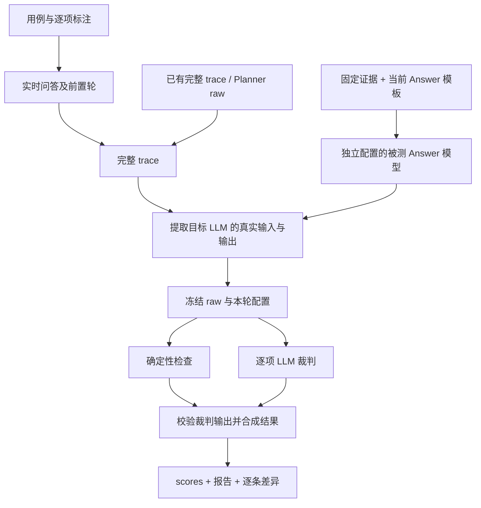

# 评测体系设计

本文面向维护 Planner、Answer 和评测脚本的开发者，说明评什么、依据什么判、如何定位失败，以及怎样比较两次改动。命令和环境变量的完整说明见 [Planner 操作说明](../scripts/evals/README.md) 与 [Answer 操作说明](../scripts/evals/ANSWER_README.md)。

**核心设计：按阶段契约建立判据，以实际模型输入为证据，用确定性检查和 LLM 裁判共同判分，冻结样本后逐条比较。** 实时行情不需要预先写死答案；需要固定的是意图、口径和证据使用规则。

## 1. 范围与当前状态

截至 2026-10-15，文件评测包含以下内容。数量表示已定义的样本，不表示这些样本已全部通过真实模型评测。

| 层次 | 要回答的问题 | 当前实现 |
| --- | --- | --- |
| Planner | 用户意图是否转成正确、必要的逻辑计划或澄清决策？ | `planner_eval.py`，63 条用例，首次与最后一次输出分别判分 |
| 执行层 | 时间解析、指标绑定、取数、计算和事实构造是否正确？ | 对应 Java 单测；接口边界另有专项探针 |
| Answer | 答案是否忠于本次可见事实，正确表达单位、时间和限制？ | `answer_eval.py`，24 条实时场景、22 条固定证据场景 |
| 端到端 | 用户任务经过上下文、规划、执行、回答后是否完成？ | 保留旧回归和追问探针；尚未合并为新的统一端到端评分套件 |

Answer 另有 26 条裁判校准样本，即 13 组同证据下的正确／错误答案（覆盖 13/22 个固定证据场景）。它们评的是裁判，不能计入被测模型通过率。

两套脚本只依赖 Python 3.9+ 标准库，不新增数据库表。样本和标注使用 JSON，运行产物使用 JSONL、JSON、Markdown 和 CSV。旧脚本继续保留。

首次实测基线（2026-10-17）：Answer 实时场景 24 条 23 PASS / 1 FAIL / 0 JUDGE_ERROR（`20261017-132417-9cc2ad7a`）；裁判校准 26 条 26/26 命中（`20261017-132613-e80e887c`）。Planner 的最新完整结果仍是 2026-10-14 的 42 条，新增 21 条尚未采集。固定证据为合成输入，被测模型需与线上一致才有可比性。

**采集范围与评分范围不同。** 当前没有独立的 Planner HTTP 接口，实时采集会调用完整 `/api/ask`，再取 `/api/trace_detail/{traceId}`。因此一次 Planner 采集也会触发执行和回答，但报告只评价 Planner，不能据此声称整条链路正确。

## 2. 设计原则

### 2.1 用契约组织覆盖，用故障补充反例

Planner 用例的设计入口是[指标元数据与计划协议](Plan与指标元数据.md)，包括：

- 指标定义、单位、支持的交易所与查询形态，来自 `cex-perpetual.yml`。
- 信封与计划结构，来自 `plan-schema.json` 及运行时注入的指标枚举、算子输入分支。
- 算子业务口径和输入契约，来自算子实现及规划说明。
- 领域、澄清、部分可答、任务选择和事实复用规则，来自实际 Planner prompt 与上下文协议。

这些契约构成覆盖维度。历史缺陷和线上问题用于发现边界、增加反例，而不是每个需求再生长一套独立脚本。

契约也不能替代需求审核：如果标注和程序共同误解业务，两者可能一起通过。因此需要审查“这条规则是否符合产品语义”，不能只从当前模型输出反推标签。

### 2.2 判语义等价，不判参考答案的外形

Planner 不只有一份正确 JSON。节点名称、无关数组顺序，以及同条件查询的分组方式可以不同；对象、指标、时间、单位和计算方向必须一致。

例如，查询区间成交量合计时，若 `trade.volume/range_statistic` 已经给出成品指标，就不必强制生成序列加 `sum`。反过来，`baseline/current` 交换会改变变化率含义，不能作为等价写法放过。

Answer 同样不逐字匹配参考文章。评测关注事实和表达口径，不要求固定措辞。

### 2.3 确定性规则由代码判断，语义关系交给裁判

JSON 完整性、字段类型、引用语法、判据 ID 是否齐全、证据路径是否存在，适合程序检查。意图是否被满足、澄清是否必要、某句话是否得到事实支持，交给逐项 LLM 判断。

程序的硬检查失败不能被裁判 PASS 覆盖。Python 只实现评测所需的基础检查，不复制 Java 的指标编译器、时间解析器、Provider 或计算逻辑，避免形成两套实现。

### 2.4 只依据目标调用真正可见的输入

Planner 从实际 `LLM_CALL/dag_planner` 提取完整 messages、输出与 response_format。Answer 从实际 `LLM_CALL/answer` 的 messages 提取 FACTS、QUERY_STATUS 和时间锚点。

不能用最终回答猜计划，也不能拿其他工具事件里存在、但没有提交给 Answer 的数据替答案补证。旧 trace 缺完整输入时，记为不可评测；不重建一个“应该发过”的近似 prompt。

### 2.5 失败、未覆盖与评测故障分别记录

模型答错、目标接口超时、裁判 JSON 截断是三种不同问题。不能把异常当成通过，也不能全部归因于被测模型。

涉及前置条件的判据，必须先确认条件真实发生。例如没有建立待澄清任务，就不能宣称测到了“澄清后短回复接续”。

## 3. 数据流与实现边界



采集、判分和报告重建可以分开执行。修改标注或换裁判后，可以对同一份原始输入输出重新判分，避免重新请求实时行情。Answer 还能离线导入与用例问题、时区、前置轮完全匹配的 Planner 采集结果，复用其中的 Answer 调用。

固定证据路径绕过 Planner、执行层和交易所，仅测试 Answer 在已知输入下的行为。它使用仓库当前 `agent_system.txt`，不自动代表线上部署使用了同一模板、模型和参数。

### 关键文件

| 文件 | 职责 |
| --- | --- |
| [scripts/planner_eval.py](../scripts/planner_eval.py) | Planner 采集、提取、基础协议检查、裁判调用、判分与报告；也提供共享 HTTP／JSON／文件工具 |
| [scripts/answer_eval.py](../scripts/answer_eval.py) | Answer 提取、固定证据生成、断言判分、裁判校准与报告 |
| [planner_cases.json](../scripts/evals/planner_cases.json) / [answer_cases.json](../scripts/evals/answer_cases.json) | 问题、前置轮、覆盖声明和逐项人工可读标注 |
| [planner_judge.txt](../scripts/evals/planner_judge.txt) / [answer_judge.txt](../scripts/evals/answer_judge.txt) | 裁判规则，与被测系统 prompt 分开维护 |
| [answer_calibration.json](../scripts/evals/answer_calibration.json) | 固定答案及预期判定；预期标签不发送给裁判 |
| [test_planner_eval.py](../scripts/tests/test_planner_eval.py) / [test_answer_eval.py](../scripts/tests/test_answer_eval.py) | 用假 trace、假裁判和临时文件验证评测程序 |

## 4. Planner：评意图到计划的转换

### 4.1 标注结构

用例以 `question + timezone + setup_questions` 定义输入，以 `criteria` 定义正确性的约束。下面是 P001 的标注节选：

```json
{
  "id": "P001",
  "question": "币安的比特币 USDT 永续现在成交价是多少？",
  "timezone": "Asia/Shanghai",
  "setup_questions": [],
  "label_source": "repository_contract",
  "expected_fields": {"in_domain": true},
  "criteria": [
    {
      "id": "P001.3",
      "dimension": "metric_shape",
      "expectation": "使用 price.last/snapshot，不能用 mark.price、index.price 或区间 close 替代。"
    }
  ]
}
```

人工修改 JSON 中的期望即可，不需要改 Python。`expected_fields` 用于少量无歧义的信封字段；其他语义通过逐项 criterion 表达。完整样本还包含标题、标签和覆盖声明等字段。

当前覆盖的主维度如下。它是人工维护的覆盖矩阵，不是根据 schema 自动生成的组合测试。

| 维度 | 重点边界 |
| --- | --- |
| 决策 | 可回答、出域、缺信息澄清、能力不足、部分可答 |
| 对象与指标 | 别名、交易所、合约品种、成交价／标记价／指数价、成交量／成交额 |
| 查询形态 | snapshot、official_24h、range_statistic、time_series、recent_n |
| 时间与参数 | 自然日／滚动窗口、显式时区、绝对范围、粒度、期数、未收盘数据 |
| 计算 | 九类算子、引用链、基准方向、口径缺失、最小必要计划 |
| 多轮 | 条件继承与替换、任务／版本选择、原样本复用与刷新、歧义、短回复接续 |

新增用例应说明它补的是哪个维度的哪个分支。相近需求优先做对照，例如“刚才那 10 期”和“最新 10 期”、“也查成交量”和“改查成交量”，让细小措辞变化对应明确的计划差异。

### 4.2 协议、语义与服务端接受状态

每次模型输出分别记录两层结果：

- **协议层**：完整 JSON、基础信封与节点结构、引用语法，以及 `task_action/new_frame` 等声明类字段机检。
- **语义层**：逐项裁判结果，以及 `in_domain/needs_clarification` 等决策类字段机检。

当前口径允许 `plan=null` 与 `metrics/calculations` 均为空的空计划等价。澄清或出域时不能带有实际可执行计划；无计划时也需要有明确回复或澄清内容。不能沿用旧脚本对空计划外形的不同判法。

基础协议通过不等于 Java 编译器接受。服务端校验事件单独保存；模型输出被判 PASS，但服务端明确拒绝时，整体记 `PLANNER_REJECTED`，供排查裁判或编译约束之间的差异。

首次和最后一次原始输出独立评分，以区分一次成功和经过修复后成功。仅一次调用时复用同一判分，不重复调用裁判。服务端代写澄清等兜底事件另外展示，不能计为模型自己遵守了规则。

### 4.3 多轮用例的前提核验

`setup_questions` 顺序执行，最后的 `question` 是评分终点；前置轮 trace 全部保留。前置轮进入服务端认可的澄清状态可以继续，明确失败则保留现场并停止采集。

最后一轮裁判应从实际输入确认：目标任务及版本是否可选、历史事实是否存在、是否确有待补信息。任务别名不能按序号猜，`task_1` 不天然代表最早任务；原样本复用也不能靠“两次价格恰好相同”来证明。

当前结果只证明终点轮满足判据。若要核对某个中间轮，应查看保存的前置轮结果，或把它另设为一个评分终点。缓存不可恢复、并发父轮次、强制跨结算等依赖环境注入的分支，不能靠普通线上提问宣称已经覆盖。

## 5. Answer：评答案与可见证据的关系

### 5.1 实时场景与固定证据互补

实时场景评价完整链路实际提交的事实，按本次数据判断，不写死 BTC 价格或费率。它能够发现真实组装、复用和裁剪后的回答问题。

固定证据场景控制输入，稳定制造空 FACTS、失败节点、缺口、省略值、旧快照、文本注入等边界。合成输入中的价格、样本数是测试条件，不是线上行情的标准答案。

两者回答不同的问题：实时场景检验真实输入下的表现；固定证据检验已知边界下的行为。只有前者，关键故障不一定触发；只有后者，无法发现真实链路提交了什么。

### 5.2 证据模型

提取器读取最后一次实际 Answer 调用。FACTS 和 QUERY_STATUS 来自其最后一条 user message；时间锚点来自实际 system message。没有 Answer 调用记 `NOT_APPLICABLE`，调用失败记 `ANSWER_ERROR`，缺完整输入记 `NOT_EVALUABLE`。

证据的使用权限也不同：

| 输入 | 可支持的内容 |
| --- | --- |
| 成功且适用的 FACTS | 对应对象、指标、窗口、单位下的数值和已产出的计算结果 |
| QUERY_STATUS | 查询缺口、系统未接入等限制说明，不能证明行情数值 |
| TIME_CONTEXT | 本轮请求时间与默认时区，不能覆盖某项事实的显式区间／时区 |
| 问题与历史 | 理解意图、指代和对照对象；其中的旧数字不自动成为本轮行情事实 |

同一个数字出现在输入里，不足以证明答案正确。必须同时核对对象、时间、单位、状态和计算方向。成功计算也不能替明显不兼容的跨币单位背书。

### 5.3 逐项判据与断言审查

裁判既评价场景的 `criteria`，也审查答案中的事实、数值、因果和预测断言。每条断言包含：

```json
{
  "quote": "答案中的原文片段",
  "verdict": "SUPPORTED",
  "reason": "说明对象、时间、单位和值为何相符",
  "source_refs": ["/facts/0/data/value", "/facts/0/identity"]
}
```

程序检查 quote 确实来自答案、引用路径存在、字段类型正确。`SUPPORTED` 必须有来源；存在无依据断言时允许返回空引用，并说明缺什么证据。

**路径合法只证明引用存在，不证明语义得到支持。** 引用旧历史或一整段 prompt，不能让错误行情结论变成有据可依；是否蕴含该结论仍由裁判判断。程序也无法证明裁判已经穷尽所有重要断言。

整体规则为：任一 criterion FAIL 或断言 UNSUPPORTED，整体 FAIL；无失败但存在不确定，整体 UNCERTAIN；判据和已审查断言全部满足才 PASS。

### 5.3.1 实例：整体判据全 PASS，逐句审查仍判 FAIL（A007）

这是断言审查存在的理由，也是目前最有代表性的一条真实样本（`answer-eval/20261017-132417-9cc2ad7a`）：

- 问题：`列出币安 BTC-USDT 永续最近6小时每根1小时K线的收盘价，把未收盘的也包括进来。`
- 结果：`A007.1 / A007.2 / A007.3` **三条 criterion 全部 PASS**；7 根 K 线的数值、时间、时区、未收盘标注均与 facts 一致。
- 整体 verdict：**FAIL**。唯一失分来自一条 claim：
  `| 2026-10-17 13:00 | 81566.60 | 未收盘（截至 13:27 时的最新成交价） |` → `UNSUPPORTED`。
- 裁判理由：该值与 `samples[6]` 一致、`contains_unclosed=true` 也正确，但 `identity.description` 明确该指标是 **K 线收盘价序列，不是当前实时价**；Answer 把它描述为"最新成交价"属**口径误述**，正确表述应是"未收盘 K 线当前的记录值"。

含义：**数值正确、来源正确、整体判据满分，仍可能因一句标签错误而失败。** 只保留 criterion 级判据会漏掉这类缺陷；它是"数字全对、标签错误"这一错误家族的真实线上实例，与固定证据 AF014（两个 120 分属币安 BTC 与 OKX ETH，被说成两所 BTC）同理。

另一类相反方向的样本是 AF008：Answer 主动加了免责说明"该数值明显偏离 BTC 的常见价格量级"，该句被判 `UNSUPPORTED`——本轮 FACTS 无任何 BTC 价格量级，只能来自训练知识，属"凭已有知识补全"。**善意补充说明本身也是断言，同样受证据约束。**

评测还检查过度拒答和任务完成边界。例如成品均值已经提供，不能以“不做计算”为由拒绝引用；比较结果没有提供时，即便两侧原始值齐全，按当前 Answer 契约也不能自行补算。这个限制来自本系统职责分配，不是所有问答应用都必须采用的通用规则。

## 6. 裁判如何被约束和验证

裁判按 criterion ID 返回 `PASS/FAIL/UNCERTAIN`、具体原因与依据，不给笼统印象分。请求默认使用严格 JSON Schema，程序继续检查完整 JSON、ID 齐全且不重复、类型、原文与路径。缺项、截断、非法引用等记 `JUDGE_ERROR`，不截取一段 JSON 抢救为通过。

结构约束只能约束格式，不能保证判断正确。Answer 的 `calibrate` 把 26 条预写答案交给裁判，隐藏预期标签，再比较判定是否命中。正确识别坏答案为 FAIL 是校准成功。小样本命中不等于真实准确率，也不证明所有错误类型均已覆盖。当前没有同规模的 Planner 独立裁判校准套件。

校准样本刻意做成**数值相同、判定相反**：多数组两个答案引用的数字完全一致，区别只在方向、观测时间、标的身份或口径（AF012 的 −5% 被说成"上涨 5%"；AF007 的 100 USDT 一个是旧快照、一个是伪造"本轮刚取到"；AF014 的两个 120 分属币安 BTC 与 OKX ETH；AF022 的 sum 成功产出 300 但跨币单位不兼容）。只会比对数字的裁判在这些组上必然失败。

首次实测（`answer-eval/20261017-132613-e80e887c`）26/26 命中、0 误判、0 JUDGE_ERROR。**零误判不等于裁判可靠，只说明这 26 条没有考倒它。** 其中 C009 值得注意：两条 criterion 均 PASS、理由还主动写了"答案未自行补算，符合契约要求"，判断完全正确，但引用了失败节点不存在的 `/facts/2/data`，仍被记为 `JUDGE_ERROR`——**结论正确而引用不合法，同样不放行。**

### 6.1 两类重试互不替代

`ANSWER_EVAL_JUDGE_RETRIES` 只覆盖传输层失败，救不了"输出不合法"。因此 `answer_eval.py` 另设输出层重试：

- `--judge-retries` / `ANSWER_EVAL_JUDGE_OUTPUT_RETRIES`，默认 0；manifest 记 `judge_output_retries`，scores 记实际重试次数。
- **只在 `EvalError`（JSON 解析失败或结构校验失败）时重试**，重试时把上次被拒原因原样回传让裁判自改；真实的 FAIL / UNSUPPORTED 一次都不会多调，否则重试会变成"多摇几次直到出好结果"。
- 单测 `test_answer_eval.py` 用 `FlakyJudge` 守三条边界：能恢复且报错已回传、重试耗尽仍记 `JUDGE_ERROR`、真实判定不重试。

背景：裁判的格式合规率约 86%，且**失败点随机漂移**——22 条固定证据连跑三轮，剩下的 3 条 JUDGE_ERROR 每轮不是同一批，其中还有纯网络超时。此时继续改 prompt 收益递减，应加重试。24 条实时场景实测有 4 条用到重试（A008、A021 各 2 次，A017、A020 各 1 次），全部救回，整轮 0 JUDGE_ERROR。

### 6.2 实例：一条报错覆盖三种情况，会把排查带偏

`validate_judgment` 曾把三种情况合并成一条 `if`，文案却只写了其中一种：

```python
if (not isinstance(quote, str) or not quote.strip() or normalize(quote) in seen
        or normalize(quote) not in normalize(sample["answer"])):
    raise EvalError("claim.quote 必须为不重复的答案原文片段")
```

实测诊断（答案取自 `trace.events` 中 `LLM_CALL/answer` 的 `output_json.content`；`scores.jsonl` 只有 `answer_hash`，不含原文）：**真重复 0 条，13 处全是"quote 不是答案原文"**。原因是裁判摘取时会规范化掉 markdown，答案是 `为 **100 USDT**`、quote 是 `为 100 USDT`，而归一化只处理空白。

已拆成三条独立报错并带上 quote 片段，归一化也扩展为：去 markdown 标记 `[*_\`~#]`、统一弯／直引号与省略号破折号、连续点归一。**教训：报错必须能照做，一条报错说清一种情况。**

人工介入的重点是审核契约、维护争议标签、检查裁判理由，以及独立复核 FAIL → PASS。常规批量判分交给模型，人工不必逐条从头评分。当前通过 JSON 文件和报告协作，尚无标注 UI、多人审核流程或自动重复采样稳定性统计。

| 结果 | 含义及处理方向 |
| --- | --- |
| PASS / FAIL | 满足全部判据／有明确违反；定位具体 criterion 和证据 |
| UNCERTAIN | 输入、前提或契约存在不能排除的不确定；补信息或修标注 |
| COLLECTION_ERROR | 问答／trace 采集失败；可能是超时、HTTP 错误等，不等于模型语义错误 |
| PLANNER_ERROR / ANSWER_ERROR | Planner 调用记录错误／Answer 调用错误或输出为空；Planner 非法 JSON 按协议 FAIL 处理 |
| JUDGE_ERROR | 裁判调用或输出协议失败；修裁判接入或判分代码后可复评原样本 |
| PLANNER_REJECTED | 模型判分通过但服务端拒绝；检查编译校验与判据差异 |
| NOT_EVALUABLE / NOT_APPLICABLE | 缺足够输入无法评分／没有目标阶段调用；均不计 PASS |

## 7. 文件归档与结果比较

每次运行新建目录，创建前备份上一轮整个目录到 `_backups`，不覆盖历史。根目录分别为：

```text
importants/回归测试/planner-eval/<时间戳>-<随机后缀>/
importants/回归测试/answer-eval/<时间戳>-<随机后缀>/
    manifest.json       本轮模式、来源、配置及内容指纹
    cases.json          冻结的用例与标注
    judge_prompt.txt    冻结的裁判规则（判分模式）
    raw.jsonl           完整输入输出与前置轮，逐条保存
    scores.jsonl        逐项判定、原因、调用信息与异常
    report.md / .csv    汇总、逐条结果及对照
```

固定证据生成模式另外保存 Answer 模板与被测模型配置。配置记录不包含 API key。每条完成后落盘，判分模式更新报告，中断后已完成结果保留。

标签修改可用新用例文件复评；默认复评使用采集时冻结的标签。问题、时区、前置轮或固定证据改变后，不能把新问题套到旧输出上。

比较报告核对用例、裁判模型／配置、裁判 prompt、评测代码等指纹。Answer 还分别比较实际输入和答案指纹。Planner 的“可比”列不代表实时上下文相同；其实际输入仍需从 raw 核对。指纹标记辅助审核，不替代实验设计。

判断改动效果时遵循以下顺序：

1. 固定评测口径，只改变一个待验证因素，例如被测模型或 Planner prompt。
2. 先看采集、裁判异常和未覆盖数量，再看首次／最终结果与逐项变化。
3. 将“修正评测误判”与“系统行为改善”分开记录。前者用同一 raw 复评，后者需要新系统输出。
4. 对 FAIL → PASS 独立核对实际输入、输出和证据；对不稳定场景显式安排重复运行。

不同改动需要不同的对照方式：

| 改动 | 应固定什么 | 如何取得可解释的结果 |
| --- | --- | --- |
| 修正标注／评测判据 | 同一份原始输入与输出 | 对旧 raw 复评，记录这是测量口径修正 |
| 更换裁判／思考参数 | 同一份原始样本和标签 | 校准并复评，检查逐项分歧；更换裁判不直接证明被测系统改善 |
| 更换 Planner 模型／prompt | 用例与评测配置 | 重新采集，核对真实上下文差异及首次／最终结果 |
| 更换 Answer 模型／prompt | 固定证据与评测配置 | 用相同 fixture 生成新答案，再补真实链路场景；生成答案变化与裁判重复性分开看 |

报告会列出 FAIL → PASS 复核清单，但不会替人工确认系统已修好。当前也没有自动 CI 发布门禁。常规评分命令只有所选样本均 PASS 才退出 0；校准命令则按是否命中预期标签决定成功。

## 8. 维护与运行入口

配置均从环境变量读取，不内置旗舰模型：

| 用途 | 必填配置 |
| --- | --- |
| Planner 裁判 | `PLANNER_EVAL_JUDGE_BASE_URL`、`PLANNER_EVAL_JUDGE_API_KEY`、`PLANNER_EVAL_JUDGE_MODEL` |
| Answer 独立裁判 | 可选整组 `ANSWER_EVAL_JUDGE_BASE_URL`、`ANSWER_EVAL_JUDGE_API_KEY`、`ANSWER_EVAL_JUDGE_MODEL`；未配置时复用 Planner 裁判 |
| 固定证据的被测 Answer 模型 | `ANSWER_EVAL_MODEL_BASE_URL`、`ANSWER_EVAL_MODEL_API_KEY`、`ANSWER_EVAL_MODEL` |

接入点使用兼容 Chat Completions 的协议。思考参数等通过对应 `EXTRA_BODY` 显式设置；输出格式使用专用 `RESPONSE_FORMAT` 变量，不能用 EXTRA_BODY 覆盖。默认单次 HTTP 超时 240 秒，不是整条多轮用例的总时限。

裁判另有两类重试，语义不同：`*_RETRIES` 管传输层失败，`ANSWER_EVAL_JUDGE_OUTPUT_RETRIES` 管输出不合法（见 6.1）。默认均为 0，建议批量运行时显式设置输出层重试为 1~2。

日常维护可先做以下离线检查：

```bash
python3 scripts/planner_eval.py validate
python3 scripts/answer_eval.py validate
python3 -m unittest discover -s scripts/tests -p 'test_*eval.py'
```

`list/validate/import-trace/import-planner/report` 等离线操作的具体支持范围见两份操作说明。`judge/calibrate` 会请求裁判，`collect/run` 会请求目标系统，`generate/run-fixtures` 会请求被测模型。网络评测仅在明确执行指令后运行，全量放后台；新增文档、修改用例或判据后不自动运行。

新增场景的维护闭环是：**找到契约分支 → 写问题和逐项判据 → 明确前提与等价方案 → 离线检查评测逻辑 → 经授权采集和判分 → 复核差异并归档。** 用例数量、PASS 数和模型品牌都不能代替这个闭环。
