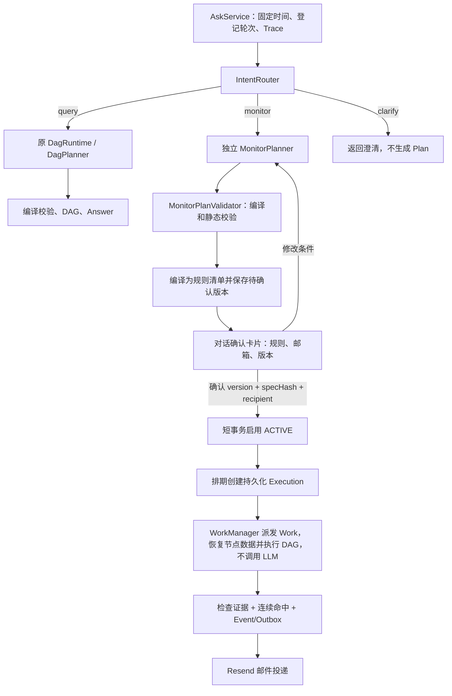

# Query / Monitor 独立路由与规划

当前 `/api/ask`、`/api/ask/stream` 在任何 Plan 生成之前调用独立 Router。Query 继续原指标规划、DAG 和回答链；Monitor 生成候选 Plan 后保存待确认草稿，展示规则与邮箱，用户明确确认后才启用后台监控。规划期间不取行情。

## 执行边界



`MONITOR_ENABLED` 默认关闭。关闭或 Resend 未配置时仍能生成草稿，但卡片会提示不可启用。聊天任务通过 `/api/monitor-flow` 按浏览器访客隔离，邮箱直接填写，不需要验证码。监控管理只保留聊天卡片入口；跨访客巡检通过独立凭证访问 `/api/monitor-health`。

## 提示词与模块

| 模块 | 提示词 | 职责 |
| --- | --- | --- |
| `IntentRouter` | `intent_router.txt` | 只分类 query/monitor/clarify；不加载指标和算子目录 |
| `DagPlanner` | 原 `dag_planner.txt` | 原查询协议与修复流程不变 |
| `MonitorPlanner` | `monitor_planner.txt` | 共享 LogicalPlan + 条件 + 连续次数 |
| `MonitorPlanValidator` | 无 LLM | 共用编译器/PlanValidator，再检查监控约束和数值引用 |

Router 看到当前 Agent、近期对话、查询任务摘要和监控候选条件摘要。它不读取完整历史事实或完整监控 Plan。Monitor Planner 可读取上一个候选与监控澄清链，以及帮助解析品种指代的查询摘要。

Query 和 Monitor 从同一个 MetricCatalog/ToolRegistry 生成能力说明；不在两份提示词中手工维护指标列表。Router 与 Monitor 当前使用 normal 模型；Router 无效输出最多修复一次，仍失败则澄清；Monitor 按 `dag.planner-max-retries` 修复，最多两次。模型传输错误直接按失败收尾，不默认为其他 Agent。

正常 Query 多一次 Router 调用，通常共3次 LLM（Router、Query Planner、Answer）；Monitor 通常2次（Router、Monitor Planner），不调用 Answer。所有调用均不传 API tools。

## 协议

Router 输出之一：

```json
{"route":"query"}
```

```json
{"route":"monitor"}
```

```json
{"route":"clarify","question":"想查询当前行情，还是创建持续监控？"}
```

Monitor Planner 输出：

```json
{
  "plan": {
    "metrics": [
      {
        "id": "m1",
        "metric": "price.change_pct",
        "exchanges": ["binance"],
        "instrument": {"market_type":"perpetual","base":"BTC","quote":"USDT","settle":"USDT"},
        "query_shape": "range_statistic",
        "time": {"type":"rolling_window","duration":{"value":1,"unit":"hour"}},
        "interval": "5m"
      }
    ],
    "calculations": []
  },
  "monitor": {
    "action": "create",
    "conditions": [{"value_ref":"{{m1.binance.value}}","operator":"LT","threshold":-2}],
    "consecutive_hits": 2
  },
  "needs_clarification": false,
  "reply": null
}
```

明确的能力缺口返回 `plan=null` 与 `reply`；需要补充条件时另带 `needs_clarification=true`。即使澄清输出中夹带了 Plan，也不会接受为候选。

### 当前服务端约束

- 仅规划 `action=create`；可以基于上一次候选重新规划，但不修改运行中的任务。自然语言管理、运行中规则修改和历史告警追问暂未接入；卡片支持取消草稿、停止任务和查看历史告警证据。
- 1～2个条件固定 AND；空条件、OR 字段和完全重复条件拒绝。同一数值的上下界两个条件允许。
- 条件引用 `{{指标ID.交易所.value}}` 或 `{{计算ID.value}}`，必须解析到编译后真实节点的数值 value。序列必须先经合法算子聚合。既有 CalculationTool 用十进制字符串编码数值，静态校验接受这类已注册算子的 value；不接受任意文本字段。
- 阈值必须是数值 JSON，比较符 GT/GTE/LT/LTE；单位沿指标/计算契约解释。百分数指标 -2 代表 -2%，ratio 的阈值按 ratio 单位填写。
- 整体连续次数1～12，默认1；检查频率5分钟和恢复后再提醒由服务端策略固定，不由模型生成。
- 同一交易所、同一 USDT 永续品种；时间节点仅滚动窗口，5～1440分钟的5分钟整数倍；窗口一致，显式采样粒度一致，不接受未完结数据。快照可用；固定日期、自然周期、official_24h、recent_n 首版不接入。
- 禁止 pinned_result，禁止无用节点；每个条件都必须依赖真实行情，不能夹带独立常量告警。
- 共用 DAG 节点预算、深度、引用闭合与算子参数校验。此处静态校验不证明未来每轮数据完整；后台 `MonitorPlanRunner` 另做共同截止点、新鲜度检查；数据不完整或过期返回 UNKNOWN。

规划层允许上述约束内的指标与计算（包括 OI、AND）。`MonitorDefinitionCompiler` 将自动采样固定为5m，生成规则说明和不可变执行定义。当前后台每5分钟检查，显式非5m粒度的候选不能确认启用，卡片展示原因；不会擅自改写用户指定的粒度。Worker 统一执行 schemaVersion=2 的Plan定义，收件邮箱固定在用户确认的任务上。

同轮保存按 source_turn_id 幂等；同一会话继续修改待确认草稿会新增版本、将旧版本标为 SUPERSEDED。确认必须匹配版本、hash、已保存收件地址，且不能和正在生成的新轮次并发。重复确认不重置调度与命中状态；已启用任务不会被后续草稿覆盖。

## HTTP 返回与可观测性

AskResponse 新增：

- `type`：query / monitor / clarify，由服务端路由结果填写。
- `routerLlmCalls`：Router 的实际尝试数；`plannerLlmCalls` 仍只计算选中分支的 Planner。
- `planning`：Monitor 或路由澄清的结构化结果，Query 为 null。

Monitor 成功返回示意（其他既有字段保留）：

```json
{
  "type": "monitor",
  "routerLlmCalls": 1,
  "plannerLlmCalls": 1,
  "toolCalls": 0,
  "planning": {
    "status": "PENDING_CONFIRMATION",
    "execution_status": "NOT_ENABLED",
    "candidate": {"plan": {}, "monitor": {}},
    "confirmation": {"ruleId":"...", "version":1, "specHash":"...", "status":"PENDING_CONFIRMATION", "rules":[], "profile":{"emailBound":false}, "canConfirm":false}
  }
}
```

上例 candidate 省略了完整内容。状态还有 NEEDS_CLARIFICATION、UNSUPPORTED、FAILED。SSE done 同样带 type、routerLlmCalls、planning；delta 仍返回简短状态或澄清文本。

每个 LLM_CALL 保存完整 messages、模型、响应、prompt_version、usage、耗时和错误；另有 ROUTE_DECISION、MONITOR_PLAN、MONITOR_DRAFT 记录确定性处理结果。Router 的 token/cost 计入总数，错误路径也保留已发生调用的计数和未知费用，不能把传输失败当成免费调用。

## 上下文与数据库

部署存量库前，手工执行一次 `src/main/resources/db/migrations/015_agent_planning.sql`及 `016_monitor_confirmation.sql`（先完成此前迁移）；新库 schema.sql 已包含这些字段。

| 表 | 新字段 |
| --- | --- |
| conversation_state | active_agent_type、monitor_planning_json |
| conversation_query | agent_type、agent_payload_json |
| ask_trace | agent_type、router_llm_calls |

Monitor 候选、最近问题和有限澄清链保存在 monitor_planning_json，轮次完整响应另存 agent_payload_json。它们不写入 QueryFrame/TaskState。有效候选另存 monitor_rule / monitor_rule_version，状态 PENDING_CONFIRMATION；确认前无调度时间、无行情检查或邮件。详见[主动监控](主动监控.md)。

Query 切回后保留监控候选；Monitor 澄清保留上一份有效候选。上轮是 Monitor 而本轮转为 Query 时，提供监控定义供指代解析，但不默认延续更早的查询 frame，显式回访仍可使用原查询任务索引。

`finishRoutedTurn` 在同一事务内检查会话 fencing token、提交轮次、保存对应 Agent 上下文并释放占用。旧轮次可以落自己的历史结果，但不能覆盖新轮次的 Agent 焦点或候选。

## 验证

先 `mvn test-compile`，再选择 MonitorExecutionServiceTest、MonitorWorkManagerTest、MonitorCheckpointTest、MonitorConversationFlowTest、MonitorPlanExecutionTest、 AgentPlanningTest、RoutedAskServiceTest、RoutedConversationTest，以及直接受影响的 AskService、DagPlanner/DagRuntime、会话和编译校验测试。脚本化模型、假行情和独立 H2 数据库不访问线上服务；本次没有自动执行真实模型或线上回归探针。
