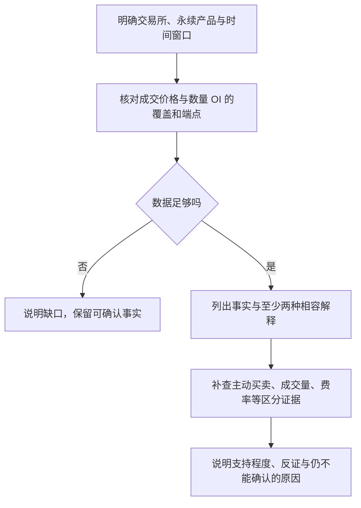

# 05 · 市场信号与分析方法

学习目标：把数据组织成可检验的解释，明确“看到了什么”“可能为什么”“还缺什么”，避免用交易术语掩盖证据不足。

## 1. 概念与业务机制

### 1.1 将事实、假设、预测分开

“某所 BTC USDT 永续一小时成交价跌 3%，数量 OI 涨 5%”是带口径的事实陈述；“有新增风险敞口参与下跌”是与它相容的解释；“接下来还会跌”是预测，需要额外模型和检验，不能由前两句直接推出。

分析的价值在于缩小可能性，而不是每次都给出单一故事。相同汇总数据可能由不同的成交路径、参与者目的和外部事件产生。OI 与 Funding 的定义依据见 [Open Interest](https://www.binance.com/en/square/post/32687009925178) 和 [Funding 官方规则](https://www.binance.com/en/support/faq/detail/360033525031)；本篇组合信号均为**分析假设，不是交易所规定的因果规则**。

### 1.2 价格与 OI 的四种组合

前提是同一交易所、同一产品、同一窗口，OI 使用基础币数量，且数据完整：

| 观察 | 可提出的解释 | 不能直接推出 |
| --- | --- | --- |
| 价格上涨、OI 增加 | 上涨伴随未平仓规模扩张 | 净多头增加、一定继续涨 |
| 价格下跌、OI 增加 | 下跌伴随未平仓规模扩张 | 一定是空头主动开仓导致下跌 |
| 价格上涨、OI 减少 | 上涨伴随合约规模收缩；平空可能参与 | 已确认逼空或空头爆仓 |
| 价格下跌、OI 减少 | 下跌伴随合约规模收缩；平多可能参与 | 已确认多头爆仓或趋势结束 |

这里不把“新增资金进场”“多头离场”等速记词当作事实。合约配对使多空两侧共同存在，名义金额变化也不代表实际资金流入。

### 1.3 给每个假设配上所需证据

| 假设 | 优先补充证据 | 仍然存在的限制 |
| --- | --- | --- |
| 主动卖出在下跌中占较大比重 | 同窗 Taker 买卖量与分时变化 | 主动卖出可能开空，也可能平多 |
| 仓位拥挤、持仓成本较高 | 多期 Funding、周期、价格与 OI | 不能识别账户组合，也不证明即将反转 |
| 流动性变薄放大了价格波动 | 事件前后的深度、价差与成交序列 | 当前盘口快照不能还原过去流动性 |
| 强平加剧了走势 | 同窗清算记录、方向与时间顺序 | 记录覆盖可能不全；加剧不等于最初驱动 |
| 市场整体共同变化 | 多交易所、现货及其他相关市场 | 相关不证明同一驱动或价格领先关系 |

应优先查询能区分竞争解释的数据。若两种解释都能产生同一组数值，再查更多相同粒度的汇总值可能并不能区分它们。

## 2. 典型业务场景

### 2.1 一条完整的分析路径

问题：“BTC 跌了，OI 却涨，是不是空头在砸盘？”

例如教学数据为价格 −3%、数量 OI +5%、主动卖量占比 62%。可说“下跌与未平仓规模扩张同时出现，该窗口主动卖出数量占比较高”。仍不能证明所有主动卖出都在开空，更不能确认“主力恶意砸盘”。如果只有当下盘口，不能用它证明一小时前的下跌由薄深度引发。

### 2.2 “放量”“异常”需要基准

“成交量放大 50%”至少要说明相对于上一等长窗口、过去同一时段还是历史均值。日内季节性、工作日差异和波动环境都会影响比较。某次 5% OI 变化是否异常，要有同品种同粒度历史分布，不能凭感觉制定通用阈值。

少数案例相符也不能证明策略有效。若以后研究预测能力，需要区分训练与验证时段、避免未来数据泄漏，计入手续费、Funding 和滑点，再检查样本外结果。当前学习 Case 用于验证语义和计算，并不承担策略收益验证。

## 3. 易错点与理解边界

- **同时发生不是因果**：一小时内两个指标变化，无法仅凭端点确定先后顺序。
- **取到更多数据不等于证据更强**：多个指标可能都受价格影响，例如 OI 名义价值和价格并非独立证据。
- **没查到不是没有发生**：本项目未接入清算或新闻，不能回答“没有爆仓”“没有消息”。
- **不能判断也应具体**：说明缺少哪类证据，并保留能确认的部分，比笼统拒绝更有帮助。
- **可计算与可归因分开**：代码保证数值公式，模型解释证据关系；算术正确不能为因果故事背书。

对数据的解释边界要写进答案，而不只是末尾加一句“仅供参考”。合理表述应将“与……相容”“支持到哪一步”放在具体结论旁边。

## 4. 对应 CEXPilot Case 与学习练习

已有 `B4 进阶-量价背离`、`B6 进阶-跨所`，见 [回归题目](../scripts/run_regression.py)。它们可以同时检验取数口径和解释边界。Planner 是否取齐、计算是否正确、Answer 是否过度归因，应通过 [Trace](../docs/trace搭建.md) 分开判断。

当前项目可查询量价、OI、已结算 Funding 和盘口摘要；清算、新闻因果、历史订单簿研究不在当前指标链能力内。下面题目中的这类数据是待补证据，不是可执行能力承诺。

### A1 · 事实还是故事？【离线推演】

给定同窗价格 −3%、数量 OI +5%、主动卖量占比 62%。逐句判断：“新增合约规模扩大”“空头人数更多”“主动卖出占比更高”“下小时还会跌”。

预测后展开参考思路

第一句若指未平仓净规模扩大则成立；第三句若明确相对同窗主动买入占比则成立。第二句无法由数量推人数，第四句是未经验证的预测。也不能声称卖出占比较上一窗口上升，因为未给对照。

### A2 · 先把前提查真【手工查询】

问题：“查币安 BTC USDT 永续最近一小时价格变化率、OI 数量变化率和主动买量占比，价格与 OI 使用 5m 粒度；说明实际窗口及这些数据不能证明什么。”

预测后展开参考思路

不预设实时一定‘价跌仓涨’。先核对实际数值、端点、粒度与覆盖；有窗口差异应披露。即使三项齐全，也不能识别账户开平仓和未来涨跌。

### A3 · 同样结果能有不同原因吗？【离线推演】

价格上涨 2%、OI 下降 4%。分别提出“空头主动平仓”和另一个可相容路径。用这两个汇总数能区分吗？

预测后展开参考思路

也可能现货市场先涨、合约跟随，同时部分参与者双边减仓。汇总结果不含完整事件顺序和账户动作，不能确认逼空，更不能确认爆仓。

### A4 · 当前盘口能解释昨天吗？【能力边界】

问题：“根据现在的盘口，证明昨天 BTC 下跌是流动性枯竭导致的。”你会保留哪部分回答、拒绝哪部分推断？

预测后展开参考思路

可以描述当前可见盘口，但证明昨天原因需要当时深度、报价及成交时间序列；当前快照无法还原。应说明历史证据缺口，不能将现在的状态倒推到昨天。

### A5 · 放量 50% 的分母在哪？【离线推演】

当前小时成交 150 BTC，上一小时 100 BTC，过去七天同一小时均值 200 BTC。分别以两种基准计算变化率，“明显放量”应如何改写？

预测后展开参考思路

相对上一小时 +50%，相对过去同小时均值 −25%。应明示比较基准，不能用一个无基准的形容词概括两个不同结论。

### A6 · 怎样把 Bad Case 写成 Eval？【离线推演】

Agent 对完整数据“价跌 3%、OI 涨 5%”回答：“已证实大量净空头进场，明天必跌。”你会把正确判据写成哪几条？

预测后展开参考思路

要求产品、窗口、单位和计算正确；承认未平仓规模扩张但无法判断净方向；不声称确认账户动作与因果，不承诺未来涨跌；能给出具体补证方向。判据针对可观察输出，不猜模型心态。

